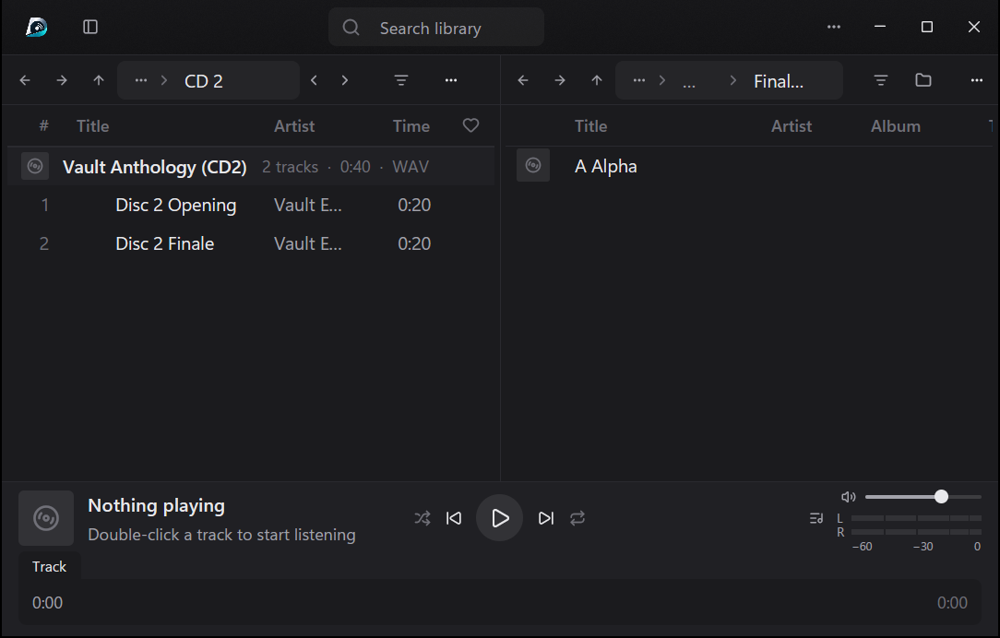
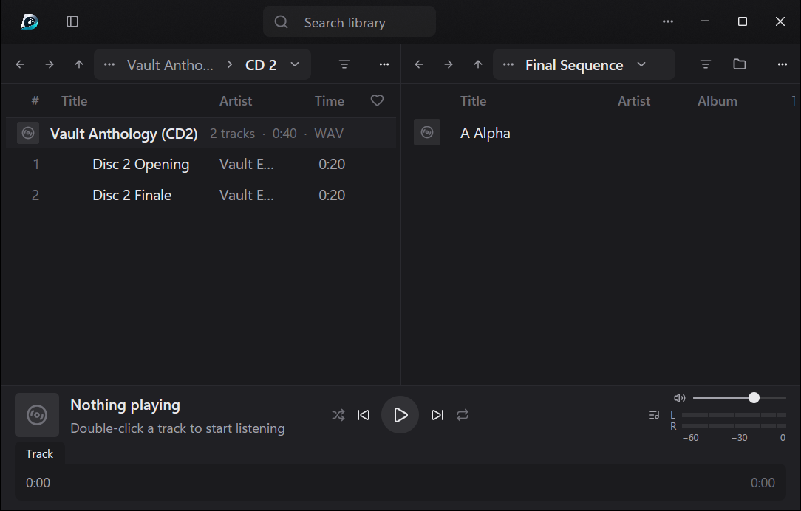
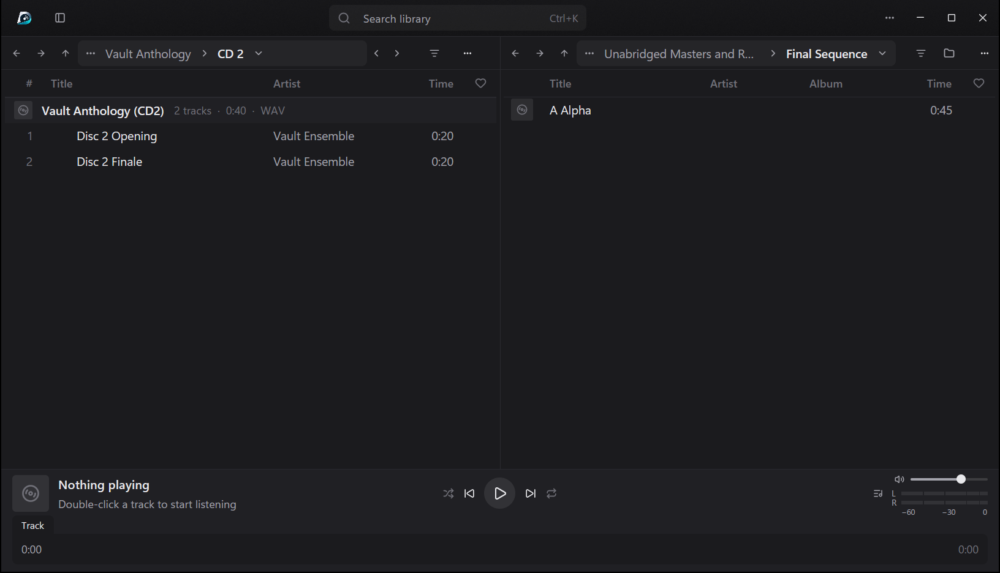

# Breadcrumb navigation

The Music Browser shows its active route in one row. Click an ancestor's label to go straight to that location. The parent reveals the child you left where it can show that child. Open the chevron beside any visible segment to choose a related destination. A check identifies the segment's current destination.

## Choose a destination

| Segment | Chevron choices |
| --- | --- |
| All Music, Collections, Playlists, or Liked Tracks | Switch among these library scopes. |
| Registered collection or playlist | Open another collection or playlist. |
| Release or standalone CD | Choose from the unfiltered release order in that scope. Multi-CD releases open their release page. Standalone CDs open their CD page. |
| CD within a release | Choose another CD in authored order. |
| Physical folder or drive root | Choose a sibling folder or a drive currently reported by Windows. A UNC share is a root of its own. |

Earlier locations move into the ellipsis menu as a split narrows. The trail keeps the current label and lets the nearest parent share the row when both can be read. Hover a shortened label for its full name. At narrow widths, **Previous** and **Next** move to the browser's panel menu. Their keyboard shortcuts remain available.

The smallest docks also put history, view, folder scope, and filter commands in **Panel menu**. Editing a filter uses the location row until focus leaves the field. An applied filter tints the panel menu icon and can be cleared from that menu.

Use **Tab** to reach an ancestor or chevron, then **Enter** or **Space** to activate it. Inside a menu, **Up**, **Down**, **Home**, and **End** move the highlight. **Escape** returns focus to the chevron. **Tab** closes the menu and continues through the header. Choosing a destination moves focus to the new table. A physical folder still supports **Ctrl+L**, **Edit Address**, and **Copy Address**.

## Implementation

- Breadcrumbs, menus, and history carry the browser's existing route. Indexed pages retain their collection and album IDs. Physical CD and release pages retain their folder scope and program IDs, including CUE sheets. These pages use their logical ancestry within the scan scope.
- Browser titles, breadcrumbs, and navigation tooltips resolve their names from the route and its authored metadata. Within a release the breadcrumb can say **CD 2** while the tooltip gives the release and disc name.
- Release menus share the unfiltered navigation data already used for previous and next steps. Opening the menu works with destination metadata and renders visible rows. Folder enumeration runs off the UI thread. A closed or superseded menu discards its result. A newly opened menu takes focus even if the previous menu has yet to paint.
- Choosing a route records the same visit as other browser navigation. Alternate destinations restore their latest saved filter, sort, selection, and viewport. Ancestor actions keep the parent's filter and sort and reveal the departing child. Back and Forward restore individual visit snapshots. Each browser owns its menu and history.

## Native Windows verification

The production comparison used `main` after PR #20. Both builds ran on Windows 11 Pro build 26300 at 150% scaling. The private desktop used generated WAV and CUE recordings, separate profiles, and the qualification fader set to silence before WASAPI initialization.

| Production | Interactive breadcrumbs |
| --- | --- |
|  |  |
|  |  |

| Check | Native result |
| --- | --- |
| Ancestors and history | Clicked the release label from CD 2 and saw that disc selected in the release. Back, Forward, and Up followed the visits. An indexed revisit restored the selected row and title sort. Up restored the collection filter. |
| Collections, releases, CDs, and playlists | Switched indexed collections, opened another release while the shelf was filtered, and switched CUE CDs in indexed and physical scopes. Switched playlists and moved between All Music, Liked Tracks, and Playlists from their chevrons. [Release choices](evidence/breadcrumb-navigation/release-menu.webp) |
| Files, drives, and removed destinations | Switched sibling folders, opened the drive root through overflow, and edited a physical address. Selected a folder removed after the menu opened, returned with Back, and reopened a menu that omitted the removed folder. [Overflow](evidence/breadcrumb-navigation/overflow.webp) |
| Split and dock layout | Compared the same locations in two browser widths. In a three-pane workspace, changed folders from the smallest pane, navigated Back from its panel menu, applied a filter, and cleared it after returning to the trail. [Three docked browsers](evidence/breadcrumb-navigation/minimum-dock.webp) |
| Keyboard and focus | Reopened the chevron from its restored focus after Escape. Used arrow keys, Home, End, Enter, and Tab in the native menus. Choosing a destination returned focus to the listing. [CD choices](evidence/breadcrumb-navigation/cd-menu.webp) |
| Large menus and rapid input | Switched from a 2,502-folder menu to a CD menu in repeated input bursts. Only the latest menu stayed open. End reached the last folder while the list exposed only visible rows. |
| Playback and restart | Changed CDs while the same chapter kept playing. The saved queue and current entry matched as the position advanced from 1.41 to 4.45 seconds. Restarted with independent routes, bookmarks and history stacks. Now Playing artwork still revealed the exact CUE chapter, and Back returned to the browsing visit. [Browsing during playback](evidence/breadcrumb-navigation/cd-switch-during-playback.webp) |

Live UNC servers and physical removable-drive changes were outside this run. Deterministic tests cover UNC and drive-root identities. Windows can still take longer to answer a directory request on an unavailable share. The browser can dismiss the menu or keep navigating while the request runs.

## Build checks

| Check | Command |
| --- | --- |
| Formatting | `cargo fmt --all -- --check` |
| Clippy | `cargo clippy --locked --all-targets --features qualification -- -D warnings` |
| Deterministic tests | `cargo test --locked` and `cargo test --locked --features qualification` |
| Locked Windows builds | `.\build.ps1` and `.\build.ps1 -Release` |

Both test runs passed 182 tests and skipped eight opt-in tests. The native runs used `cargo build --locked --release --features qualification` and `--qualify-silent`.
