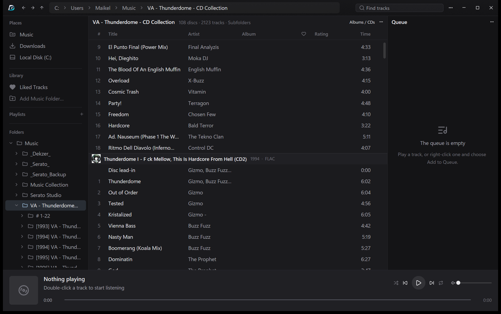
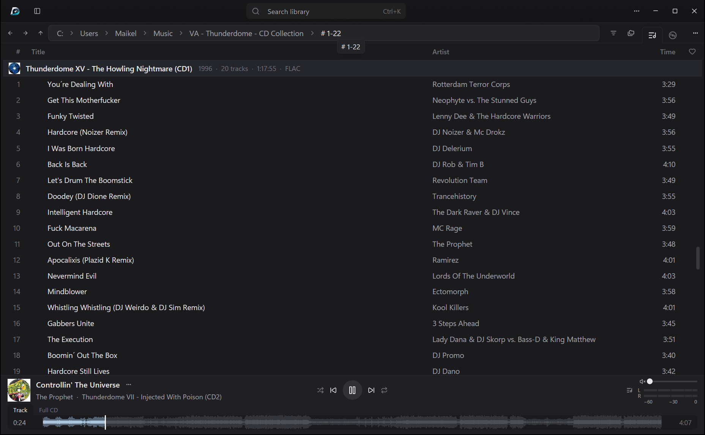
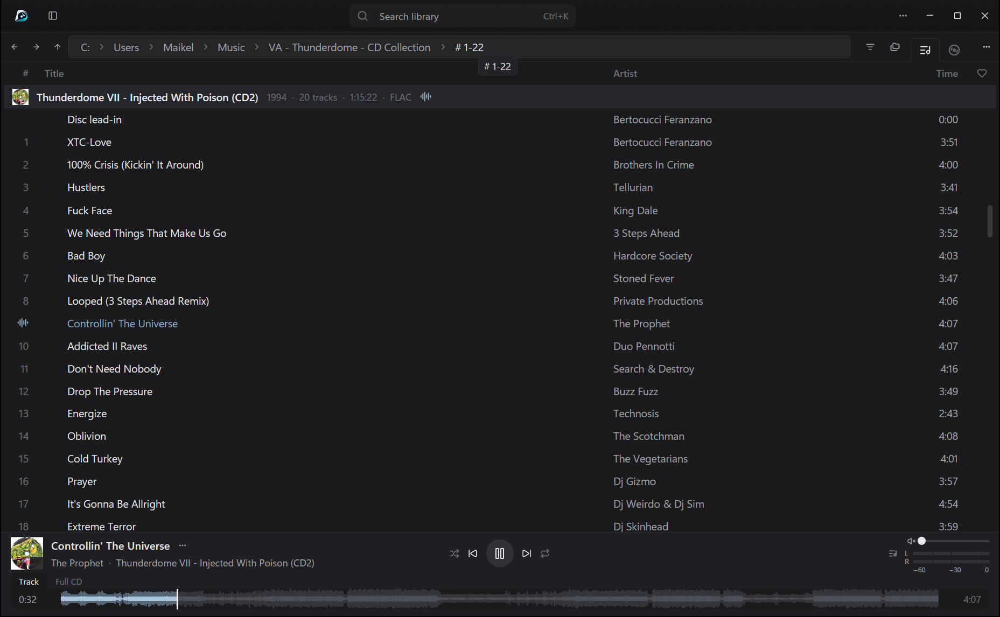
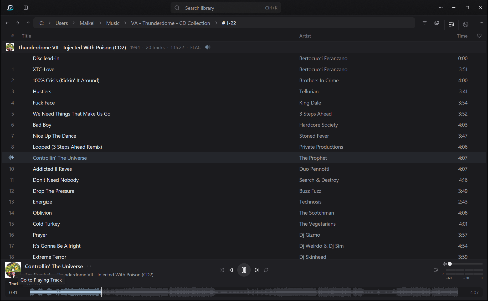
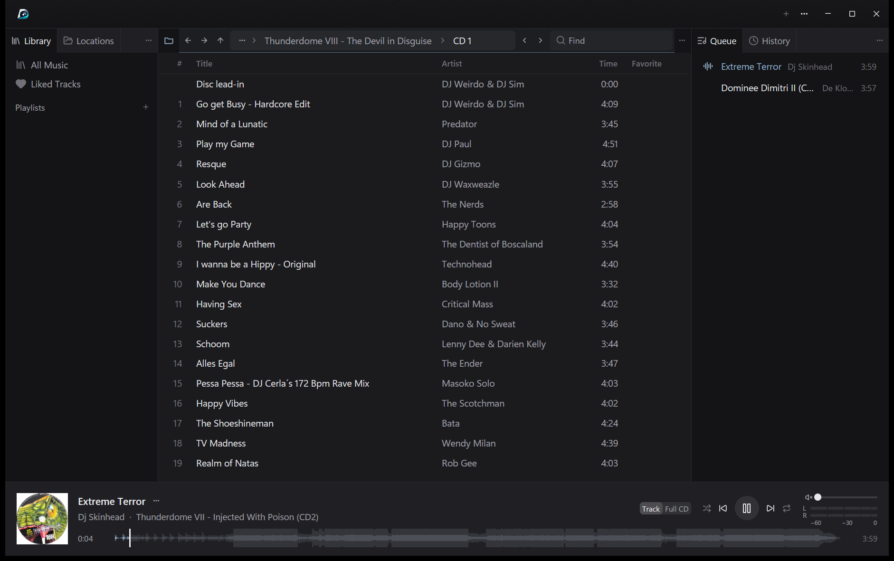
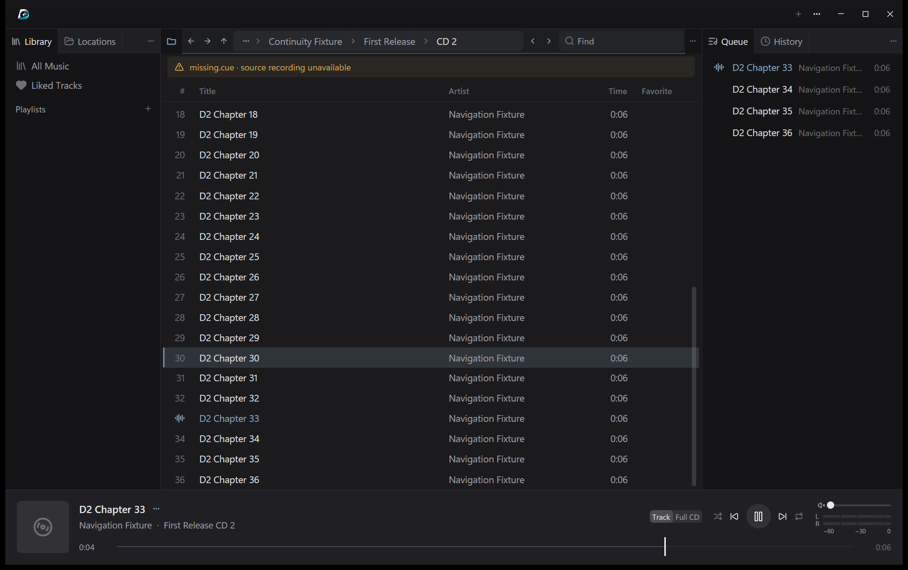

# Browsing discs and releases

**All Tracks** groups a recursive folder or indexed collection by disc. Double-click a section header, or select it and press Enter, to open the CD. Search keeps the headers of matching discs. Clicking a column heading sorts across the collection. The third click restores the grouped order. **Albums / CDs** remains the disc overview.

## Previous and Next

The chevrons beside the address bar move between CDs when the browser shows a CD, and between releases on a release page. Hover a chevron to see its destination. **Alt+Page Up** and **Alt+Page Down** invoke the same actions. From a CD, the browser menu and **Alt+Shift+Page Up / Page Down** move between releases. A single-disc release opens its disc page and supports both kinds of step. The breadcrumb overflow keeps earlier locations reachable when the path is narrow.

- In **Locations**, a disc or release opened from a recursive collection browses that folder's scan scope. The order follows the unfiltered Albums / CDs shelf, using the same natural folder order and authored disc order. Opening a CD's folder directly or revealing a chapter can use the nearest configured recursive folder or registered collection. Without either, a numbered CD folder can step within a release when discovery confirms the numbered siblings belong together. An explicit smaller scope still applies.
- In **Library**, a disc or release browses its registered collection. The indexed shelf orders by year where known, then its stored path and title sort key, with album ID as the final tie-breaker. A release keeps the position of its first authored disc. Indexed collections have one registered root and project nested physical folders onto that shelf. The Locations tree provides direct access to the physical hierarchy.
- A CUE program, tagged album, or numbered disc recognized by the library contributes a CD. Loose recording groups can anchor a step when explicitly opened as CDs. Traversal skips them, empty folders and missing indexed programs. The controls stop at the scope's ends. Track filters and column sorts affect the visible table and are restored on revisit. The sequence uses the collection's unfiltered structure.

Each step records the outgoing visit in the same browser. Back and Forward follow the order of visits. The chevrons follow collection order and restore the most recently saved view of the destination. Rescanning can change the order for future steps while existing history keeps its destination identities.

## Listening controls

| Action | Result |
| --- | --- |
| Double-click a chapter, including a filtered or globally sorted result | Start at that chapter in the complete authored CD sequence. Previous reaches earlier chapters and Up Next contains the remainder of that CD. |
| Double-click a loose file | Play the single file. Album tags, a disc tag, a CUE program or a numbered CD folder supply disc context. Opening a disc page also explicitly selects that scope. |
| Choose **Play Only This Track** from a CD or playlist row | Replace the queue with just the clicked track or playlist occurrence. The ordinary **Play** and double-click actions keep their CD or playlist behavior. |
| Choose **Play CD** from a CD row, section or page menu | Start the whole CD at the beginning, including a recorded lead-in. Disc playback uses authored order and clears shuffle and repeat-one. The queue ends with the CD. |
| Choose **Play Release** from a release, one of its CDs, or the release page | Start CD 1, then each following CD of the release in authored order, then stop. Only CDs that belong to a release of several discs offer it. [Releases](releases.md) |
| Choose **Play Collection** from a collection | Start with the first matching recording and follow the shelf's release and disc order, including loose recordings. The current search limits the queue. Column sorting affects the displayed rows. Liked Tracks, playlists and single folders call their corresponding action **Play All**. |
| Choose **Add All to Queue** from a collection | Append the matching recordings in the table's display order. |
| Double-click a playlist occurrence | Play from that occurrence in the displayed playlist sequence. Repeated occurrences retain independent queue entries. |
| Choose **Show in Library** or **Show in Locations** from the Now Playing menu | Reveal the exact chapter in the active Music Browser. Library opens the registered disc. Locations opens the physical location. Back returns to the previous browsing position. |
| Click the player artwork | **Go to Playing Track** selects the exact chapter in the active browser’s existing results. On an Albums / CDs shelf it opens All Tracks in that collection. If the recording is outside the results, it opens its indexed disc or physical location. |
| Choose **Show in Library** or **Show in Locations** from a queue or history entry | Select that entry’s exact chapter. The playback indicator stays on the active recording. A live indexed entry can also resolve the current path after a verified move. |
| Choose **Continue This CD** from the Now Playing menu or the playing CD’s panel menu | Place the remaining chapters immediately after the current occurrence. Current position, play/pause state and history are preserved. |

Continue reuses the first available queued occurrence of each required chapter and creates only missing entries. All other upcoming entries keep their relative order, including intentional repeats. If the continuation is already correct, a second invocation leaves the queue revision unchanged. When there are chapters to continue, the operation disables shuffle and repeat-one. Saved playlists keep their entries and ordering.

## Ownership and navigation

The folder scan supplies the shared track objects used by the overview, table and player. A CUE sheet identifies a program across physical files. Ordinary albums use folder, album and disc number. Sections retain discovery order, CUE tracks retain authored order, and tagged file albums use track numbers with stable ties. The table interleaves fixed-height section headers with track rows through an index of header offsets. Selection, ratings, likes, drag targets and paging still use track or playlist occurrence keys. Only rendered headers request thumbnails.

Indexed sections and ordered keys come from one SQLite read snapshot. Explicit column sorting removes the headers. Opening a track resolves the CD independently of the visible filter and viewport. Queue edits still go through the transport. It can remap a contiguous run inside the decoder range already open, including restoring a previously cleared continuation. A boundary outside that range requires a subsequent decoder open.

Each Music Browser saves its current view, Back and Forward stacks, and most recent context for previously visited locations. A direct revisit restores the last filter, presentation, sort, selection, selection anchor and viewport for that location. The viewport uses the top logical row and its pixel offset so it can survive row order changes. If that row was removed, the saved scroll distance is clamped to the surviving rows. Moving between a physical collection and its CD pages can reuse an active scan.

Up follows the same hierarchy as the breadcrumb. From a CD it selects the CD section in the release. From a playlist or a registered collection it selects that item in the parent directory. From a physical folder it opens the parent and selects the originating child in Locations. Navigating, including explicit reveal, uses the active Music Browser. Playback changes only the playing indicator as it advances.

Workspace saves store logical keys and viewport positions. Each browser retains up to 100 visits per history direction and 100 recent locations. Archived selections share a per-browser budget of 128 Ki selected keys and prioritize recent visits. A selection over that budget can keep its primary row and viewport when archived. Each browser also owns its subfolder preferences. A newly opened browser starts from the current defaults. Live indexed tracks can follow verified relocation by database ID. Saved queues retain their original file and chapter locators across restarts.

## Collection returns and Now Playing

Back and Forward replay visits, including their filters, sort, selection and viewport. Hover either arrow for its destination. Up and ancestor breadcrumbs reveal the child in the parent’s saved presentation. A jump from a CD straight to the collection selects that CD. A return from a release selects its shelf row, matching group header or a recording on the release in a flat list. A filter that hides the requested child clears for the reveal. Back still holds the visit as it was before navigation.

The waveform glyph identifies the playing chapter and its CD. It appears beside the title when the number column is hidden, and on the containing disc and release in Albums / CDs. The artwork’s locator opens **Go to Playing Track** with a click, Enter or Space. An indexed playlist with repeated copies reveals the first occurrence in display order. Playback changes update the glyph while browsing stays in place.

### Windows reproduction

On production, opening VII CD 2 directly and pressing Back restored its original collection row and offset. With *Controllin' The Universe* by The Prophet playing on VII CD 2, issuing **Show in Locations** from XV and then pressing Back correctly returned to XV. Clicking the **# 1-22** collection breadcrumb from VII CD 2 also returned to XV on production. The breadcrumb skipped the release and reopened the collection as an ordinary revisit, so the saved XV viewport won.

The same breadcrumb now places VII CD 2 at the top. Up selects CD 2 inside release VII. Clicking the artwork in All Tracks selects chapter 9 in that collection. The captures use the real Windows player and collection, with isolated profiles on a private desktop and the qualification output fader set to digital silence before device creation.

| Production breadcrumb | Corrected breadcrumb |
| --- | --- |
|  |  |

In a split workspace, the left browser kept its `injected` filter, descending title sort, selected chapter and viewport through a natural CUE boundary. The right browser stayed on XV. Both visits and histories survived a native restart. A separate indexed playlist held two offscreen occurrences of the same chapter after 324 other entries. The artwork selected its first occurrence. **Show in Library** opened the indexed CD. Holding a fixture database write lock delayed the lookup behind a queued edit. A subsequent row click and a separate Back navigation each retained their destination after the lock was released. Returning from an indexed release to a title-sorted collection preserved a filter that hid CD 1 and selected the first matching CD 2 track. The checks compared saved queue entries before and after navigation.

The pinned Windows toolchain passed formatting, all-target Clippy with warnings denied, the standard Windows build and 171 default tests. Five opt-in tests were skipped by the default command. Native interaction used the optimized qualification build. The debug window hit the existing GPUI “hover style already set” assertion, also recorded on the dock-tab baseline.

## Sequential navigation qualification, 24 November 2026

The optimized Windows app ran at 150% scaling with isolated profiles and muted output. The real Thunderdome run started *Extreme Terror* near the end of VII CD 2. **Next CD** opened VIII CD 1. **Previous CD** restored VII CD 2 and its bookmark, then opened VII CD 1 and VI CD 2. Back and Forward replayed the visits in order. Up opened VI and selected CD 2. **Next Release** opened VII. Up again returned to the shelf with its earlier `injected` search. The saved queue entries stayed identical throughout. The long title on VI still left the current disc number visible.

A second pass on the real collection visited a playlist and Downloads during playback. Back restored the playlist, then VII CD 2 and its exact bookmark. The player artwork revealed the playing CUE chapter from the playlist. Back returned to that playlist and the queue entries stayed identical.

The fixture placed a two-disc CUE release, a single-disc CUE release three folders deep, and a three-disc release of individual WAV files into one recursive scope. An empty directory and a CUE with a missing image contributed no steps. Traversal reached both boundaries in both directions. Back and Forward restored the previous visits. A direct sequence revisit returned to chapter 30 at its original viewport, anchored to chapter 17 with a 24.67 px offset. By then chapter 33 was playing on a separate row. The test compared the saved queue entries, stable row identity, viewport anchor, and offset. The available destination tooltip named VIII CD 1 on the final step out of VII CD 2. [Tooltip capture](evidence/navigation-continuity/thunderdome-next-cd-tooltip.webp) · [VI CD 2 breadcrumb](evidence/navigation-continuity/thunderdome-previous-cd.webp)

With `DISQRO_TRACE_DISCOVERY=1`, opening that fixture and taking four CD steps produced one completed 76-track scan despite the missing-CUE warning. The browser restored the original bookmark and kept the queue entries identical.

The indexed fixture exercised both Now Playing menus and the artwork. Library and Locations selected the logical CUE chapter. Revealing chapter 32 from the queue selected it while the paused transport remained on chapter 30. Two side-by-side browsers kept separate filters and histories. After closing and reopening the app, Forward changed the right browser to the single-disc release while the left browser kept the indexed chapter and filter. [Queue reveal](evidence/navigation-continuity/indexed-queue-reveal.webp) · [Split browser after restart](evidence/navigation-continuity/split-browser-restart.webp)

Physical **Play Collection** played two CUE chapters and crossed into the three-disc release while the browser stayed on CD 2. **Play Release** advanced from CD 1 to CD 2. **Play Only This Track** queued chapter 2 alone. Double-clicking chapter 1 then restored the normal two-chapter CD queue. The native shortcut check drove CD navigation in both directions and invoked Next Release from the focused disc pane.

The split check restored four marked chapters with the original selection anchor and cursor. Opening Liked Tracks in a new tab and moving it into a vertical split kept all three browsers open through resizing. Rapid indexed CD steps finished on the requested disc and rendered its own rows. Back restored the search and sort, and a sidebar visit cleared that browser's Forward stack. Renaming a fixture folder and refreshing changed the next-step order. Its old historical destination reported unavailability, and Forward returned to the surviving disc. [Vertical split and restored range](evidence/navigation-continuity/vertical-split.webp)

Formatting, Clippy with warnings denied, the debug and release Windows builds, and all 131 default tests passed. The separate six-figure test scanned 100,089 tracks in 1.52 s, grouped 1,011 discs in 40 ms, and ran its filtered query in 53 ms on the local Windows machine. The codec decode and seek test passed. The sequence regression also rebuilds an order of 1,011 destinations and verifies neighbor lookup after reordering.

The live indexed relocation fixture moved a two-chapter CUE program, kept the chapter's database ID after rescan, and revealed the same queued chapter in Library and at the new physical path. Recovery from unplugging a drive during an active scan, relocation of a queue entry restored from an older saved workspace, and audible or gapless output across files remain outside this run.

## Navigation verification, 24 November 2026

The Windows app ran with an isolated profile and a two-disc CUE release. Each disc had 36 logical chapters on one WAV. Playback started at chapter 32 on CD 2 while chapter 17 was at the top of the viewport. Up revealed and selected the CD 2 section in its release. Back restored chapter 32 at the same viewport position while chapter 33 played. The browser showed the selected and playing chapters on separate rows.

The native session ended before the indexed reveal, playlist, split-browser and restart paths could be checked interactively. Automated coverage exercises visit snapshots, direct revisits, release and directory ancestry, CUE identities, obsolete workspace data, independent browser records and viewport anchoring after a row moves or disappears.

## Windows qualification, 20 November 2026

The optimized Windows application ran with isolated profiles and application volume zero. The real Thunderdome archive displayed **108 discs and 2,123 logical tracks**. The separately populated SQLite index returned the same counts.

- Double-clicking *Boomerang (Koala mix)* in grouped search results, on its dedicated CD page, and in indexed results built a 13-entry queue. Chapter 7 played with *Dominatin* and five later chapters up next.
- Returning from a CD restored the previous scrolled section and selection. Back also restored the two-disc search for `title:boomerang`. Clicking the artwork from a different CD selected chapter 7. Revealing *God* from the queue selected chapter 9 while chapter 7 played.
- Clearing Up Next and choosing **Continue This CD** kept queue entry 7 active. The saved transport position advanced from 11.512 to 13.372 seconds and the six remaining chapter titles returned in order.
- The playing chapter retained its like and three stars in Liked Tracks. A two-occurrence playlist started at its second entry. Continuing the CD kept that occurrence active, appended the six chapters and left the saved playlist at two occurrences.
- A separate fixture combined a multi-file CUE with a recorded lead-in, a second CD of individual WAV files and a loose folder. The two CD track starts produced three and two queue entries respectively. A loose file played alone. Explicit Play All included all eight entries.
- Shift+Down crossed a section header and selected the next playable row. A two-track selection spanning CDs survived opening the player’s CD and returning with Back. Switching from All Tracks to Albums / CDs during an active refresh completed with 108 discs and 2,123 tracks.
- In one release run with an empty application cache, discovery published its first 19 tracks at 12.6 ms and completed in 302 ms. Applying six batches took 8.8 ms total on the interface thread, with a 4.8 ms maximum. These are application timers with Windows filesystem caching enabled.

Formatting, warnings-denied Clippy and all 60 default tests passed locally. Tests cover alternate sheets, missing and replaced sources, verified moves, recorded lead-ins, multi-file CUE ordering, playlist duplicates and decoder-range restoration. An in-memory renderer also compared stereo samples across a CUE boundary. The two opt-in codec and scale campaigns were outside this run. Physical output, audible transitions and gapless playback between different files remain unqualified.

The final correction added two regression tests covering loose WAV files, explicitly selected untagged CDs and tagged album/disc order. All 62 default tests passed. In a separate muted Windows session, a loose WAV played alone and its artwork menu showed only **Show in Collection**. Clearing the last chapter of a three-chapter CUE and continuing from the artwork restored that chapter. The middle chapter kept its queue entry as its position advanced from 11.91 to 21.30 seconds.
