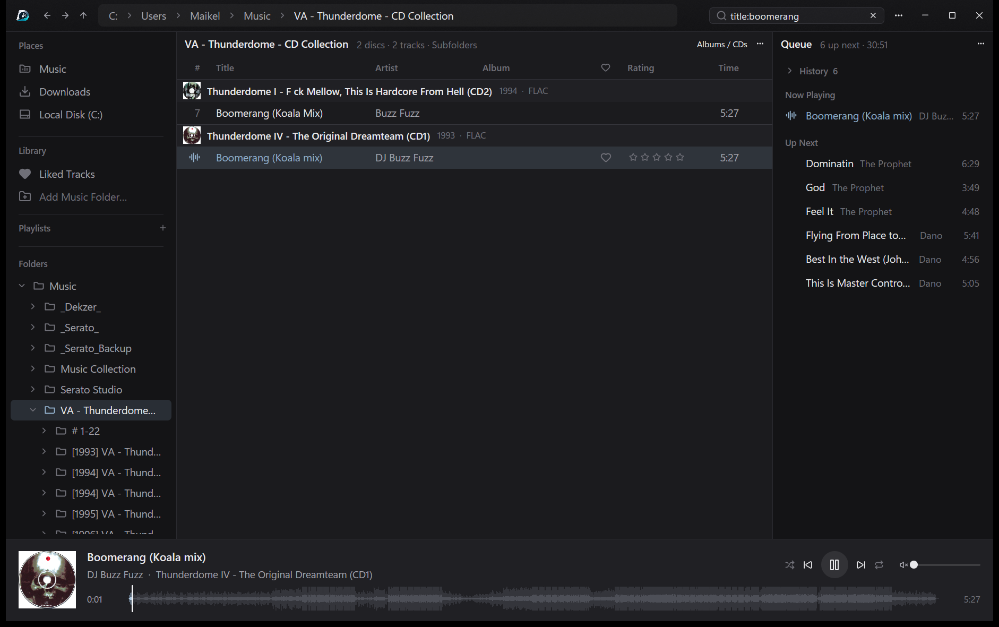
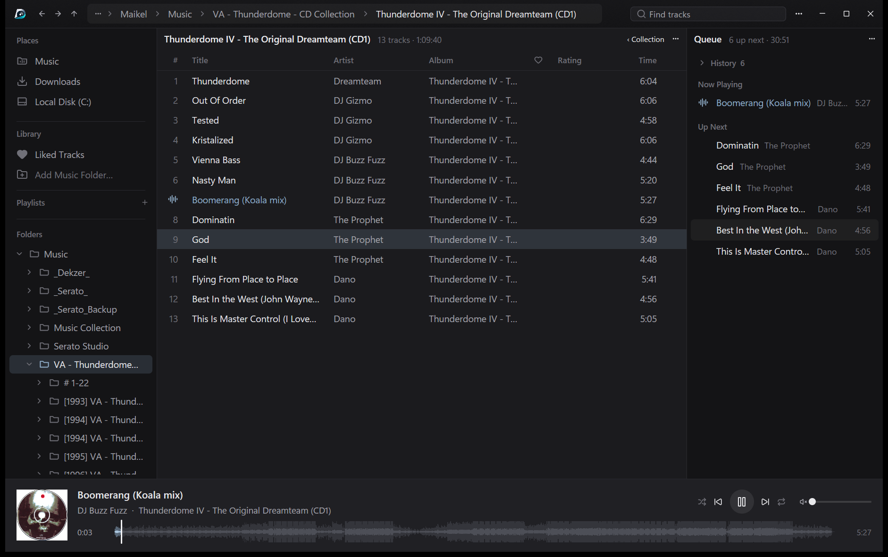

# Browsing and continuing a CD

**All Tracks** groups a recursive folder or indexed collection by disc. Double-click a section header, or select it and press Enter, to open the CD. Search keeps the headers of matching discs. Clicking a column heading sorts across the collection. The third click restores the grouped order. **Albums / CDs** remains the disc overview.

## Listening controls

| Action | Result |
| --- | --- |
| Double-click a chapter, including a filtered or globally sorted result | Start at that chapter in the complete authored CD sequence. Previous reaches earlier chapters and Up Next contains the remainder of that CD. |
| Double-click a loose file | Play the single file. Album tags, a disc tag, a CUE program or a numbered CD folder supply disc context. Opening a disc page also explicitly selects that scope. |
| Choose **Play CD** from a CD row, section or page menu | Start the whole CD at the beginning, including a recorded lead-in. Disc playback uses authored order and clears shuffle and repeat-one. The queue ends with the CD. |
| Choose **Play Release** from a release, one of its CDs, or the release page | Start CD 1, then each following CD of the release in authored order, then stop. Only CDs that belong to a release of several discs offer it. [Releases](releases.md) |
| Choose **Play Collection** or **Add All to Queue** from a collection | Play or append the whole displayed track sequence, several releases and loose recordings included. A search limits these actions to the results. Liked Tracks, playlists and single folders call it **Play All**. |
| Double-click a playlist occurrence | Play from that occurrence in the displayed playlist sequence. Repeated occurrences retain independent queue entries. |
| Choose **Show in Library** or **Show in Locations** from the Now Playing menu | Reveal the exact chapter in the active Music Browser. Library opens the registered disc. Locations opens the physical location. Back returns to the previous browsing position. |
| Click the player artwork | Reveal the current recording in its indexed disc when it has a Library identity, or in its physical location. |
| Choose a reveal action from a queue entry | Select that entry’s exact chapter. The playback indicator stays on the active recording. |
| Choose **Continue This CD** from the Now Playing menu or the playing CD’s panel menu | Place the remaining chapters immediately after the current occurrence. Current position, play/pause state and history are preserved. |

Continue reuses the first available queued occurrence of each required chapter and creates only missing entries. All other upcoming entries keep their relative order, including intentional repeats. If the continuation is already correct, a second invocation leaves the queue revision unchanged. When there are chapters to continue, the operation disables shuffle and repeat-one. Saved playlists keep their entries and ordering.

## Ownership and navigation

The folder scan supplies the shared track objects used by the overview, table and player. A CUE sheet identifies a program across physical files. Ordinary albums use folder, album and disc number. Sections retain discovery order, CUE tracks retain authored order, and tagged file albums use track numbers with stable ties. The table interleaves fixed-height section headers with track rows through an index of header offsets. Selection, ratings, likes, drag targets and paging still use track or playlist occurrence keys. Only rendered headers request thumbnails.

Indexed sections and ordered keys come from one SQLite read snapshot. Explicit column sorting removes the headers. Opening a track resolves the CD independently of the visible filter and viewport. Queue edits still go through the transport. It can remap a contiguous run inside the decoder range already open, including restoring a previously cleared continuation. A boundary outside that range requires a subsequent decoder open.

Each Music Browser saves its current view, Back and Forward stacks, and most recent context for previously visited locations. A direct revisit restores the last filter, presentation, sort, selection, selection anchor and viewport for that location. The viewport uses the top logical row and its pixel offset so it can survive row order changes. If that row was removed, the saved scroll distance is clamped to the surviving rows. Moving between a physical collection and its CD pages can reuse an active scan.

Up follows the same hierarchy as the breadcrumb. From a CD it selects the CD section in the release. From a playlist or a registered collection it selects that item in the parent directory. From a physical folder it opens the parent and selects the originating child in Locations. Navigating, including explicit reveal, uses the active Music Browser. Playback changes only the playing indicator as it advances.

Workspace saves store logical keys and viewport positions. Each browser retains up to 100 history steps and 100 recent locations. For unusually large archived selections, the most recent selections take priority within a per-browser budget of 128 Ki selected keys. The newest archived selection can exceed that budget so it stays intact. Live indexed tracks can follow verified relocation by database ID. Saved queues retain their original file and chapter locators across restarts.

## Navigation verification, 24 November 2026

The Windows app ran with an isolated profile and a two-disc CUE release. Each disc had 36 logical chapters on one WAV. Playback started at chapter 32 on CD 2 while chapter 17 was at the top of the viewport. Up revealed and selected the CD 2 section in its release. Back restored chapter 32 at the same viewport position while chapter 33 played. The browser showed the selected and playing chapters on separate rows.

The native session ended before the indexed reveal, playlist, split-browser and restart paths could be checked interactively. Automated coverage exercises visit snapshots, direct revisits, release and directory ancestry, CUE identities, obsolete workspace data, independent browser records and viewport anchoring after a row moves or disappears.

## Windows qualification, 20 November 2026

The optimized Windows application ran with isolated profiles and application volume zero. The real Thunderdome archive displayed **108 discs and 2,123 logical tracks**. The separately populated SQLite index returned the same counts.

- Double-clicking *Boomerang (Koala mix)* in grouped search results, on its dedicated CD page, and in indexed results built a 13-entry queue. Chapter 7 played with *Dominatin* and five later chapters up next.
- Returning from a CD restored the previous scrolled section and selection. Back also restored the two-disc search for `title:boomerang`. Clicking the artwork from a different CD selected chapter 7. Revealing *God* from the queue selected chapter 9 while chapter 7 played.
- Clearing Up Next and choosing **Continue This CD** kept queue entry 7 active. The saved transport position advanced from 11.512 to 13.372 seconds and the six remaining chapter titles returned in order.
- The playing chapter retained its like and three stars in Liked Tracks. A two-occurrence playlist started at its second entry. Continuing the CD kept that occurrence active, appended the six chapters and left the saved playlist at two occurrences.
- A separate fixture combined a multi-file CUE with a recorded lead-in, a second CD of individual WAV files and a loose folder. The two CD track starts produced three and two queue entries respectively. A loose file played alone. Explicit Play All included all eight entries.
- Shift+Down crossed a section header and selected the next playable row. A two-track selection spanning CDs survived opening the player’s CD and returning with Back. Switching from All Tracks to Albums / CDs during an active refresh completed with 108 discs and 2,123 tracks.
- In one release run with an empty application cache, discovery published its first 19 tracks at 12.6 ms and completed in 302 ms. Applying six batches took 8.8 ms total on the interface thread, with a 4.8 ms maximum. These are application timers with Windows filesystem caching enabled.

Formatting, warnings-denied Clippy and all 60 default tests passed locally. Tests cover alternate sheets, missing and replaced sources, verified moves, recorded lead-ins, multi-file CUE ordering, playlist duplicates and decoder-range restoration. An in-memory renderer also compared stereo samples across a CUE boundary. The two opt-in codec and scale campaigns were outside this run. Physical output, audible transitions and gapless playback between different files remain unqualified.

The final correction added two regression tests covering loose WAV files, explicitly selected untagged CDs and tagged album/disc order. All 62 default tests passed. In a separate muted Windows session, a loose WAV played alone and its artwork menu showed only **Show in Collection**. Clearing the last chapter of a three-chapter CUE and continuing from the artwork restored that chapter. The middle chapter kept its queue entry as its position advanced from 11.91 to 21.30 seconds.
