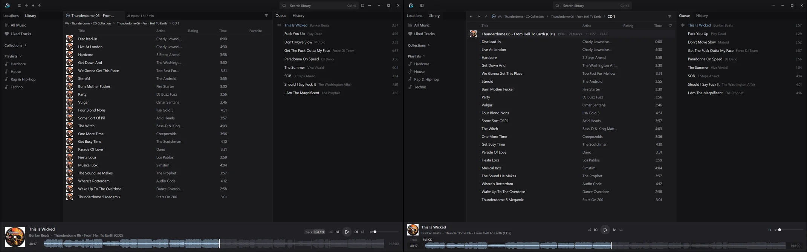
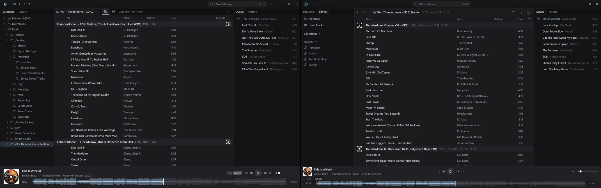
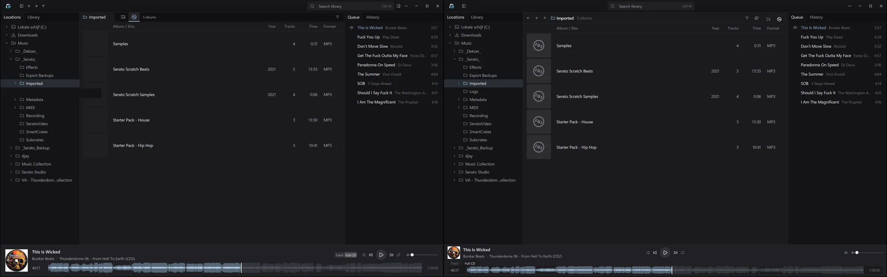
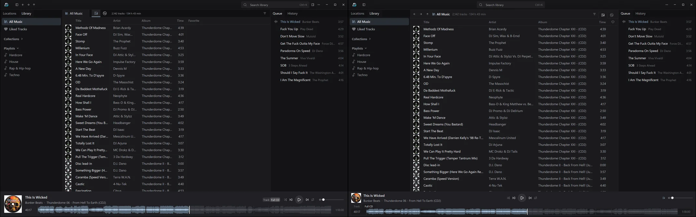
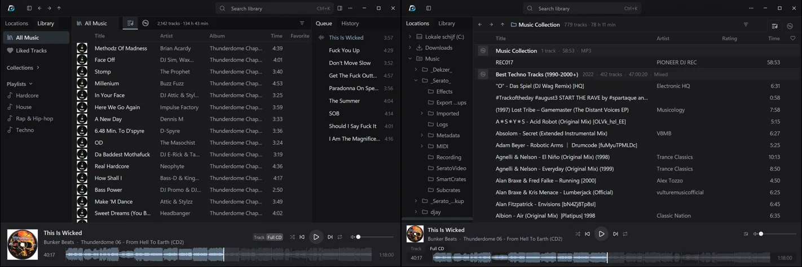

# One workspace, designed as a whole

This pass recomposes the window rather than restyling its parts. It keeps every capability: multiple independent browsers, split and tabbed groups, docking, sidebars, configurable and pinnable columns, ratings and likes, the queue and history, source-accurate Track and Full CD timelines, and workspace restoration.

Each comparison shows the build before this pass on the left and this build on the right. Both are optimized builds at 150% Windows display scale, run against the same isolated and muted copy of a real catalog.

## Diagnosis

The faults were in the system, not in individual screens.

1. **Navigation lived in three places.** Back, Forward and Up sat in the title bar, the browser's identity and view controls sat in the dock tab strip, and release pages added a breadcrumb row inside the browser. A disc page stacked three rows above its column headings. With two browsers open, the title-bar arrows acted on whichever browser was last active, out of sight of the arrows.
2. **The dock tab strip did a header's job.** A lone browser kept a tab whose only purpose was to carry its title, count and controls. When those did not fit, the strip wrapped onto a second row.
3. **Table widths froze.** Resizing any column fixed every column in pixels. A wider pane then ended in a dead band beside truncated artists, and a narrower one scrolled sideways while text columns kept their width. Favorite reserved 88 px for a 14 px glyph because its heading was a word.
4. **Grouped artwork had no place.** A collection kept the Cover column but left it blank on every track, because the disc header owned the artwork. The header then drew a 36 px thumbnail at the far right. The empty column plus a 28 px title indent left about 70 px of unexplained gutter. Single-disc pages had the opposite fault: the same cover on every row.
5. **Missing artwork was invisible.** The fallback was a 1.8% white square, so an album without a cover showed an empty 96 px hole.
6. **The player had no hierarchy.** Transport sat at the far right beside volume, with the Track / Full CD switch next to it. The waveform began after a 100 px cover, and the queue toggle lived in the title bar, far from playback.
7. **Selection looked different everywhere.** Dock tabs, view switches and the waveform perspective each used a different treatment, and the pills did not read as tabs.

A real defect turned up along the way. The folder-scope icons (`Folder`, `Folders`) were never bundled, so the scope control rendered as a blank button.

## Decisions

### Composition: a library-first three-pane default, with the queue under the player's control

| Direction | Assessment |
| --- | --- |
| Two panes (library + browser) with the queue hidden | Most calm, but "what plays next" disappears for the people who use the queue most, and its discoverability depends on a menu. |
| Three equal panes | Status quo. A 300 px queue with nine rows took more width than the music being browsed. |
| Everything as free dock panels | Already true underneath. Making it the default presentation adds chrome without adding capability. |
| **Library and Locations, the browser, and Queue and History, with the queue shown or hidden from the player** | Chosen. The queue stays a first-class dock panel that can be moved, tabbed or stacked. Its visibility is one click from the transport, so hiding it to give the browser room no longer costs discoverability. |

The default proportions are unchanged. What changed is that the trailing sidebar is now a playback surface, toggled by the player's **Queue** button (Ctrl+Alt+Right still works).

### Navigation and docking are separate

- **Navigating changes a browser.** Every Music Browser has one header with its own Back, Forward and Up, its location (parents as buttons, then its own name), what it holds, its filter and its view. With two browsers open, each has its own history in plain view.
- **Docking arranges panels.** A tab names one panel among several, so a group shows a tab strip only when it holds more than one panel. A lone panel shows its own header, and right-clicking a lone browser's location offers the tab commands (Open in New Tab, Rename, Split, Close). While the layout is being customized, every group shows its tabs, because tabs are the drag handles. The rule is the same for every panel type.
- **The title bar is the window's.** It holds the left sidebar toggle, Library search centred in the window, and the workspace menu. Ctrl+L opens the path editor in the active browser's header.

Rejected: keeping the arrows in the title bar and only removing the breadcrumb row. That would have kept the ambiguity about which browser the arrows drive.

### Selection is a connected tab

A selected tab takes the surface of the content beneath it and opens into it. This holds for dock tabs, the browser's All Tracks / Albums switch (whose selected tab breaks the header's bottom rule into the table), and the Track / Full CD tabs on the timeline lane. Inset pills are gone.

### Tables share the pane

- **Text columns are elastic.** Title, Artist and Album share the pane in the proportions the listener gave them. They grow into spare room and give way to their minimums before the table scrolls. Time, Rating, Favorite, Cover and the other fixed columns keep their widths. While a column boundary is dragged, that column holds still and the other text columns absorb the change. On release, every width is fixed as shown, so nothing jumps. An untouched layout still distributes 2 : 1 : 1.
- **Favorite is a 36 px glyph column** with a heart heading that keeps its accessible name. Saved layouts migrate once (layout version 3). Every other saved width, pin, order and visibility is kept.

### Artwork belongs to its group

- A group header (a disc in a collection or a release, or the one disc of a disc page) draws its artwork **in the Cover column**, above the tracks it describes, and its title lines up with theirs. A Cover column before Title already sets grouped tracks in, so the extra 28 px indent applies only when there is no Cover column. Headers say what the group holds: disc, year, track count, length and format.
- Track rows draw their own artwork only when it differs from the group's. A disc page is now one group, so its cover appears once instead of on every row.
- **One fallback everywhere:** a quiet tile with a disc glyph, used for missing and still-loading artwork in track rows, group headers and the album overview.

### The player has three zones and a lane

- **Left:** the playing recording, a 40 px cover (it still opens the playing CD, and its menu still offers Show in Collection and Continue This CD), title, and artist and release.
- **Centre:** shuffle, previous, play, next and repeat, centred in the window by equally flexible side zones.
- **Right:** Queue and volume.
- **Below:** the timeline lane, full width, recessed on the canvas surface, with times at either end. It takes all extra height when the player is dragged taller. The Track / Full CD tabs sit on its upper edge. A recording without a CD context offers only Track, so a non-CD source is never labelled Full CD. Detailed waveform analysis remains a future dockable visualization, so the permanent player can stay compact.

Playback, CUE handling, source continuity and the waveform's source-aware timeline are unchanged. Only their presentation moved.

## Before and after

| View | Comparison |
| --- | --- |
| Collection, All Tracks, grouped by CD |  |
| Album overview without artwork |  |
| All Music, 2,142 tracks |  |
| 960 × 640 window (queue hidden after) |  |

This build only: [two browsers side by side](evidence/coherent-workspace/two-browsers.webp) · [two browsers tabbed in one group](evidence/coherent-workspace/tabbed.webp) · [restored after quitting](evidence/coherent-workspace/restored.webp) · [playlist](evidence/coherent-workspace/playlist.webp) · [physical folder, queue hidden](evidence/coherent-workspace/folder-queue-hidden.webp) · [collection albums](evidence/coherent-workspace/collection-albums.webp)

In one baseline capture a Locations tooltip showed a local user path. That area is covered with the sidebar colour.

## Verification

Builds and tests: `cargo fmt`, warnings-denied all-target Clippy, and the locked release build passed. All 129 default tests passed (two opt-in tests are ignored by default and were not run). New and updated tests cover elastic widths and the held column during a resize, settling a resize, the Favorite migration, narrow panes releasing inner pins after text columns reach their minimums, and tab-strip fitting.

The native optimized build was driven with real mouse and keyboard input in a 1440 × 900 logical window at 144 DPI, on an isolated copy of the profile with muted output:

| Check | Observed |
| --- | --- |
| Disc page (Thunderdome 06, CD 1) | One header row with Back, Forward, Up, parents, name and count. One group header with the cover in the Cover column. No repeated covers. Headings aligned with their cells. |
| Collection, All Tracks (2,123 tracks) | Every disc header shows its cover at the leading edge. Track titles align with the header title. |
| Collection, Albums / CDs (51 albums) | Selected view tab opens into the table. Count reads "51 albums". |
| All Music, a playlist, a physical folder | Same header structure. The folder shows the scope control. Recordings without artwork show the fallback tile. |
| Album overview without artwork | Fallback tiles instead of empty 96 px cells. |
| Queue closed and open | The player's Queue button hid and showed Queue and History. The browser's text columns took the space. |
| Two browsers | *Open Beside* from Locations opened a second browser with its own header and no tab strip. Ctrl+T in it produced a tabbed group whose strip appeared only then. |
| Resizing | 1100 × 700, 1280 × 800, 960 × 640 and back to 1440 × 900. At 960 × 640 the header kept its history and count, and the transport stayed centred. |
| Playback during manipulation | The position advanced from 40:19 to 40:33 across four resizes, a view switch and a sidebar tab change. |
| Restoration | Ctrl+Q, then a relaunch, restored both browsers, their split and tab arrangement, the Albums view, the hidden queue and the playback position. |

## Limitations

- A browser narrower than its columns' minimums scrolls sideways. In a split at about 400 px, the mixed layout's minimums (Cover, Title, Artist, Rating, Time, Favorite: 434 px) clip Time until the pane is scrolled. Hiding Rating, or pinning Time and Favorite to the right, avoids it.
- A lone browser's header and a tabbed group's header sit at different heights when the two groups are side by side. That follows from showing tabs only when they name something.
- Renaming a lone browser shows the tab strip while the name is edited. Afterwards its header continues to show its location rather than the custom name.
- Keyboard focus order through the new header (history, location, filter, scope, views) follows reading order but was not separately audited with a screen reader.
- Only 150% display scaling was available on this machine.
