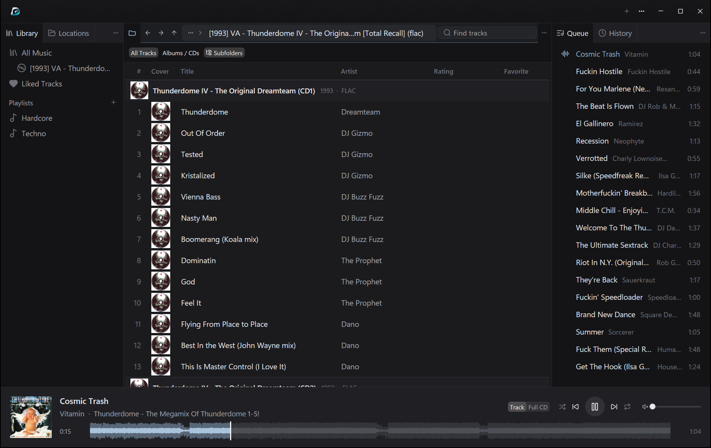

# Listening workspace

Disqro opens a folder or a CUE album directly. Browsing never changes what is playing: the queue retains the tracks independently of the browser, so you can open other folders, sort tables or rearrange panels while an album continues.

## Workspace

Every view in the window is a panel in one dock: **Music Browser**, **Library**, **Locations**, **Queue** and **History**. The default workspace puts Library and Locations together on the left, a Music Browser in the middle, and Queue and History together on the right. The player along the bottom of the window is not a panel: no arrangement of panels closes it or changes what is playing.

- **Tabs.** A single Music Browser uses its address row and icon. Browsers sharing a group have tabs directly above that row. Library and Locations share a connected header, as do Queue and History. The title bar uses only the app icon for branding and holds the panel picker and workspace menu.
- **Arranging.** The layout starts locked every time you open Disqro. You can switch tabs, drag music and resize a boundary while listening. Choose **Customize Layout** in the workspace menu to drag a tab onto another group, change tab order, or drop at a group edge to split it. The tab menu also offers **Split Right** and **Split Down** during editing. Choose **Done** in the title bar to lock the arrangement.
- **Opening and closing.** **+** lists every panel type and offers **Reopen Closed Panel**. Immediately after a close, reopening restores the exact arrangement. The picker remembers the most recently closed instance of each type across restarts and uses surviving tab companions when available. Closing every panel leaves **Open a Panel** above the player.
- **Recovery.** **Undo Layout Change** in the workspace menu restores the preceding panel arrangement during this session. **Restore Default Layout** returns to the three columns with your active browser. Undo can bring the preceding layout back. Both commands leave the queue, library and playlists alone.
- **Music Browsers.** Each browser has its own breadcrumb, search, history, table and view settings. Click a browser to direct Library and Locations navigation there. Its navigation row takes on a steel-blue accent. **Open in New Tab** and Ctrl-click create a browser in the active group. **Open Beside** opens one to its right when the group has room for two readable tables, or in the same tab group at smaller widths. Ctrl+T opens another browser at the current view.
- **Toolbars.** A browser's toolbar holds **All Tracks** and **Albums / CDs** for a collection, **Subfolders** for a folder, the way back from a CD or release page, and the browser's menu. **Hide Toolbar** in the tab menu hides it for that browser only, and the small arrow left in its corner brings it back. Hiding the toolbar leaves the view as it was.
- **Saved workspace.** The profile saves the arrangement, active browser, closed panels and player height. Each browser restores its current page, search and Back/Forward destinations. A layout saved by a build with the fixed Sidebar, Recordings, Queue and Now Playing panels is replaced once by the default workspace. The first browser restores the previous folder or collection view. Expanded folders, Places, playlists, table preferences, volume and the queue carry forward.

### Adding music by dragging

- Drag a folder from Locations onto the Library tab, or onto the Library panel, to add it to the library. The folder is indexed where it is; nothing is moved or copied.
- Drag a track or selection onto a playlist in Library or into an open playlist, including its empty space. The drop preview names the destination and track count. A drop appends new references in selection order. Each repeated occurrence gets its own entry. To reorder within a playlist in its natural order, drop its entries on the row they should precede.
- When Library is behind another tab, rest over its tab while dragging to reveal the playlist entries.
- With Library and Locations side by side, drag directly from one to the other.
- Dragging a track or folder never moves a panel, and dragging a tab never adds music.

## Controls

| Action | Control |
| --- | --- |
| Edit the folder path | Ctrl+L, Alt+D or F4, or click the address bar |
| Open a folder | Ctrl+O, a Place or folder in Locations, or a breadcrumb |
| Back, Forward, Parent folder | Alt+Left (or Backspace), Alt+Right, Alt+Up, or the mouse's back and forward buttons |
| Find tracks in the current collection | Ctrl+F |
| Play from a track | Double-click, Enter, or **Play** in its context menu |
| Queue a track | **Play Next** or **Add to Queue** in its context menu; **Add All to Queue** in the panel menu |
| Play or pause | Space outside a text field, the media keys, or the tray menu |
| Previous and next track | Ctrl+Left and Ctrl+Right, the media keys, or the tray menu |
| Seek | Click or drag the waveform |
| Volume | Click, drag or scroll the volume bar; click the speaker to mute |
| Show or hide columns | Right-click a column header |
| Sort | Click a column header: ascending, descending, folder order |
| Reorder the queue | Drag an entry in Queue, or Alt+Up and Alt+Down; Delete removes it; Enter plays it |
| Open or close a tab | Ctrl+T opens a Music Browser; Ctrl+W closes the panel you are working in |
| Quit | Ctrl+Q, the workspace menu, or **Quit Disqro** in the tray menu |

### Address bar

The current folder appears as breadcrumbs. Click a crumb to open that folder. Click the empty part of the bar, or press Ctrl+L, to edit the full path with everything selected. Type or paste a drive path such as `C:\Music\Albums`, a UNC path such as `\\server\share\Music`, a path in quotes, or one with `%VARIABLES%`. Enter opens it; Escape restores the breadcrumbs. A path that does not exist shows a short message in the bar and leaves the current folder as it was. Paths are checked off the interface thread, so a sleeping network share cannot stall the window. A path to an audio file or CUE sheet opens its folder with that track selected. Right-click the bar to copy the address.

### Library and Locations

**Library** holds the indexed collections, Liked Tracks and playlists. **Locations** holds the Places, and each Place opens in place to show its own folders: Music expands to the folders inside Music, so Locations never shows Music twice. Disqro starts with Music and Downloads, resolved through Windows Known Folders, and the drives present on the machine. Library and Locations are separate panels. Each keeps its own scroll position and selection, and switching between them leaves the browser as it was.

- Click a Place or folder name to open it. Click the arrow to open or close a branch without leaving the current folder.
- The Place menu offers **Open**, **Open in New Tab**, **Open Beside**, **Add to Library**, **Rename Shortcut** and **Remove from Places**.
- Right-click the Locations tab or the space below the Places: **Add Folder to Places…**, **Restore Missing Default Places**, **Reset Places to Defaults…**.
- A folder's context menu offers the same three opening options, plus **Add to Places** and **Add to Library**.
- Drag a Place onto another to move it there, or below the last row to move it to the end.
- Right-click the Library tab, its empty space or a collection for **Add Music Folder…** and **New Playlist**. Collections, Liked Tracks and playlists offer both **Open in New Tab** and **Open Beside**. The **+** beside Playlists creates a playlist. Entries are always visible beneath the heading and scroll with Library.

Removing a shortcut never touches its folder. Restoring adds back only the defaults you removed, at the end, and leaves your own shortcuts, names and order alone. Reset replaces the whole list after a confirmation. A drive that is not attached disappears until it returns; a custom Place whose folder is missing stays, dimmed.

A registered collection and a Place can point at the same folder. The Library entry opens the index; the Location opens the folder on disk.

### Folders in Locations

- The open folder is shown under one Place: the one you chose it from while you stay inside it, otherwise the outermost Place other than a drive that holds it, then its drive. A folder outside every Place appears under a dimmed entry for its drive or share until you return to a Place.
- Opening a folder expands the way down to it and the folder itself, never its neighbours or the discs inside a large collection. Nothing collapses because you navigated; the rest of the tree, its scroll position and the row under the pointer stay where they were.
- Back, Forward, Parent, breadcrumbs and typed paths keep the highlighted folder, the breadcrumbs and the list in agreement. While a library view is shown, the tree keeps the last folder in view without highlighting it. The tree follows the active browser.
- Each Place keeps its own open folders, and they are remembered across restarts. Folders are listed off the interface thread, one listing task per Place, so a sleeping network drive holds up only its own branch.
- Folders whose names start with a dot, such as `.git` or `.cache`, and hidden or system folders are left out of the tree and of subfolder discovery. Typing the path of one in the address bar still opens it, and the tree shows the way to it.
- Folders and files are ordered as Explorer orders them, so `CD 2` comes before `CD 10`.

### Queue and History

**Queue** shows the current entry, marked as playing or paused, followed by what plays after it. **History** shows what played before it, most recent first; double-click an entry to play it again, or use its menu to play it next, remove it or show it on its CD. They are separate panels with their own selection and scroll position, and switching, splitting or closing them never changes the queue. **Clear Up Next**, Shuffle and Repeat are in the Queue menu, **Clear History** in the History menu. Shuffle reorders only what is still to come and switching it off restores that order. Repeat cycles Off, All and One. Previous restarts a track after three seconds and otherwise steps back through History. A CUE chapter is an ordinary entry: a chapter from one disc, a single file from another folder and a chapter from a second disc queue and play in that order with their own artwork, titles and boundaries. Consecutive chapters of the same disc image still share one decoder, so an album plays without gaps between its chapters. The queue, the current entry and the position are saved shortly after each change and on exit; the next launch restores them paused.

### Tray and background playback

Disqro shows its compact icon in the notification area while it runs. Click it to bring the window back. Its menu offers Show Disqro, Play or Pause, Previous, Next, Show Queue and Quit Disqro. The minimize button and taskbar use normal Windows minimize and restore. Choose **Hide to Tray** from the workspace menu to hide the window explicitly. Enable **Close to Tray** to hide it when closing. By default, closing the window quits Disqro.

Quit Disqro is always in the tray menu and the workspace menu. While the window is hidden, playback, the queue, the tray and the media keys keep working; the interface stops drawing and waveform analysis waits until the window returns.

### Windows media controls

Disqro registers with the System Media Transport Controls. The Windows media overlay shows the title, artist, album, artwork and timeline of the current track, including CUE chapters, and its Play, Pause, Previous, Next and seek controls drive the same transport as the window and the tray.

## Appearance

Disqro Dark is a neutral graphite theme: the title bar and the navigation panels sit on `#141416`, tables on `#1B1B1E`, the player on `#202024`, with `#2A2A2F` separators and a steel-blue `#91AFCB` accent reserved for selection, focus and what is playing. The waveform has its own colours so it never tints the interface.

The theme lives in `src/theme.rs` as a small set of materials (chrome, canvas, raised, overlay, lines, three text levels, accent, hover and selection states, and the waveform colours) mapped onto GPUI Kit's theme. Kit components and Disqro's own views read the same values. A Light or Glass appearance adds another set of materials, and for Glass a compositor backdrop behind the chrome surfaces, without a separate frontend.

## Playback and analysis

The transport streams local mono and stereo recordings through Kira and the default Windows audio output. Symphonia decodes WAV, AIFF, FLAC, MP3, AAC and ALAC in M4A, and Ogg Vorbis. Ogg Opus uses the bundled libopus adapter. FFmpeg is only needed to generate and compare optional test fixtures.

CUE times use 75 ticks per second. The next track's INDEX 01 ends the current track in the same source. Recorded pregaps remain playable and a recorded lead-in before the first track is accessible. When the queue changes while a disc is playing, the running decoder keeps only the chapters that still follow in the queue and stops where the next queued entry differs. Synthesized gaps, mixed-mode discs, complex MP4 edit lists, and surround playback are outside this build.

The player reads embedded artwork or a neighbouring cover image. The waveform keeps the minimum and maximum of both channels per bin, so antiphase audio stays visible, and the RMS level inside that envelope, which shows the structure of heavily limited masters. A cancellable background job writes up to 1,536 bins per overview. The versioned SQLite cache checks source path, size, modification time and CUE range before reusing an overview. [Collection storage and verification](recursive-collections.md)

On a normal close, and shortly after any change to the queue or Places, Disqro saves the workspace with each panel's own state, the volume, queue, Places, window preferences, and the column layouts and view new browsers start with, in `%LOCALAPPDATA%\Disqro\workspace-v1.json`. Set `DISQRO_PROFILE_DIR` to use an isolated profile. The dock layout is version 3; a layout of another version is replaced by the default workspace.

## Engineering decisions

- Panels are instances of registered types (`src/panels.rs`). A type names itself, its icon, whether it exists once or many times, where it opens, and how to build an instance from saved state. An instance has a stable identity and saves its own state into the dock layout. GPUI Kit's dock owns the layout tree, dragging, splitting and persistence, and rebuilds instances through its panel registry. The workspace creates, places, closes and reopens instances without knowing their types, so a new panel type, such as a visualizer, is a new module rather than a change to the workspace.
- Shared state is not owned by any panel: the catalog, the player and queue, and the Places and folder tree live outside the dock. Closing Library, Locations or Queue loses nothing, and every Music Browser reads the same catalog while keeping its own view.
- GPUI Kit supplies each group's tabs, active panel, order and drag operations. A browser instance owns its address editor and search input. Moving it between groups moves those controls with it.
- Each group renders its selected panel. Cached drawing isolates playback updates from the dock. When Windows assistive technology requests an accessibility tree, the dock and visible panels render their controls into that tree.
- One transport owns playback and the queue on its own thread. The window, the tray and the Windows media controls all send it the same commands, so they cannot disagree about what is playing.
- Redraws follow what is visible. The player redraws for position only when the playhead moves at least three quarters of a pixel or the clock changes a second, instead of on every 40 ms transport tick. While the window is hidden the transport stops waking the interface for position updates.
- GPUI Kit's default "show while scrolling" scrollbars kept requesting animation frames for the folder tree, costing about 4% of a core in an idle window. Disqro uses hover scrollbars, which Windows 11 uses as well.
- Controls inside the title bar are marked as occluding so Windows does not treat them as the caption.
- The tray icon lives on a hidden window owned by the interface thread, created with the Win32 API from the `windows` crate that GPUI already depends on. No second UI toolkit is involved. The media session uses `ISystemMediaTransportControlsInterop` on the same window.
- The read-only Dekzer review covered its playback crate, native player integration, CUE handling, player qualification, and waveform research. Disqro adopted source-frame addressing, decoder preroll, a buffered boundary between decoding and output, and sample-oracle checks. It has its own implementation and no Dekzer source or runtime dependency.

## Final Mission 10 Windows qualification

The final optimized Windows executable has SHA-256 `6f76a31e1dc6e8d8386b372634fa31cdd1e7d1193330a01c3175342b698daecd`. The locked release suite passed all 111 tests, including the Windows junction fixture, missing-source playlist copies, browser history persistence, FFmpeg fixtures and the six-figure collection test. Formatting, warnings-denied Clippy and the locked release build passed. [Release test output](evidence/modular-workspace/final/test-suite.txt)

Native input and accessibility checks ran at 150% Windows scaling against an isolated copy of a 126-track collection. The following captures show the application during that run. [Default listening view](evidence/modular-workspace/final/default.webp) · [Three selected tracks over an empty Techno playlist](evidence/modular-workspace/final/playlist-transfer.webp) · [Customize Layout with Done visible](evidence/modular-workspace/final/customize-layout.webp)

| Check | Observed in the optimized application |
| --- | --- |
| Navigation and sizing | Liked Tracks → Techno reused the same browser. Open in New Tab created a second tab. Open Beside tabbed at 720 × 460 and 900 × 600, then split at 1240 × 780 into tables measuring 362 and 361 logical pixels. Also checked the default view at 1540 × 940. |
| Music transfers | Dragging three selected CUE chapters into an empty Techno browser appended the displayed recordings in order. Dropping one again onto a populated row appended a distinct occurrence. Copying from Techno into another playlist preserved Techno's occurrences. Source file digests, likes, ratings and queue entries matched the pre-transfer values. Tracks and folders also crossed the utility tabs, including indexing a folder in Library. |
| Layout safety and recovery | Dragging a locked tab left its group intact. A splitter resized while locked. Customize Layout enabled splitting, reordering and moving between groups. Done locked them again. Undo restored the group and instance identities after rearrangement and reset. Reopening after a close restored the original arrangement. Closing all panels kept playback running and the panel picker accessible. |
| Browser independence and restart | Clicks in vertically stacked Techno and Liked Tracks directed subsequent Library navigation to the chosen browser. Scrolling one of two side-by-side tables left the other in place. On restart, both browsers restored their locations, search text, Back and Forward destinations, active recipient and grouping. The layout reopened locked. A panel closed before quitting reopened with its previous ID, tab group and search. The library, playlists, favorites, ratings and saved queue survived restart. [Native check results](evidence/modular-workspace/final/windows-checks.txt) |
| Playback during interaction | The two muted sessions recorded 8,648 and 5,124 callbacks across navigation, panel edits, resizing and empty-workspace recovery. Each had zero decode or device errors and one unchanged-position tick in a sample containing a transport command. These traces measure transport behavior. Audible output on speakers or headphones remains unverified. [First session](evidence/modular-workspace/final/playback.csv) · [After restart](evidence/modular-workspace/final/playback-after-restart.csv) |

### Production playback comparison

Both optimized executables played the same 44.1 kHz stereo FLAC at zero application volume in a visible 1240 × 780 window. Each run used a fresh isolated profile and six seconds of warm-up after audio callbacks began. Windows process counters measured CPU over the following 15 seconds and private memory at the end. Run order was production, Mission 10, Mission 10, production.

| Build | CPU, percent of one logical core | Private memory | Audio callbacks |
| --- | --- | --- | --- |
| Production baseline | 11.14%, 10.42% | 118.3, 119.1 MiB | 1,502, 1,499 |
| Final Mission 10 | 6.98%, 6.15% | 117.4, 117.5 MiB | 1,504, 1,498 |

All four samples recorded zero device errors, decode errors and unchanged-position ticks. The production binary had SHA-256 `0c2ea99199946ebafe2964ae0639935de0b500f8fdf230b4f87dd87a5ea84427` and was built from the requested production baseline. These measurements cover foreground playback of one file on this Windows machine. Library indexing, startup and complex arrangements were outside this comparison. [Per-run measurements](evidence/modular-workspace/final/comparison.csv)

## Earlier Mission 10 Windows qualification

The optimized Windows executable was built from `f5e1cac859b5bbe474f8860d1f12aaeae0b1b45c` plus the working-tree refinement. Its SHA-256 is `75446b6b04551183db28beba548bed0b9bf3b13813b4bf5afb6c67bc8f368684`. Screenshots below are lossless window captures at 150% Windows scaling.

| Check | Observed result |
| --- | --- |
| Default navigation | Clicking Liked Tracks and then Techno kept the same browser instance ID and the original three dock groups. [Techno in the original browser](evidence/modular-workspace/refined/same-browser-techno.webp) |
| Explicit second browser | **Open in New Tab** on Liked Tracks added a second ID to the same content group. Library and Queue retained their selections. [Local content tabs](evidence/modular-workspace/refined/browser-tabs.webp) |
| Split navigation and restoration | Splitting the browsers placed a breadcrumb and search above each table. Back and Forward in the upper pane changed only that browser. The two search fields kept different values. Two successive restarts restored both IDs, locations, searches, the active recipient and dock geometry to within one logical pixel. [Techno and Liked Tracks in separate panes](evidence/modular-workspace/refined/scoped-vertical-browsers.webp) |
| Window sizes | Tested at requested window sizes of [720 × 460](evidence/modular-workspace/refined/player-720.webp), [900 × 600](evidence/modular-workspace/refined/player-900.webp), [1240 × 780](evidence/modular-workspace/refined/player-1240.webp) and [1540 × 940](evidence/modular-workspace/refined/player-1540.webp). The table measured 427, 527, 732 and 913 logical pixels wide, respectively. Narrow utility headers stacked each icon over its label. |
| Utility docking and drops | A track dragged over inactive Library revealed its playlist target and created one entry. A folder hovered over Library and dropped into the panel produced an indexed track. A second folder dropped on the Library header from a separate Locations pane also indexed. Both pairs split and re-tabbed. [Library and Locations](evidence/modular-workspace/refined/split-library-locations.webp) · [Queue and History](evidence/modular-workspace/refined/split-queue-history.webp) |
| Playlist operations | Created, renamed and deleted a playlist through the Windows UI. Added the same recording twice and moved the final occurrence to the start. Checked the order by occurrence ID in SQLite. |
| Panel lifecycle | Hid and restored a browser toolbar, closed and reopened History, then closed every panel. The player and the empty-workspace picker remained available. Opening a browser and restoring the default layout recovered the three groups. |
| Existing profile | Used a copy of a version-2 profile with the old playlist disclosure set to closed. The new geometry opened with both playlists visible. Verified the original folder, expanded folders, Places, column preferences, volume, playback position, queue order, all 126 track IDs and the contents of the likes, ratings, playlists and playlist-entry tables. |
| Playback during interaction | Resized the window and a dock splitter, switched tabs and dragged panels and music during muted playback. The 196-second trace recorded 18,959 callbacks, zero device or decode errors and one unchanged-position tick in a sample that also contained a transport command. Physical audio quality was outside this measurement. [Playback trace](evidence/modular-workspace/refined/playback.csv) |

Formatting, warnings-denied Clippy and the locked optimized build passed in this earlier run. Running the complete suite including the FFmpeg and six-figure collection tests produced **108 passes and one fixture setup failure**. Windows returned access denied when `directory_junction_is_not_descended` invoked `mklink /j`. Repeating the fixture in a writable directory produced the same denial. At the time, the production-baseline build had exited 101 during its CMake step, leaving the performance comparison unverified.

## Earlier listening-workspace verification

Measured on a Ryzen 7 8845HS running Windows 11 at 150% display scaling with the optimized build, using isolated profiles with the application volume at zero. CPU is the share of one logical core averaged over 12 seconds; GPU is the sum of the process's GPU engine counters.

| State | CPU | GPU | Private memory |
| --- | --- | --- | --- |
| Before this change, window visible, playing | 16.2% | 4.1% | 122 MB |
| Window visible, idle, nothing played | 1.6% | 0% | 109 MB |
| Window visible, playing a FLAC disc | 4.0% | 0% | 113 MB |
| Hidden in the tray, playing | 1.1% | 0% | 114 MB |

The first row is this branch before the redraw throttle and the scrollbar change; the earlier build drew its seek slider on every transport tick in the same way.

Checked in the running application:

- The before and after layouts at 1240×780 and 900×600. [Before](evidence/before-refinement.png), [after](evidence/disqro-dark.png).
- Address bar: click and Ctrl+L select the whole path; a quoted path opens; a missing path shows its message and keeps the folder; Escape restores the breadcrumbs; Back, Forward, Parent and Backspace follow the history. [Missing path](evidence/address-error.png).
- Places: Add to Places from the tree, drag to reorder, remove, restore one missing default, reset after confirmation, and the saved order. [Places menu](evidence/places-menu.png).
- Queue: Play Next for track 7 of the second disc of *Thunderdome IV*, Add to Queue for a single FLAC from another folder, Add to Queue for track 11 of *The Megamix Of Thunderdome 1-5!*, a drag to reorder, and playback across those entries by seeking near each end. Each entry kept its title, artist, album, artwork and duration. After a restart the queue returned paused at the same entry and position. [Queue after playing across sources](evidence/queue-mixed-sources.png).
- Tray: Hide to Tray removed the window while playback continued, and activating the icon restored it.
- Media controls: through the WinRT session manager, Disqro's session reported title, artist, album, a thumbnail, playback status and timeline. Pause and Skip Next sent through Windows paused the player and advanced to the next queue entry.
- The earlier checks still pass: a 13-track FLAC+CUE disc that also carries an alternate sheet for an absent WAV rip shows 13 tracks, and a three-chapter CUE across two WAV files advances through both boundaries. [Four native transport captures in playback order](evidence/cue-transport.png)

Not yet verified: audible output on physical speakers or headphones (the runs used application volume zero), physical media keys (the session was driven through the Windows API rather than a keyboard), the tray menu opened with a real right-click, scaling factors other than 150%, device loss, gapless joins between separate files, and sample-accurate AAC seeking.

For repeatable audio checks, run `cargo test --release --locked` with CMake available. With FFmpeg on PATH, use `cargo test --release --locked -- --include-ignored --nocapture` to exercise the encoded fixtures as well.

## Not in this build

Future work includes output device selection, loudness normalization, zoomable waveforms and additional visualizer panel types.
