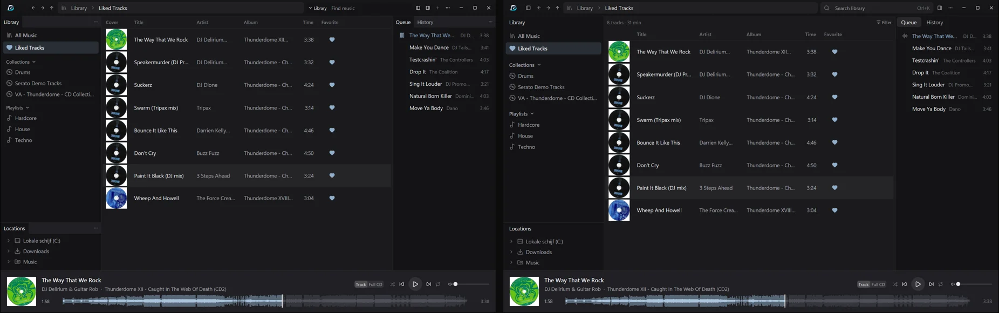
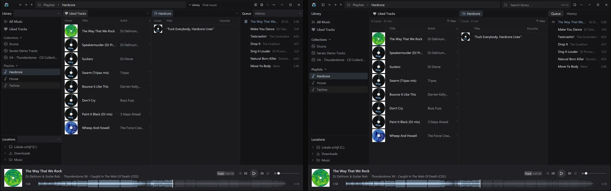
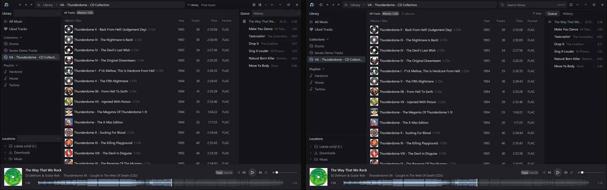
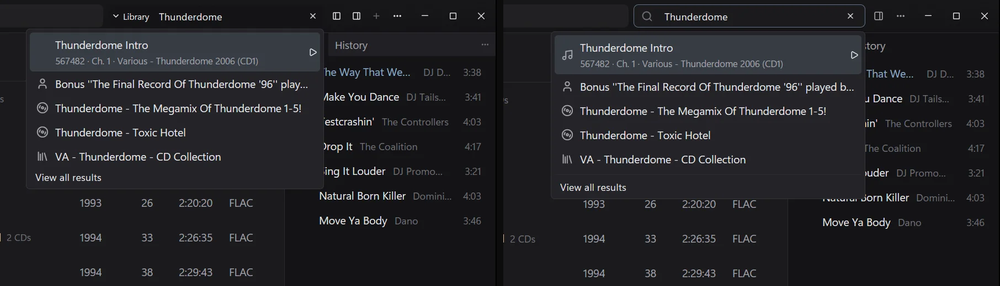
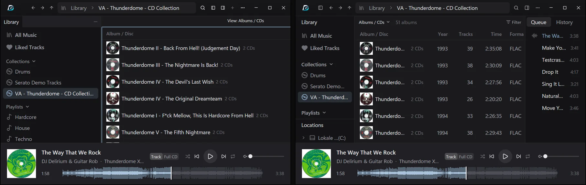
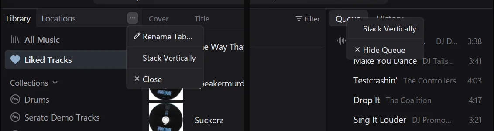
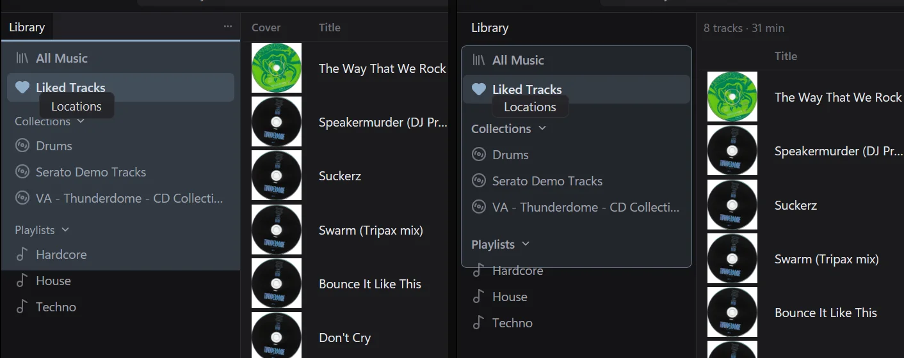

# Mission 11 design review

This review treats Disqro as one product rather than a set of panels. It started from the committed Mission 11 evidence and the optimized Windows build at `a71c9c8`, then refined the shell, docking chrome, browsers, sidebars, Queue and History, and tables around one small set of shared rules. The architecture underneath is unchanged: the GPUI Kit dock and panel registry, independent browser instances, shared address navigation, indexed search, collections and playlists, CUE identities, configurable tables, playlist transfers, sidebar and layout persistence, transport and decoding.

Every comparison below shows the original build on the left and the refined build on the right. Both ran the same isolated, muted copy of a real catalog at 150% Windows display scale.

## Audit

Findings are ranked by their effect on someone using the player.

| Rank | Finding | Resolution |
| --- | --- | --- |
| Critical | One title-bar field had two hidden modes. A *Library / This View* menu decided whether typing searched the whole catalog or filtered the most recently focused browser. With two browsers, the filtered one could not be seen from the field. The field also had no visible edge or magnifier. | The title-bar field always searches the Library. Each browser has its own visible filter in its own bar. |
| Critical | Group-level **…** menus acted on the active tab only. *Close* closed one panel. *Rename Tab* renamed fixed panels such as Queue, and browser groups repeated the tab menu. | The group menus are gone. Panel commands live on each tab's context menu, where their scope is obvious. Fixed panels offer *Hide Queue* (or the panel's own name) instead of *Close*, and cannot be renamed. A tab switcher appears only when a strip is too narrow for its labels. |
| High | Utility strips drew a lighter band with a darker notch for the selected tab, producing disconnected rectangles. A one-tab stacked group showed a full-width band around a single title. | All strips share the chrome surface of their panel. A lone utility tab is a plain panel title. |
| High | Drop previews filled half a panel with saturated blue and a 2 px edge, stronger than any selection. | Previews are an inset translucent region with a hairline accent edge, the same for dock drops and sidebar stacking. |
| High | The title bar ended in four icon buttons of uneven weight. The left sidebar toggle sat at the far right, and **+** repeated the workspace menu. | Each sidebar toggle sits on its own side and says whether it will show or hide. **+** is folded into the workspace menu, which gains *Reopen Closed Panel*. |
| High | History reserved an empty now-playing column. The paused marker was a pause glyph that read as a button. Narrow queues reduced every artist to "…". | History rows start at the edge. The marker is the same audio glyph in both states, accented only while playing. A narrow queue shows whole titles without artists. |
| High | The narrow view switch became a centred "View: All Tracks" label, unlike its left-aligned wide form. | Both forms sit at the left of the browser bar. The narrow form is a labelled menu with a caret. |
| High | Two bundled icons were missing. The filter icon never rendered, and track results in search had no icon. | `ListFilter` and `Music` are bundled. |
| Visual | Strip, toolbar and table-heading heights were 28, 29 and 30 px, so top edges did not line up across columns. | One header height (30 px) for every strip, bar and table heading. |
| Visual | Tab labels were 12.5 px, rows 13 px, headings 11.5–12 px in regular weight, with stray 11.5 and 12.5 px sizes elsewhere. | A shared type scale: 13 px body, 12 px secondary and column labels, 12.5 px medium section headings. |
| Visual | A "Cover" heading printed over a column that explains itself. | The heading is visually empty but keeps its accessible name and column menu. |
| Visual | The search popup's *View all results* floated among the suggestions, and the full results page did not show the query. | The footer is divided from the suggestions. The page heading repeats the query. |
| Minor | Keyboard focus ranged from a 2 px ring around a whole table to an almost invisible hover tint on rows. | One focus outline everywhere: a hairline accent border inside a transparent border each control reserves, so focus never moves content. |
| Minor | The "No matching tracks" state showed a folder icon in library views. | The icon names what is empty: a filter, Liked Tracks, a library view or a folder. |
| Defect | After a resize, the Albums / CDs table kept headings laid out for the old width until something else redrew it. The original build showed only *Album / Disc*. | When the width changes during paint, the table draws again on the next frame. |

## Design system

`src/theme.rs` now holds the rules that the panels previously repeated as literals.

- **Surfaces.** Chrome for the frame, sidebars and tab strips. Canvas behind tables and the browser bar. Overlay for menus. A text field rests on `field()` and switches to canvas with an accent edge while focused, the same way as the address.
- **Selection.** A quiet inset pill marks the selected tab, the active view and the waveform perspective. The browser that the shell addresses carries the accent tint, as the selected sidebar row does. A lone utility tab is a title and has no pill.
- **Geometry.** `size::HEADER` is shared by tab strips, the browser bar and table headings. Tabs are 24 px pills inset in that header, with label insets that align with sidebar row icons.
- **Type.** `size::TEXT`, `size::TEXT_SMALL`, `size::LABEL` and `size::HEADING`.
- **Focus.** `focus_line()`: a 1 px accent outline inside a reserved border.
- **Drop previews.** `preview_fill()` and `preview_edge()`, inset by `size::PREVIEW_INSET`.

## Decisions and tradeoffs

- **Search and filter are separate.** The original Mission 11 used one field for both, which was compact but hid its meaning behind a mode. The refined layout costs a 30 px bar in every browser. In return the filter sits beside the table it changes, two browsers keep visibly independent filters, and the title-bar field means one thing. Ctrl+K searches the Library and Ctrl+F filters the active browser, as before. Escape clears and closes a filter, and an empty filter folds back into its button when it loses focus.
- **The browser bar earns its height.** Besides the view switch and filter, it states what the view holds ("2,123 tracks · 134 h 5 min" or "51 albums"). That count is the first thing to give way at narrow widths.
- **Pills rather than underlines.** An underline indicator was tried and rejected in review. Pills match the existing view and waveform switches, so every selection control in the app now looks the same.
- **Stacking stays reachable without chrome.** Dragging a tab to the upper or lower edge of a sidebar panel stacks or reorders it. *Stack Vertically* and *Group as Tabs* remain in the tab context menu for anyone who does not drag.
- **The table focus ring is lighter, not removed.** The Kit ring is turned off for music tables and replaced by the shared 1 px outline, shown only after keyboard input.

## Before and after

| View | Comparison |
| --- | --- |
| Default workspace, stacked Library and Locations |  |
| Two browsers side by side |  |
| Albums / CDs |  |
| Library search |  |
| 720 × 460 window after a resize |  |
| Panel menus |  |
| Held tab drag over Library |  |

Refined build only: [browser filter](evidence/design-review/filter.webp) · [full search results](evidence/design-review/results.webp) · [both sidebars hidden](evidence/design-review/hidden.webp) · [restored after restart](evidence/design-review/restored.webp) · [keyboard focus](evidence/design-review/focus.webp)

## Native interaction log

Both optimized builds were driven with real mouse and keyboard input in a 1240 × 780 logical window at 144 DPI, then at 720 × 460. Each run used a fresh copy of the same isolated profile, with a read-only backup of the real catalog (Drums, the Serato demo tracks and the 2,123-track Thunderdome archive) and muted output. Captures came from the native window with `PrintWindow`.

| Interaction | Observed result |
| --- | --- |
| Library search | Ctrl+K focused the title-bar field and returned grouped suggestions with track, artist, release and collection icons. *View all results* opened the paged page titled with the query. *Done* returned to the browser. Escape dismissed the suggestions and kept the browser where it was. |
| Browser filter | Ctrl+F opened the filter in the active browser. Typing *XV* in Albums / CDs left four releases, and the bar read "4 albums". Typing *dreamteam* in All Tracks left 46 tracks, and the bar read "46 tracks · 3 h 32 min". Escape cleared the query, restored the full count and returned focus to the table. An empty filter folded back into its button when it lost focus. |
| Two browsers | *Open Beside* on a playlist opened a second browser. Each had its own bar, filter and count. Only the browser that the address addressed carried the accent pill, and clicking the other moved it. |
| Tab menus | Right-clicking Queue offered *Stack Vertically* and *Hide Queue*. Browser tabs kept *Open in New Tab*, *Rename Tab…* and *Close Tab*. No strip showed a group **…** button. |
| Stacking | Dragging Locations over the top of Library showed the inset preview while the button was held. Releasing placed Locations above Library. Releasing the same drag over the browser changed nothing. |
| Sidebars and restart | Ctrl+Alt+Left and Ctrl+Alt+Right hid both sidebars, and the toggles' labels changed from *Hide* to *Show*. After restart both sidebars were still hidden, and the browser filter still held its query. |
| Resizing | After shrinking to 720 × 460, the album table's headings matched its new column widths on the next frame. The original build kept the old layout, labelled only *Album / Disc*, and did not show the right sidebar. Queue rows dropped artists below 230 px and kept whole titles. |
| Keyboard focus | After a collection opened, Tab reached the first row's Like control, and Shift+Tab moved to the table. Each showed the 1 px accent outline. A mouse click on the same table showed none. |

## Tests and performance

Formatting, warnings-denied all-target Clippy and the release build passed. The debug and release suites each passed 118 tests: the previous 117, plus a test of the new count and duration wording. The two opt-in tests (codec fixtures and the six-figure catalog) are unchanged by this work and were not rerun.

Playback was compared in alternating trials, two per build. Each fresh launch played the same FLAC recording with muted output for 20 seconds while the window stayed at 1240 × 780.

| Build | CPU (% of one logical core) | Private memory | Output callbacks | Decode errors | Device errors | Unchanged-position ticks |
| --- | ---: | ---: | ---: | ---: | ---: | ---: |
| Original `a71c9c8` | 9.29, 7.42 | 122.8, 123.0 MiB | 2,000, 1,999 | 0 | 0 | 0 |
| Refined | 9.75, 8.66 | 121.9, 121.8 MiB | 1,999, 2,000 | 0 | 0 | 0 |

The CPU ranges overlap, and two short trials cannot separate them. Memory and the audio counters are unchanged.

## Remaining concerns

- At 720 × 460 the album overview's fixed Year, Tracks, Time and Format columns leave little room for titles. Columns can be hidden from the heading menu, but automatic column priorities would serve narrow windows better. This was already the case in the original build.
- A narrow browser beside another shows the first character of a clipped column at its right edge. This was also already the case.
- Only 150% display scaling was available on this machine.
