# Mission 11 UX corrections on Windows

The [design review](mission-11-design-review.md) follows these corrections and refines the shell, docking chrome, browsers, sidebars, Queue and tables. This record and its evidence describe the build before that review.

## Sidebar spacing

All Music and Liked Tracks use 30 logical pixels per row, down from 36 in the first correction. Medium-weight type distinguishes these destinations from the 27-pixel collection and playlist rows. Section headings are 23 pixels high with 8 pixels above them. The chevron follows the heading as in the supplied sidebar reference. The add action occupies the far edge and appears on hover or keyboard focus. Selection, keyboard focus and playlist drop targets still use the whole row.

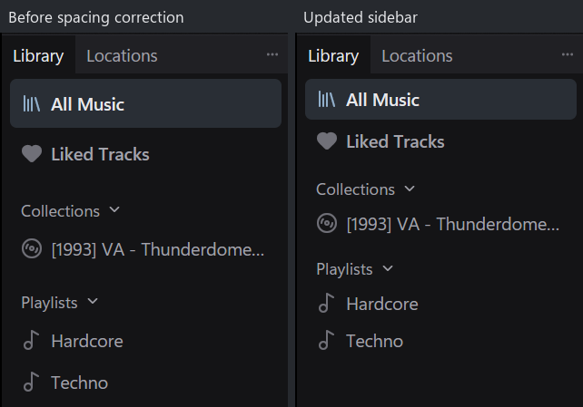

## Visual comparison

These are Windows captures from the repository and the corrected native player. The narrow captures use a 720 × 460 logical window. Open the images at full size to inspect the text and controls.

| View | Original Mission 11 | Corrected build | What changed |
| --- | --- | --- | --- |
| Default | 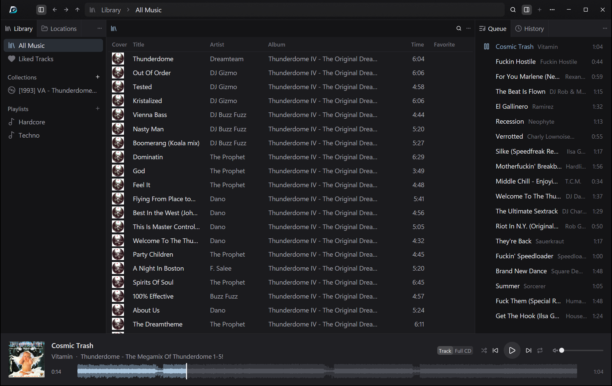 |  | The shared address and large track surface stay. Search and the All Tracks / Albums / CDs selector are visible and the lone browser tab strip is gone. |
| Search | 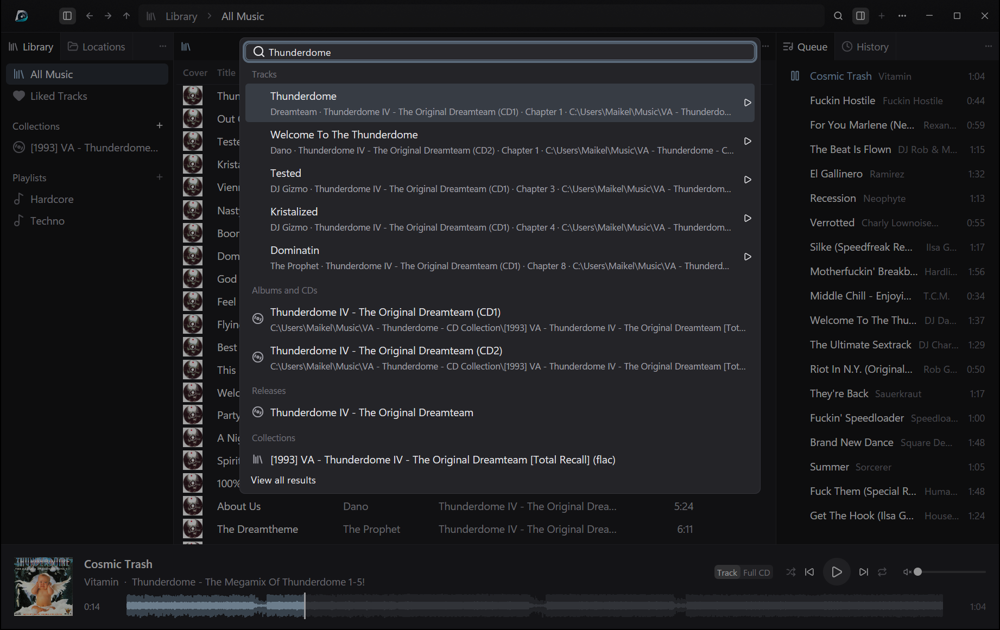 | 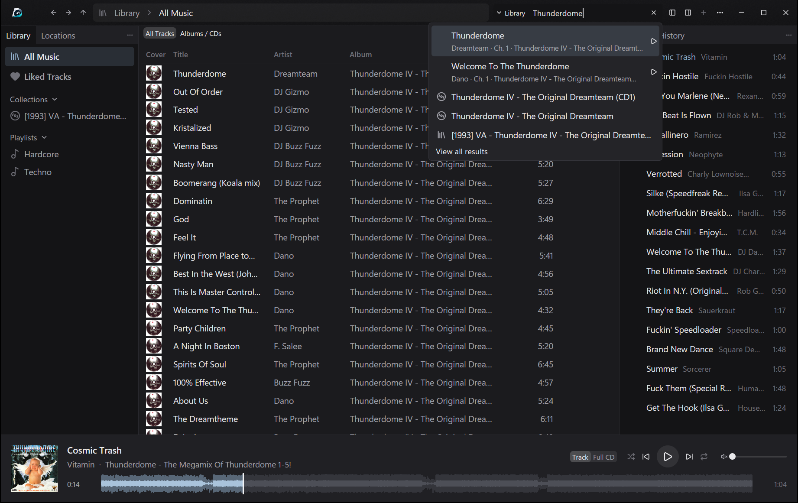 | Up to five suggestions appear below the field. The track table, sidebars and transport remain visible. |
| Filter | 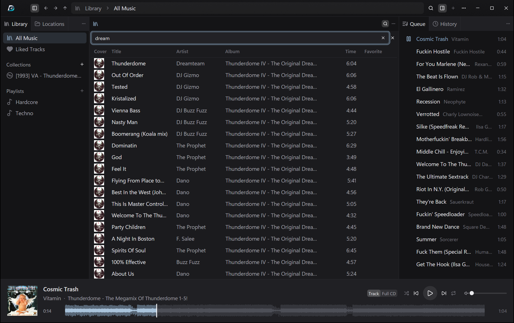 | 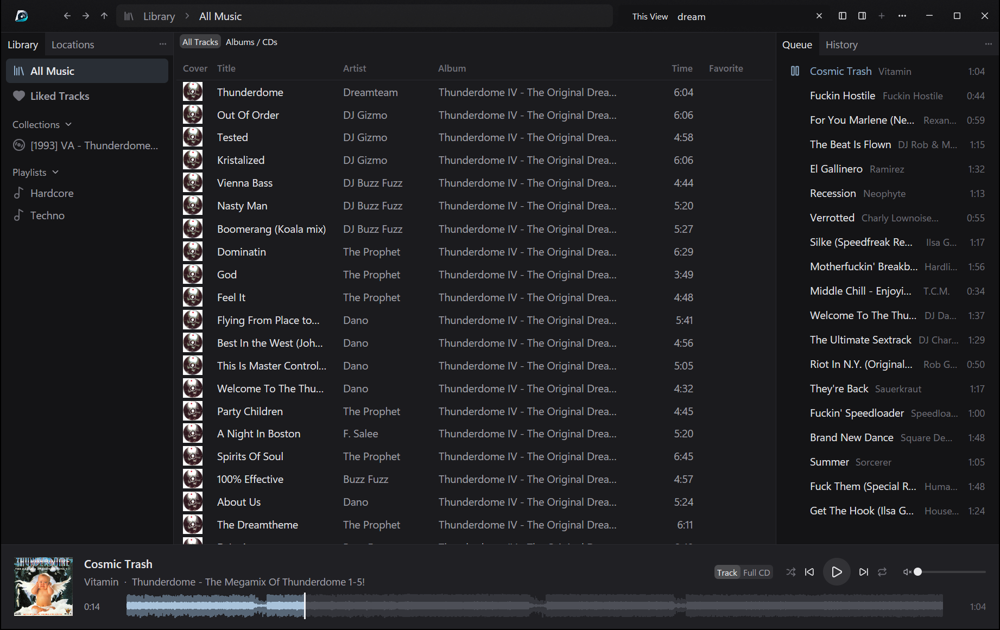 | This View uses the same shell field and keeps the active browser’s query. |
| Two browsers | 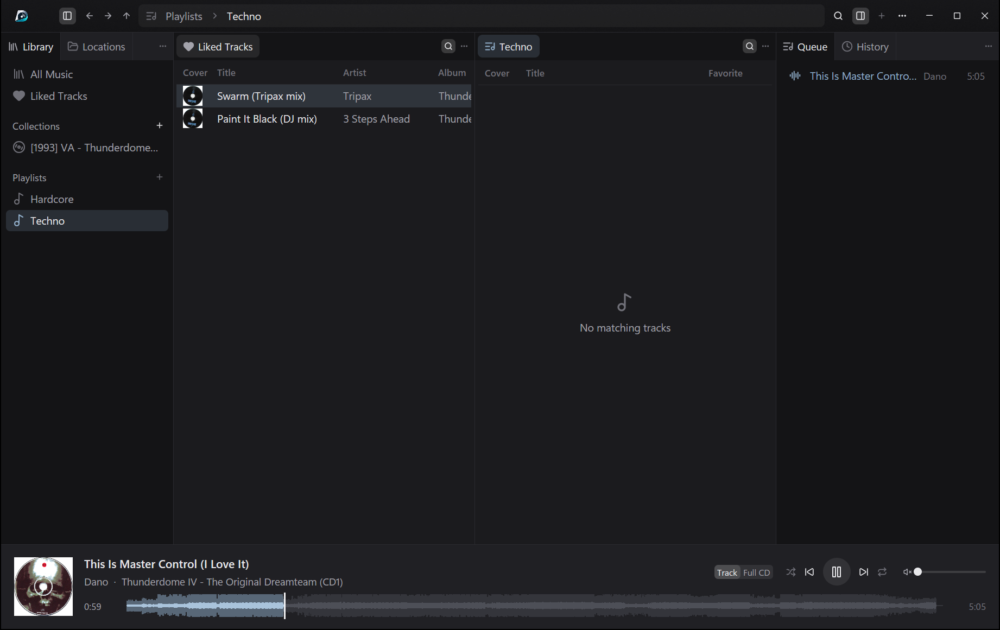 | 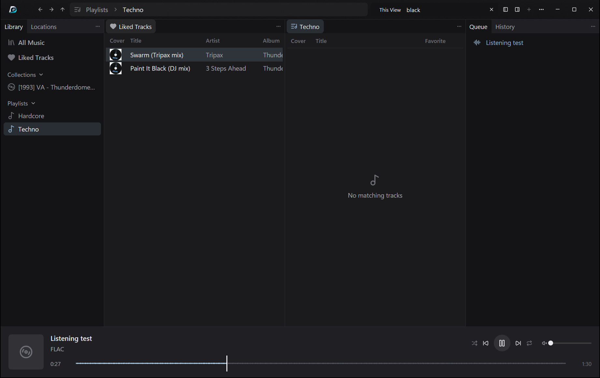 | Each instance keeps its table and query. The shell shows the focused instance’s address and search scope. |
| Library | 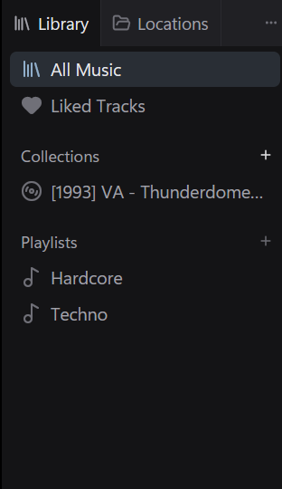 | 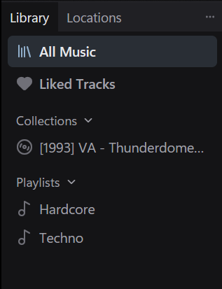 | Section headings disclose their own children. Both primary destinations read at a glance and add controls recede until needed. |
| Narrow | 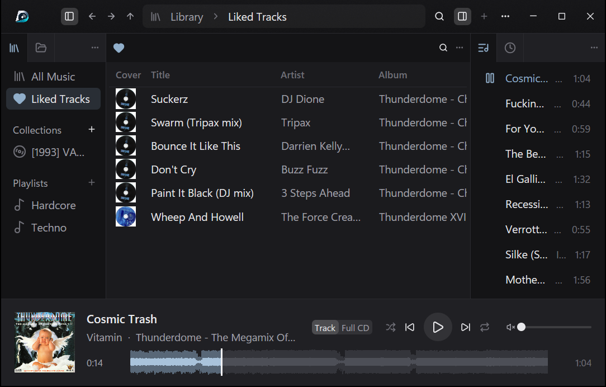 | 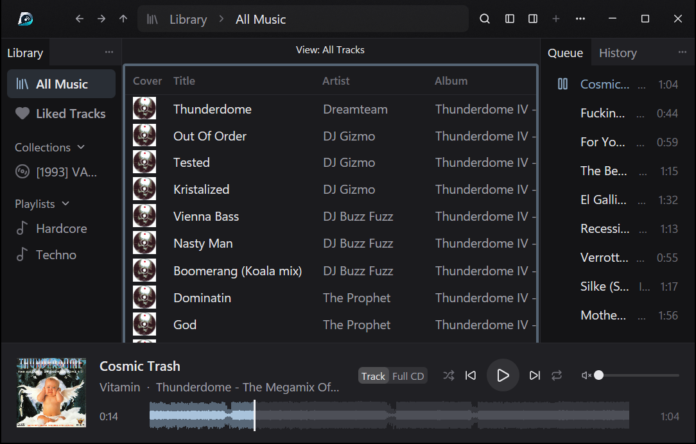 | The visible view selector names its current mode. Short utility strips show the current tab name and offer the others in the panel menu. |
| Stacked | 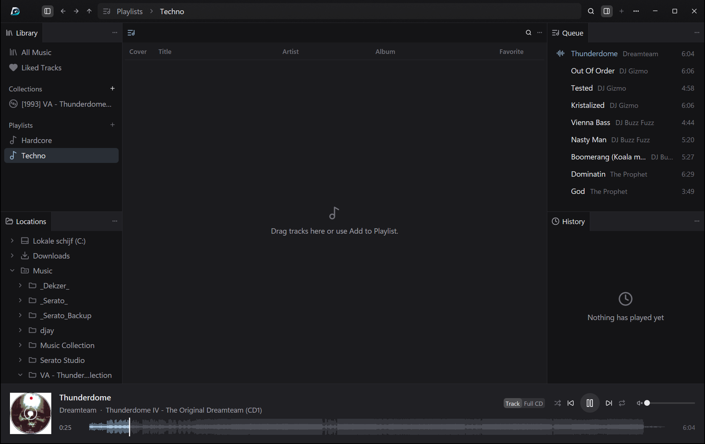 | 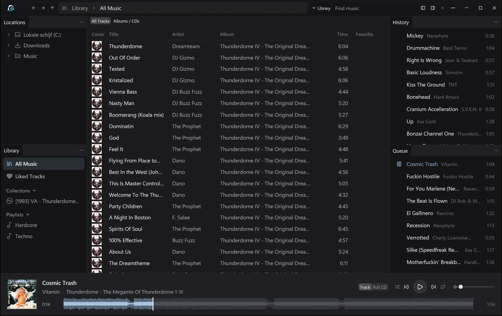 | Both utility pairs keep independent regions. A tab can be dragged to create or reverse a stack during ordinary use. |

Mission 10 made the current browser’s controls easy to find, but splitting the browser repeated navigation chrome. The original Mission 11 shared the address effectively and recovered width when the sidebars closed. Its modal search, icon-only controls and empty single-browser header made common actions harder to find. The correction preserves the shared address, independent tables, player and docking model while restoring visible search and view switching. [Mission 10 default](evidence/modular-workspace/final/default.webp) · [Mission 10 split browsers](evidence/modular-workspace/refined/scoped-vertical-browsers.webp) · [Mission 10 narrow tabs](evidence/modular-workspace/corrections/tabbed-720.webp) · [Original Mission 11 qualification](unified-shell-qualification.md)

## Albums and CDs

Serato Demo Tracks has two independent three-track albums. Their missing years stay blank. Each multi-disc Thunderdome release also occupies one row, with artwork, the CD count and aggregate metadata. A single click selects it. Enter, double-click or Open Release takes the listener to the track list grouped by CD. Back returns to the overview. Older workspaces that bookmarked a CD inside the list restore selection to its release.

| Previous inline expansion | Current overview | After opening the same release |
| --- | --- | --- |
| 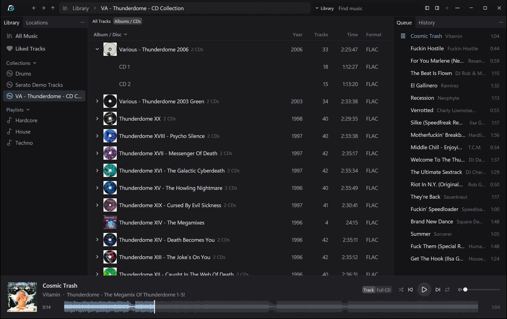 | 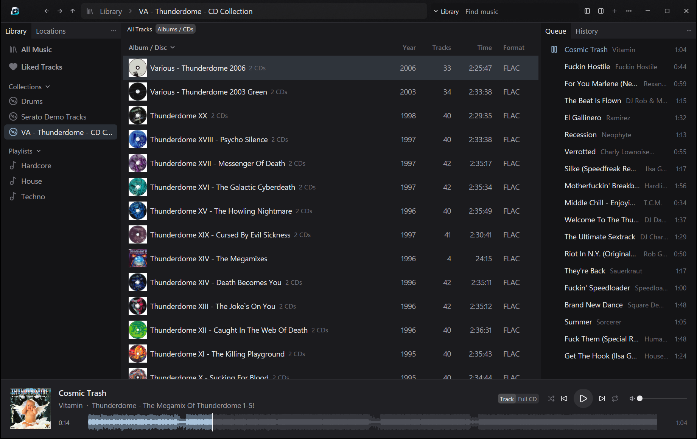 | 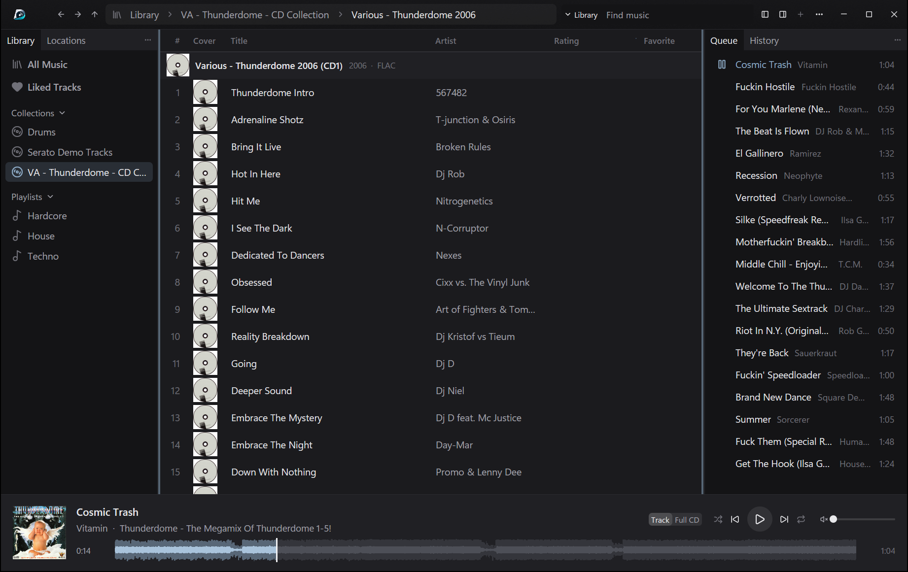 |

[Two individual Serato albums](evidence/mission-11-corrections/serato-overview.webp) · [Narrow overview](evidence/mission-11-corrections/release-overview-narrow.webp)

## Native interaction evidence

Windows UI Automation supplied accessible names and geometry. The driver sent mouse press, movement and release events to the native window and exercised keyboard shortcuts, focus and application restart. The held-drag image was taken with the button down. Playback and layout tests used isolated profiles. Album checks used a read-only SQLite backup of the real catalog.

| Interaction | Observed result |
| --- | --- |
| Library / Locations and Queue / History | Each pair reordered in both directions. Dragging near the bottom of its own group tinted the proposed lower half, then created a vertical split on release. Dragging the lower tab above the upper one reversed the order. The recording table retained its bounds. [Held drag](evidence/mission-11-corrections/drag-held.webp) · [Both pairs stacked](evidence/mission-11-corrections/stacked.webp) |
| Regroup, hide and undo | Both stacked pairs reopened after restart. Hiding and restoring the sidebars kept their layout. Dragging one member onto its sibling’s tab regrouped the pair. A cross-region drop had no effect. Undo restored the previous order. [One sidebar](evidence/mission-11-corrections/one-sidebar.webp) · [Both hidden](evidence/mission-11-corrections/hidden.webp) · [Restored](evidence/mission-11-corrections/restored.webp) |
| Browser tabs and menus | Opened Liked Tracks in a new tab and dragged it before All Music. Its tab menu offered tab-specific actions. Bulk queue, playback and Close Other Tabs commands were absent. [Browser tab menu](evidence/mission-11-corrections/tab-menu.webp) |
| Collapse a sidebar section | Collections and Playlists collapsed independently while the browser destination stayed selected. Collapse survived restart. Enter and Space toggled the focused heading. New Playlist could be reached from a collapsed section. [Collections closed](evidence/mission-11-corrections/collections-collapsed.webp) · [Playlists closed](evidence/mission-11-corrections/playlists-collapsed.webp) |
| Browse an album | Sorted the Serato titles in both directions and opened one with Enter. A single click on a Thunderdome release preserved every visible row. Enter and double-click opened the release. Scrolled to the second CD heading and double-clicked it to browse that CD. Back returned through the release to the overview. The queue stayed intact and the saved overview reopened at 720 × 460. |
| Configure the album table | Showed Folder, hid Year, resized the title column from 429 to 339 physical pixels and dragged Tracks past Time. Column width, visibility, order and sort survived process restart. Switched back to All Tracks using the narrow view selector. |
| Search and filter | Using the scope menu to switch from This View to Library and back preserved the local query. The compact popup returned several kinds of results. View all results opened a paged browser surface. Escape dismissed suggestions and the active browser kept its query. Two browser filters survived restart independently. [Full results](evidence/mission-11-corrections/all-results.webp) · [Narrow search](evidence/mission-11-corrections/narrow-search.webp) |
| Playback and playlist transfers | Dragged three CUE recordings into a playlist in order and copied one again as a separate occurrence. Source hashes, source entries and the queue matched. Opening a search hit preserved the queue. Explicit Play resolved its source file, sheet, chapter number and frame range. [Transfer](evidence/mission-11-corrections/transfer.webp) |
| Six-figure catalog | Opened the Albums / CDs table, sorted and scrolled it with 100,089 indexed tracks, then searched and paged the full results. [Native large-catalog search](evidence/mission-11-corrections/large-search.webp) |

The left-side drag began at client coordinates (133, 81) on Locations and reached (24, 975) before release. The lower half was highlighted while held. The next press began on the newly stacked Locations tab at (52, 552) and moved to (28, 122), placing Locations above Library. On the right, History moved from (1549, 81) to (1451, 975) below Queue, then from (1469, 552) to (1455, 122) above Queue. Moving History over Library preserved the saved layout. The same-tab-group browser test dragged Liked Tracks from (529, 81) to (335, 81), ahead of All Music.

## Build and performance

Formatting, warnings-denied all-target Clippy, the Windows debug build and the optimized build passed. Debug and release each passed all 117 default tests. Both opt-in tests passed separately in release, covering the FFmpeg codec fixtures and the 100,089-track catalog. On that catalog, grouping took 19 ms and the projection query took 24 ms. The indexed first-page searches took 69 ms for “Volume 777”, 32 ms for “Track 99” and 129 ms for “Track” on this machine. These worker timings exclude the 65 ms input debounce.

Native checks ran at 144 DPI (150% Windows display scale) across 720 × 460, 900 × 600, 1240 × 780 and 1540 × 940 logical windows. Two split browsers remained available at each size with both, one and neither sidebar visible. Both vertical utility stacks were exercised at all four sizes. Windows hit testing identified both search and address as client controls. The system move operation shifted the window by 48 × 32 physical pixels. Maximize, restore and minimize were exercised through Windows system commands.

During continuous muted FLAC playback the driver transferred music, changed independent browser filters, resized the window and stacked a utility panel. The trace recorded 3,477 output callbacks, zero decode errors, zero device errors and one unchanged-position sampling tick. Audible quality and display scales other than 150% were outside this run.
