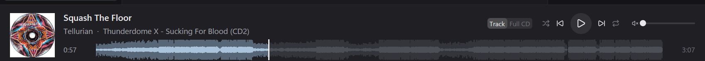
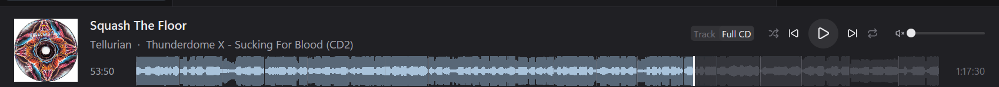

# Track and Full CD

In the bottom player, choose **Track** or **Full CD**, or press **Alt+W**. The first view follows the playing chapter. The second shows its position in the authored disc, with chapter boundaries and a highlight over the current chapter. Hover over a chapter to see its title. Disqro remembers the preference and shows the track waveform for a standalone recording.

These Windows captures show the same paused position in chapter 14 of *Thunderdome X*, CD2. The chapter starts at 52:53.667 on the disc. At 57.250 seconds into the chapter the disc position is 53:50.917. The player rounds its labels to the nearest second.

### Navigation and source ownership

- Dragging previews a position. Releasing commits one occurrence-scoped seek. In Full CD, a destination must belong to the contiguous authored sequence around the current queue entry. Hover text identifies chapters outside that sequence. **Continue This CD** explicitly adds the following chapters when wanted.
- A perspective change updates the local preference and requests a redraw. Playback position, volume, shuffle, repeat and queue ownership stay with the audio engine. Natural chapter advancement changes the active segment. An explicit seek to another occurrence resolves and validates the target, queue revision, source revision and sheet revision on the transport thread. Paused seeking preserves pause.
- `timeline::Program` reads authored CUE order including recorded lead-ins, before unavailable recordings are filtered from playback. Each segment has a physical source, a half-open decoded frame interval and a half-open disc time interval in integer nanoseconds. The segment index is its ordinal. Widened integer math converts each source's absolute frame boundaries at its own rate. A join belongs to the following segment. Disc EOF is an exclusive endpoint.
- Physical pages contain signed stereo extrema and the sum of sample-derived stereo energy. Four measurement cells per CUE tick place every supported chapter edge on an exact decoded frame boundary. Pages end at the trimmed source EOF. The current overview projects these measurements at chapter and disc resolution independently for each source. Finer levels can extend the source cache for future zoom.
- One cancellable worker prioritizes the active region, publishes bounded geometry and retains at most one analysis decoder. It reuses adjacent pages and committed SQLite data keyed by source path, size, modification time and page. Each page covers four seconds. Batch pruning bounds the cache to 4,159 pages. Pending and unavailable regions have no waveform. Verified silence has a center line.
- An offline recording retains its place if the same CUE revision has a previously verified decoded duration. An unknown duration disables Full CD and the control explains why. When the playing source changes on disk, Disqro suppresses incompatible waveform data for the open voice. Synthesized gaps contribute no invented samples.

### Windows qualification

Measurements used an optimized native player with isolated profiles. The primary single-image run began paused in chapter 14. It included repeated switches while paused and playing, an explicit seek near the chapter end, natural advancement into chapter 15 while viewing an unrelated library page, and switching back to Track. Reopening the app restored chapter 15, its queue, paused position and Full CD preference. The source recording was read-only throughout. [One-second player counters](evidence/timeline-windows.csv)

| Measurement | Observed |
| --- | --- |
| Cached switch handler, worst observed over 69 changes | 1 µs |
| Handler entry to GPUI canvas paint, observed maximum | 17.253 ms Track → Full CD, 16.612 ms Full CD → Track |
| Cold request to first verified chapter geometry / first canvas paint | 55.899 ms / 68.793 ms |
| Warm application reopen to first geometry / paint, timed from waveform request | 68.435 ms / 81.026 ms |
| Player synchronization at natural chapter 14 → 15 | 11 µs |
| Playback commands / decoder opens / voice creations caused by switching | 0 / 0 / 0 |
| Physical page reuse on this CD | Cold 1,163 pages decoded and 19 shared reads. Warm 1,182 reads and zero decoded pages |
| Peak retained player waveform geometry | 733,416 bytes |
| Peak Windows working-set increase over fresh optimized analysis-test process baseline | 8.55 MiB cold, 4.33 MiB warm, including SQLite, decoder, allocator and retained shapes |
| Coordinate error in the four-rate integration fixture | 0 frames across 220,136 frames and 12 segments |

Canvas paint measures application work through the paint callback. Display presentation and hardware output latency require separate instrumentation. The memory probe loaded the same complete disc through the production analysis function and kept the latest projections for every chapter. Its process peak working sets were 17,920,000 bytes cold and 13,496,320 bytes warm.

| Additional native journey | Observed |
| --- | --- |
| Filesystem CD and indexed CD | Both resolved the same full Thunderdome disc and playing chapter. |
| Playlist with a repeated chapter | Full CD retained the playlist. An out-of-run click preserved the queue. Continue This CD and Play CD worked through their normal menus. |
| Play Release | A 32 kHz WAV and 96 kHz FLAC formed a 15-second CD. Both recorded lead-ins were retained. Playback crossed into the second source, then into the next 45-second, 44.1 kHz disc. |
| Standalone WAV | The player showed a 45-second Track waveform with the saved Full CD preference. |
| Missing and replaced sources | A 45-second track stayed playable with an unknown second file. Adding the 7-second file enabled a 52-second CD. Removing it retained its verified interval. Replacing the open recording suppressed stale geometry. |

The automated tests compare decoded stereo samples and 1,024 Kira-rendered frames around a contiguous chapter join. They also cover mixed-rate inverse positions, the last valid frame, exclusive EOF, a transient one frame before an unaligned CUE boundary, source revision invalidation, paused restoration and stale seek rejection. A natural physical-file transition can open a new decoder. Physical gaplessness across separate files was not measured.

### Optional playback trace

Set `DISQRO_PLAYBACK_TRACE` to a new writable CSV path before launch. The non-realtime writer records one row per second for at most 30 minutes. It observes playback commands, voice starts, decode latency, decoder packet intervals, Kira callback CPU samples, errors and UI timings. A long decoder packet interval alone does not establish starvation. Kira does not expose a stream-fill gauge or hardware output timestamps here.

The reported intermittent distortion remained unconfirmed. Before adding the new waveform renderer, cold and warm Windows runs played a generated 375 Hz source through 310 resize operations and ten minimize/restore cycles each. Each run used one playback voice, with zero decoder or output-device errors. The highest observed decode durations were 198 and 349 µs. Peak callback CPU samples were 1.8% and 0.9%. In warm process-specific WASAPI loopback, the steady idle, resize and restore windows had zero capture-discontinuity flags and at most 6.36 signed 16-bit PCM counts of tone residual. This is digital-output evidence from short runs. The cause of the listener's intermittent artifact remains open.
