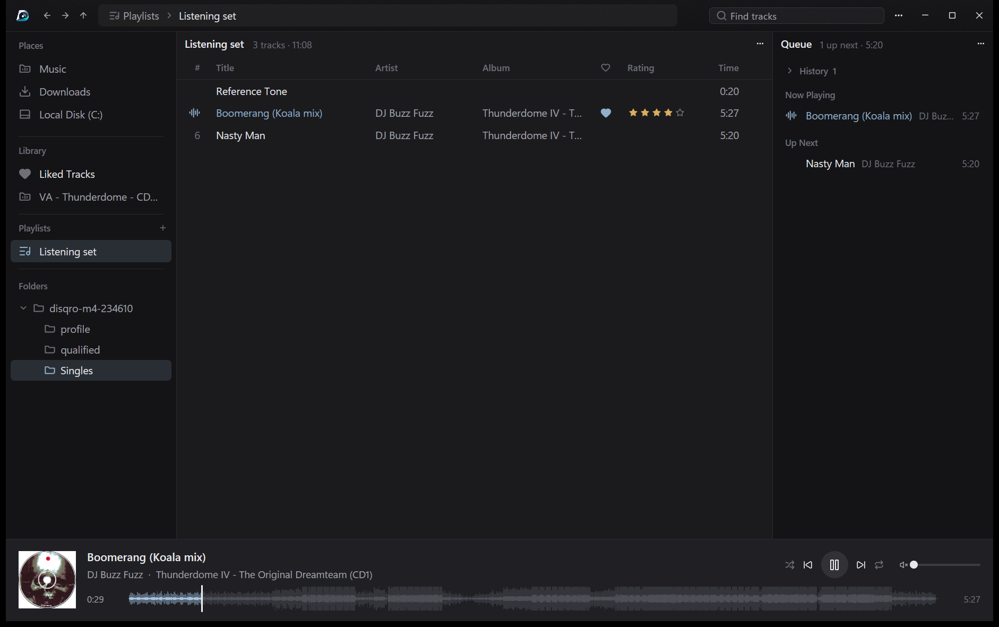

# Persistent library and personal collections

## Listening controls

- Open a folder and choose **Add Folder to Library** from the Recordings panel, or **Add to Library** from its menu in Locations. **Add Music Folder…** is in the Library heading's menu and the empty All Music view. Choose its Library entry to browse the index. **Albums / CDs** opens the disc list. Open a disc to browse its CUE chapters. The address bar, Back and Forward follow indexed locations.
- Ctrl+F searches the current view. Terms include `artist:`, `album:`, `format:`, `liked:yes` and `rating:4` (four or five stars). Click a heading to cycle through ascending, descending and original order.
- Right-click a track-table header to show or hide columns, pin it to either edge, or unpin it. Drag headers to reorder columns within a pin group. CD and grouped-disc views, mixed views, and playlists save their layouts separately. **Reset Columns** restores that view's metadata and the compact Favorite column at the right. Title is always available and scrolls by default.
- Drag a metadata column edge to resize that column. An untouched layout shares spare room between Title, Artist and Album. **Cover** is optional and appears by default in mixed views and playlists. Widening it grows the artwork up to 96 pixels and adjusts row height. When pins crowd a narrow pane, the inner columns scroll at their saved widths. Widening the pane restores their fixed positions.
- Click a heart in **Favorite** or a star in **Rating** to edit one track. Favorite has a blank header and a fixed width of 34 logical pixels. Unliked hearts appear when you hover the row or focus the button. Enter or Space activates a focused heart. Alt+L toggles likes on the selection. Alt+1 through Alt+5 set its rating, and Alt+0 clears it. Liked Tracks includes saved favorites whose sources are missing.
- Ctrl+N creates a playlist. Drag tracks onto its sidebar entry or choose **Add to Playlist** from their context menu. Ctrl-click or Shift-click selects multiple rows. Shift+Up and Shift+Down extend a range from the keyboard.
- Playlists preserve repeated occurrences. In the original, unfiltered order, drag entries before another entry or use Ctrl+Shift+Up and Ctrl+Shift+Down. Delete removes selected occurrences. Browsing and editing a playlist leave the playback queue independent.
- Double-click plays from the selected track within its CD, or from the chosen occurrence in a playlist. A loose recording plays individually. **Add All to Queue** explicitly requests the whole view. A root's context menu offers rescan and removal.

## Storage and identity

The permanent `library.sqlite3` lives alongside the workspace profile. Parsed sheets, audio headers, artwork-related data and waveform analysis can be rebuilt independently. Foreign keys protect tracks referenced by likes, ratings or playlist entries. Removing a root detaches personal tracks. Removing music from disk leaves its personal entries in place.

A physical audio source and its CUE sheet each have a file ID. A standalone track is anchored to its audio file. A chapter is anchored to its sheet and authored number, with a separate part for the recorded lead-in. Source IDs and CD-frame bounds describe playback. Tagged albums include the folder and disc number in their grouping. Playlist entries have independent IDs so two occurrences of the same track can be moved separately.

The index compares recordings before reusing a known path. For FLAC it samples encoded frames and includes STREAMINFO. For RIFF/WAVE it uses the audio format and data chunk. It skips leading ID3v2 tags on tagged streams. Other containers use bounded byte samples. Small payloads are covered in full. Larger ones contribute 8 KiB from the beginning, middle and end. A matching large sample normally also requires the same native file object. A nonzero FLAC stream checksum corroborated by frame samples can survive an editor rewriting the file. With no native ID on either side, the revision stamp and prefix must also match. A verified move requires a unique match, an absent old path, native object identity, size, modification time and content evidence.

When a new recording claims a path, its predecessor keeps its last display path, marks and playlist occurrences as unavailable. For CUE chapters, the source ID and both CD-frame bounds must also agree. Text corrections keep the track ID. Reauthoring a slice creates a different track, and restoring the original slice on the same source can bring its saved entries back. Detached playlist sources are checked on a background worker. The playback queue continues to own its snapshots.

The samples cannot detect every edit between sampled regions. Re-encoding, a tag rewrite in a container without a recognized payload range, or replacing a large file without corroborating identity may create a new ID. Schema 1 audio rows acquire the new baseline only when the previous native object, revision and prefix can be verified. Earlier relationships remain available in personal collections even when their audio cannot be matched.

Each index pass uses a separate connection and a root generation. Each batch checks ownership under the SQLite write lock. A retired scan cannot publish new availability after root removal or a competing scan. A completed walk marks absent paths missing and protects unreadable areas. Header reads take place outside library write transactions. Schema upgrades back up the database and advance the version in the same transaction as the migration. A future or corrupt database produces an error.

## Paging and ownership

The browser owns navigation and search. The table delegate owns the ordered keys, painted rows and selection. The catalog sends personal edits to SQLite and projects the resulting marks and playlist summaries into GPUI. The audio engine consumes independent track snapshots.

Each search or sort materializes one 64-bit key per matching row, with stable tie breakers. Metadata is fetched around the viewport with 64 rows of prefetch. The table trims its cache after 4,096 full rows. The SQLite worker retains the latest pending read per view and up to 128 pending requests in total. Running superseded SQL reads have a progress handler. Views also check the generation before applying an asynchronous result. Personal writes retain FIFO order and shutdown drains accepted edits.

The filesystem walk and album grouping still require memory proportional to the collection being scanned. Substring searches examine the candidate set. Rendering a track page does not materialize the entire library. Explicitly queuing an entire library does.

## Windows verification

An isolated debug profile at volume zero opened a standalone WAV folder and the Thunderdome archive. Registering the archive produced 108 discs and 2,123 logical tracks. One run recorded 309 ms between root registration and the initial index commit. This was a warm-filesystem observation on the real archive. It excludes later tag enrichment and screen presentation.

Opening *The Original Dreamteam (CD1)* displayed 13 tracks. Searching for `artist:buzz` returned three. Sorting by title put *Boomerang (Koala mix)* first. Clicking its heart and fourth star left playback stopped. Two CUE chapters and a standalone WAV were dragged into *Listening set*. Moving the WAV to the first position preserved all three entries. The context menu queued *Boomerang*, and double-clicking started its transport and waveform. Browsing Liked Tracks and navigating back preserved playback. Restart restored the playlist order, four stars, favorite, registered root and paused queue position.

In the same playlist, moving the temporary WAV outside its registered collection retained its entry at position one. Disqro marked the entry unavailable and explained why it could not play. Returning the same file under a new name restored availability and refreshed its filename-derived title. Read-only checks confirmed that its file, track and playlist-entry IDs stayed the same. Two-row keyboard selection and reordering preserved the selected order, and the disc breadcrumb, Back and Forward restored the expected indexed views.

Temporary filesystem tests cover verified same-volume relocation, ambiguous copies, missing and restored sources, root removal during a scan, competing scans and migration rollback. This qualification did not measure audible output, removable-drive latency or six-figure indexed-library performance.
