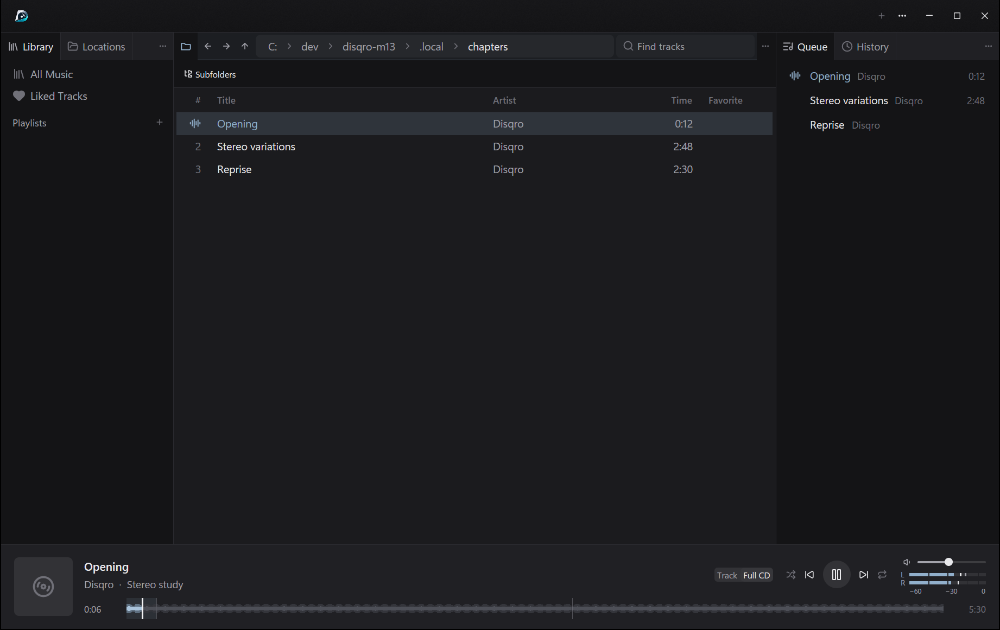

# Windows playback qualification

## Optimized desktop comparison

The untapped control was built from production `main` after PR #10. The candidate used the same Rust 1.99.1 release profile, Cargo.lock, Kira 0.12.6, Symphonia 0.6.1, CPAL 0.18.2, Windows 11 Pro build 26300, Ryzen 7 8845HS and default WASAPI endpoint. Both used fresh profiles, 150% display scale, a 1,240 × 780 logical window and an uninterrupted 44.1 kHz stereo FLAC with varying channel amplitudes at 45% player volume. Every run enabled the same one-second playback trace.

| Window condition | Untapped process CPU | Meter visible | Meter switched off | Max renderer budget used, untapped / visible / off |
| --- | ---: | ---: | ---: | ---: |
| Steady, 25 s | 5.87% | 11.24% | 6.37% | 0.9% / 1.1% / 0.7% |
| Resize, 15 s | 23.89% | 31.68% | 24.33% | 0.7% / 1.5% / 0.8% |
| Minimized, 25 s | 3.62% | 4.81% | 4.43% | 0.7% / 1.7% / 0.9% |
| Restored, 180 s (off run 30 s) | 5.45% | 10.89% | 5.88% | 2.0% / 2.5% / 0.9% |

CPU is process time divided by wall time, expressed as a percentage of **one logical core**. The second CPU column retains the preference while minimized and its meter is unsubscribed. The visible display cost about 0.05 core in steady playback on this machine. During the restored run the median one-second maximum renderer ratio was 0.4% untapped and 0.5% visible. These are sequential single-machine observations with normal OS scheduling variation. [Phase measurements](evidence/signal-monitor/comparison.csv)

Each run kept one decoder and voice, and reported zero device or decode errors. A single unchanged position tick occurred at startup in each trace. During steady, resize, minimized and restored measurement intervals there were zero unchanged ticks or transport commands. The maximum absolute voice-position delta error on the visible run was 8.9 ms, including startup. Decoder-call gaps reached about 112 ms. The maximum decode duration was 1.88 ms untapped and 0.86 ms visible in the restored phase. Window resizing raised private memory temporarily. Across the 180-second restored phase, private memory went from 148.29 to 147.36 MiB untapped and from 147.72 to 147.58 MiB visible. [Untapped trace](evidence/signal-monitor/baseline-trace.csv) · [Visible trace](evidence/signal-monitor/visible-trace.csv) · [Meter off trace](evidence/signal-monitor/hidden-trace.csv)

An early build repainted the waveform roughly 15–20 times per second during steady playback. Caching the waveform view separately brought that to about four paints per second on the 330-second fixture while the meter continued sampling transport updates at up to 25 Hz. Native pointer seeks, CUE perspective changes and Windows accessibility checks exercised the cached and directly rendered paths.

After timing, a compatibility change relocated UI construction within the same functions and moved the waveform view definition. This let the feature integrate with both open UI branches. A fresh release build produced a pixel-identical 271 × 95 physical-pixel crop of the idle volume controls, stereo meter and scale on a private Windows desktop. Both builds use the same signal and measurement code.

## Audio-thread cost

The release microbenchmark processed 500,000 successive 128-frame stereo blocks per pass with the same input. Two subscribed passes averaged **198.7 and 201.9 ns per block**. Two unsubscribed passes averaged **3.5 and 2.2 ns**. At 48 kHz each block spans 2.667 ms. These are means of the isolated effect, separate from the real-device renderer observations above. The tap object occupies 496 bytes and its shared state occupies 56 bytes on Windows x64, excluding allocation headers and reader handles. Capacity stays fixed across callback sizes and sample rates.

## Process-specific output during resize

Both executables played a 48 kHz PCM source with 375 Hz left and 750 Hz right at 45% player volume. Windows process-loopback capture targeted the individual player PID and recorded stereo signed 16-bit PCM at 48 kHz for 25 seconds. Each run issued 250 window resizes among 720, 900, 1,240 and 1,500 logical pixels wide. The capture covered setup, active resizing and steady output. We removed the first and last second and fit a single sine phase and amplitude per channel across 1,102,560 frames per run.

| Observation | Untapped | Meter visible |
| --- | ---: | ---: |
| Capture packets / discontinuity flags / silent packets | 2,497 / 0 / 0 | 2,497 / 0 / 0 |
| Maximum absolute residual, L / R (16-bit counts) | 2.172 / 2.144 | 2.172 / 2.144 |
| RMS residual, L / R (16-bit counts) | 0.511 / 0.513 | 0.511 / 0.513 |

A phase-aligned comparison of 1,102,432 frames from the two captures differed by at most three 16-bit counts per channel. The historical one-second distortion did not reproduce in these digital captures. The comparison supports continuity through the Windows process-loopback boundary for this test. Physical speakers, driver underruns after capture, exclusive output and device unplug/replug remain unverified. [Capture measurements](evidence/signal-monitor/loopback.json)

## Signal, codecs and controls

- **Accuracy.** Silence measured −∞ dBFS. A constant ±0.5 measured −6.0206 dBFS RMS and peak. A sampled full-scale sine measured −3.0103 dBFS RMS and 0 dBFS peak. The two-channel fixtures covered different levels and polarity, a 1.25 over-range channel, NaNs, infinities, signed zero, warm-up, callback partitioning, output-rate reset and peak-hold expiry. The effect preserved every input bit in the pass-through fixture.
- **Device output.** Generated stereo recordings played through the native application and CPAL as 32 kHz WAV, 96 kHz FLAC and ALAC, 44.1 kHz AIFF, MP3 and Vorbis, and 48 kHz AAC and Opus. Process-loopback RMS retained the expected approximately 2:1 channel ratio in every case. The independent FFmpeg decoder test passed lossless seek comparisons. On its compressed AAC fixture, reopening and seeking yielded a peak sample difference of 0.147 from linear decode. Sample-exact AAC seeking remains an existing limitation. [Per-format measurements](evidence/signal-monitor/codec-output.csv)
- **Transport.** A real-device test observed active signal, digital silence after gain-to-zero and pause, signal after unmute/resume, four rapid seeks, silence after stop and signal on a 96 kHz replacement. A contiguous CUE join kept its original voice epoch. A separate captured-renderer test matched the source stereo samples on both sides of the join.
- **Presentation.** At 1,240 × 780 and 720 × 460 logical pixels, Windows UI Automation found both named channel meters. Switching between Track and Full CD seven times, hiding/reopening Levels and muting/unmuting kept one decoder and one voice. The profile retained the visibility setting. An additional real-disc run exercised eight pointer seeks through the rendered waveform, cold background waveform analysis, natural playback and interactive controls. It ended when the window was closed. No device or decode errors were reported.



[Compact CUE player](evidence/signal-monitor/compact.webp) · [Native meter during music playback](evidence/signal-monitor/music-levels.webp)

## Repeating the checks

The following commands run from the repository root on Windows. The codec fixture needs FFmpeg on PATH. The native transport fixture opens the default endpoint with the test main fader silenced downstream of the signal observer. The longer soak expects one recording or a contiguous CUE program with at least ten minutes remaining. It uses the production streaming path and tap, then silences the test main fader before device output.

```powershell
.\build.ps1 -Release
cargo test --locked --release signal::tests
cargo test --locked --release time_observation -- --ignored --nocapture
cargo test --locked --release encoded_formats_open_decode_and_seek -- --ignored --nocapture
cargo test --locked --release output_levels_follow_transport_and_contiguous_chapters -- --ignored
$env:DISQRO_SOAK_SOURCE = 'C:\fixtures\disc.cue'
$env:DISQRO_PLAYBACK_TRACE = Join-Path $env:TEMP ("disqro-soak-" + [guid]::NewGuid() + ".csv")
cargo test --locked --release sustained_output_observation -- --ignored --nocapture
```

To repeat the desktop comparison, build production and the PR from separate worktrees and retain each release executable. Generate the shared stimulus once.

```powershell
ffmpeg -f lavfi -i 'aevalsrc=0.35*sin(2*PI*220*t)*(0.68+0.32*sin(1.7*t))+0.12*sin(2*PI*330*t)|0.2*sin(2*PI*277*t)*(0.68+0.32*sin(0.9*t))+0.09*sin(2*PI*415*t):s=44100:d=330' -c:a flac 'Stereo study.flac'
```

For each launch, point `DISQRO_PROFILE_DIR` at a fresh directory with `workspace-v1.json` containing `{"volume":0.45,"show_levels":true}`. Use `false` for the off run and a new trace filename each time. Pass the FLAC path as the first argument. After callbacks appear, allow four seconds to settle. Sample Win32 process times and private bytes at phase boundaries. Cycle the four widths about every 60 ms for the resize phase, then minimize and restore the window. Divide the trace’s permille values by ten for percent of renderer budget.
