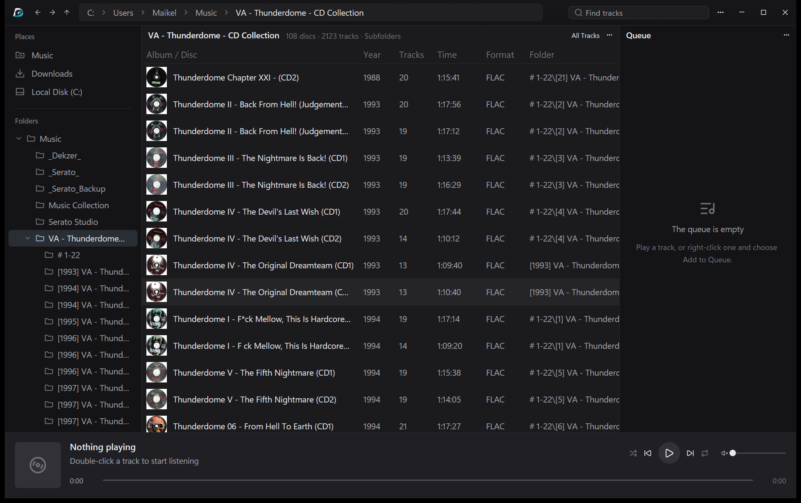

# Browsing a music collection

Open the collection root from Places, the address bar or the folder picker. Disqro starts showing tracks as it finds them. The Recordings panel menu remembers **Include Subfolders**. Turn it off to browse just the selected directory.

- **Albums / CDs** shows the artwork, title, year, track count, duration, format and relative folder for each disc. Double-click a disc or press Enter to see its tracks. The button above the table returns to the discs.
- **All Tracks** uses the existing customizable table. Click a heading to sort across the collection. Ctrl+F searches titles, artists, albums and paths. Combine terms such as `artist:gizmo format:flac` or `album:thunderdome`.
- **Queue a selection** by Ctrl-clicking tracks or Shift-clicking a range, then choosing Play Next or Add to Queue from the selection’s context menu. Entries follow the displayed order. Open Containing Folder selects the same chapter in its original folder. Browsing, searching and refreshing leave the playing queue independent.



## What counts as a disc

A CUE program owns its authored track sequence and source-frame boundaries. For ordinary tagged files, the grouping uses the containing folder, album and disc number. Untagged files fall back to the folder. Album names alone never merge editions across folders. Disc folders named CD1 or Disc 2 supply a disc number when interpreting a sheet. The Albums / CDs list shows one row per disc.

The walker checks each referenced source on every visit. A missing file in a multi-file sheet takes only its own tracks out of the playable results. An equivalent available sheet shares a program when the entire sequence agrees on canonical physical sources, numbers, boundaries, titles, artists and albums. Covered audio images disappear from the flat list even when their sheets are discovered in another directory. Recorded lead-ins remain playable. A rescan can restore missing sources.

## Ownership and storage

- Two discovery workers allow a newer local request to proceed while a previous filesystem call is blocked. They share a single pending request slot. Each scan publishes through a bounded channel. Navigating closes the old receiver and invalidates its generation. An iterative walk skips linked directories and Windows reparse points. Network or filesystem calls already inside the operating system can take time to return.
- The browser publishes playable records before audio-header enrichment. It sends additions, replacements and removals. Filtered and sorted tables share immutable track allocations with queued entries. Virtualization limits rendering to the visible rows. Album artwork is requested on demand and reduced to 96-pixel thumbnails before upload.
- The versioned SQLite database under the profile’s `Cache` directory holds rebuildable data. Source-header records and parsed CUE programs are checked against file size and modification time. A transaction replaces an entire sheet and its indexed chapters. Folder enumeration and source availability remain authoritative. Browsing works when the cache is unavailable.
- Waveform overviews use the physical source and exact CUE range, file revision and cache-format version. Equivalent ranges can reuse an analysis across sheets. Adjacent disjoint chapters still have individual overviews. The player holds its current overview in memory.
- The profile uses atomic replacement, a process-level file lock and ordered background commits. Quit obtains a queue snapshot after pending transport commands, then waits for the final commit. Recovery preserves corrupt bytes and reports their location. A second process uses a named session file if it cannot acquire the primary workspace.
- The transport keeps FIFO ordering across queue edits and control actions. Adjacent seeks or volume updates coalesce in their pending slot. A seek targets the queue entry displayed when issued. The 64-slot queue returns an error on saturation and the UI can report it. Zero volume uses Kira’s exact silence value.

## Windows qualification, 19 November 2026

The optimized x64 application ran on Windows 11 Pro build 26300, Ryzen 7 8845HS, at 150% scaling. The local Thunderdome archive contained 211 subdirectories, 108 FLAC images totalling 60.86 GiB and 214 CUE sheets. An independent count found 108 available programs and 106 sheets referencing absent rips. The available programs specified **2,086 numbered tracks and 37 recorded lead-ins**. Disqro displayed all **2,123** in **108 discs**.

| Observation | Result |
| --- | ---: |
| First 20 tracks applied to the table, empty Disqro cache | 27.9 ms |
| First captured window with disc rows, from process launch | 391 ms |
| Full discovery and header enrichment, empty Disqro cache | 392 ms |
| Full refresh during playback | 89 ms |
| New process reopening the same root with the populated cache | 88 ms |
| Working set at discovery completion / process peak to that point | 104.2 / 106.4 MiB |
| Largest sampled window-message response during startup and discovery | 17.4 ms across 15 probes |
| Native table scroll on the playing collection | 16 distinct table captures in 16 scroll steps |

These are individual desktop runs. Windows filesystem caching remained enabled. The table and completion timers begin at the browse request. The first captured row includes process launch and capture overhead. Window-message probes measure UI-thread dispatch. Scroll samples measure changes in rendered content. Frame pacing and physical display latency need separate measurements.

From the root, opening *Thunderdome IV – The Original Dreamteam (CD1)* exposed 13 numbered tracks. Playing track 7, *Boomerang (Koala mix)*, selected DJ Buzz Fuzz, the disc artwork and its own waveform. While it played, a refresh returned 2,123 rows, switching off subfolders returned zero, and turning them back on restored the collection. Searching `artist:gizmo format:flac` found 25 tracks across discs. The table sorted those results by title. The player and queue remained on *Boomerang*. [CUE playback](evidence/thunderdome-cue-playback.png) · [Filtered tracks](evidence/thunderdome-filtered-tracks.png)

After a restart the original 13-entry queue returned paused at 7.452 seconds. Ctrl-selecting two tracks and using Add to Queue produced 15 saved entries. Open Containing Folder revealed the selected CUE chapter. A shell integration check removed only Disqro’s icon, delivered Windows’ registered TaskbarCreated message and verified the restored icon rectangle. A real Explorer process restart remains unqualified.

The Rust suite passed 33 default tests. Both opt-in tests passed separately. FFmpeg fixtures exercised seven encodings, including sample comparisons for the lossless cases. In an optimized synthetic walk, 1,011 fixture discs produced 100,089 logical tracks in 843 ms. Grouping the resulting records took 32 ms and a two-field filter took 22 ms. This fixture measures scanner and projection costs with placeholder audio files. The Windows UI and memory measurements above used real FLAC images.

To repeat the desktop timings, set `DISQRO_TRACE_DISCOVERY=1`, choose a fresh `DISQRO_PROFILE_DIR`, and launch the release executable on a collection root. The trace on standard error reports first table publication and scan completion. Reopen with the same profile to measure reuse. Run the opt-in checks individually with these commands.

```powershell
cargo test --release --locked six_figure_collection_projection -- --ignored --nocapture
cargo test --release --locked encoded_formats_open_decode_and_seek -- --ignored --nocapture
```

## Release boundary

Playback qualification here used application volume zero. The observed transport continued advancing during discovery. Audible continuity, buffer underruns on a physical output, device-loss recovery, cross-file gapless playback, network-drive latency and sample-accurate AAC seeking remain open.

The browser still holds the selected collection’s track references in memory. A paged global library and verified relocation of moved sources are the next storage milestones. Persistent identities currently use paths and authored CUE segments. User-owned playlists and ratings need durable identities and an explicit relocation policy. Waveform table cells, shared multiresolution analysis across disjoint chapters and independent visualizer panels remain future work.
