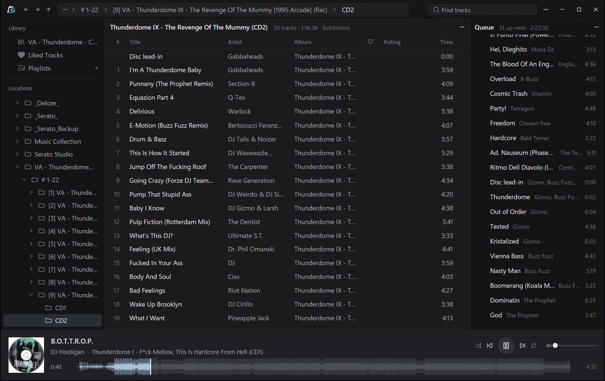
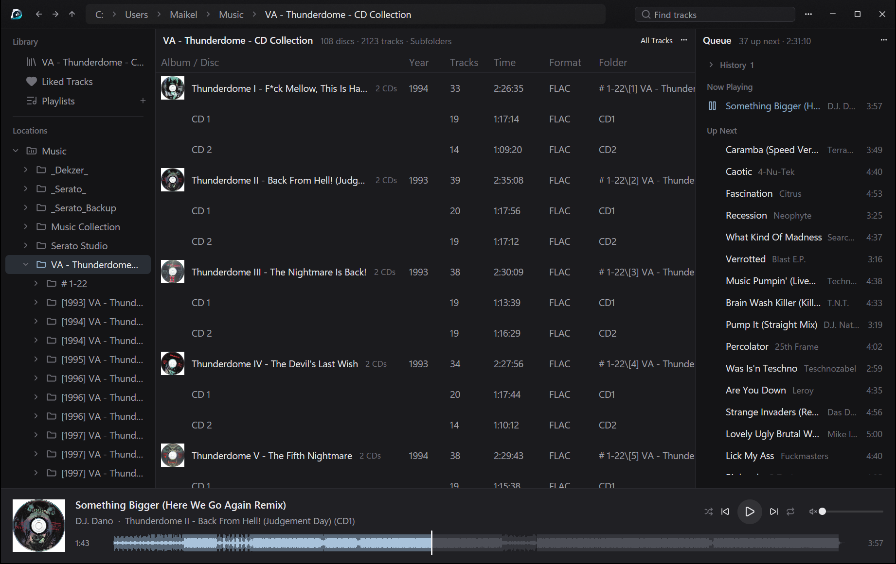
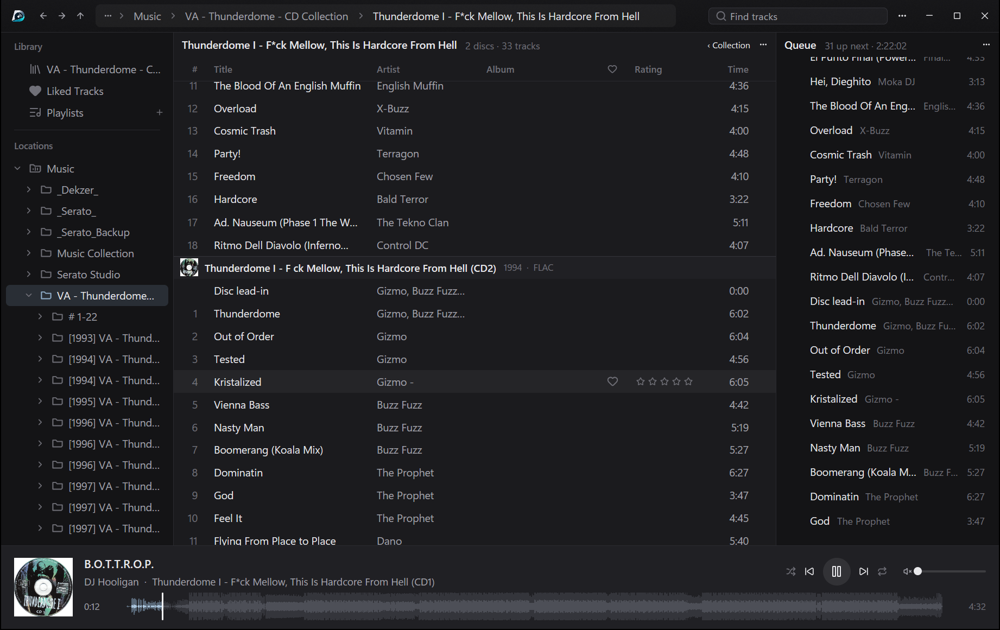
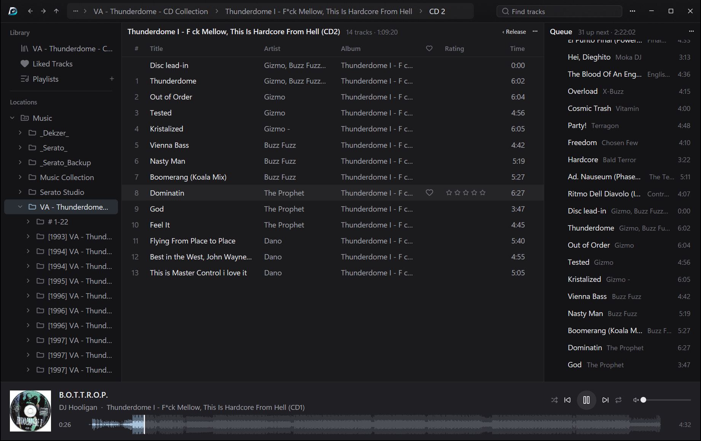

# Releases and Locations

**Library** holds the indexed collections, Liked Tracks and playlists. **Locations**, a panel of its own, holds the Places, and every Place opens in place to show its own folders. A collection can also tell which of its CDs belong to one release, so a two-CD album appears as one release with its CDs beneath it, and **Play Release** plays them in order.

## Locations

C:, Downloads, Music, other available drives and your own Places are roots of one tree. The arrow opens a branch and the name opens its folder. The address bar and Parent reveal the ancestors of the destination. Back and Forward preserve the tree's manual expansion. Library and Locations share a tab group by default and can stack vertically in the same sidebar. [Controls and menus](listening-workspace.md#library-and-locations)

**Add Music Folder** is available from the Library menu, the collection menus and the empty All Music view. **All Music** shows the complete index. Each registered collection has its own row.

## What counts as a release

A **disc** is a CUE program or a tagged album in one folder, as before. A **release** is two or more discs that Disqro can show belong together:

- **Disc folders.** A folder whose music lives entirely in subfolders named as discs, such as `CD1`, `CD 2`, `Disc 3` or `CD1 - Electronic Overdrive`. Each disc folder holds exactly one disc, the numbers run from 1 without gaps, and a disc tag, if present, agrees with its folder.
- **Disc tags.** Tagged discs in one folder that share an album and are numbered 1 to n by their disc tags, with no untagged disc of that album beside them.

In both cases the discs' titles must agree once their disc markers are removed: `Thunderdome I - F*ck Mellow… (CD1)` and `Thunderdome I - F ck Mellow… (CD2)` agree, while a title that names a different disc number than its folder does not. A subtitle that only one disc carries, such as `(CD2) - Hardcore - Evil Activities` or the `Filthy Kicks` of `CD2 - Filthy Kicks`, is shown beside that CD. Years are not compared, because the sheets of one release can disagree; the release shows the year of CD 1.

Everything else stays a set of independent CDs. Volumes and editions in neighbouring folders never merge, nor do compilations credited to the same artist, a remaster in its own folder, a folder with a gap such as CD1 and CD3, a disc folder holding two programs, or a release folder that also holds other music. A missed release is better than a wrong one.

In the Thunderdome archive this finds 48 releases of two to four CDs and keeps three single CDs apart: 108 discs, 2,123 tracks, as before. The second CD of *Chapter XXI* says 1998 in its folder and 1988 in its sheet; the release still forms and sorts by its first CD.

## Browsing

**Albums / CDs** shows a release with its cover, title, year, number of CDs, tracks and time, and its CDs beneath it as `CD 1`, `CD 2` with their own tracks, time and folder. Single CDs keep their own row. Double-click a release to open its page, or a CD to open that CD. There is no third view and nothing to expand: the CDs are always listed.

A release page lists every CD of the release under its section headers, in the shared track table, with search, sorting and selection as everywhere else. A CD of a release goes up to its release, and the release up to the collection. The address bar names the path: `Collection › Thunderdome I – F*ck Mellow… › CD 2`. Back and Forward restore each page with its search, selection and scroll position.

## Listening

| Action | Result |
| --- | --- |
| Double-click a chapter | Play from it within its own CD. The queue ends with that CD. |
| **Play CD** | Play the CD from its recorded lead-in, in authored order. |
| **Play Release** | Play CD 1, then CD 2 and any further CDs, each in authored order with its own lead-in, then stop. Offered on a release, its CDs, their section headers and the release page, and only where a release of several CDs exists. |
| **Play Collection** | Play the whole collection as displayed: several releases and loose recordings. Liked Tracks, playlists and single folders call it **Play All**. |
| **Continue This CD** | Unchanged: the rest of the playing CD follows the current occurrence. A release page offers it while one of its CDs plays. |

Play CD and Play Release replace the queue, turn shuffle off and repeat-one off, and give every chapter its own queue occurrence. Repeat All still repeats the whole queue. Opening a release, a CD, the collection or a folder, clicking artwork, Back, Forward and expanding folders never change the queue or what plays.

## Ownership and storage

Release detection is one pure function over a collection's discs: their folders, titles and disc numbers. Folder browsing applies it to the discs of the open scan each time a batch arrives. The library applies it on read to the album rows of the registered collection, so the database needs no migration and no new identity: tracks, CDs, likes, ratings, playlist entries, relocation and missing sources are untouched, and a rescan or a renamed folder simply changes the result. Play Release on an indexed release reads its CDs' track keys in disc order through the same SQLite worker as Play CD.

Regrouping the 206 discs under the listener's Music folder takes about 0.33 ms in an optimized build, and building the release rows 0.08 ms. Release detection allocates one key per disc and reads titles only of discs that could form a release.

Locations lists folders off the interface thread, one listing task per Place, so a sleeping network drive holds up only its own branch. Each tree entry is identified by its Place and path, so a folder reachable from two Places opens and closes separately under each. Open folders and the Playlists state are saved with the workspace; the dock layout keeps the panel's earlier name, so saved layouts still load.

## Windows qualification, 21 November 2026

An optimized build ran on Windows 11 Pro build 26300 at 150% scaling with isolated profiles and application volume zero, driven through the window. The listener's music files and sheets were only read.

- **Locations.** Music expanded in place, without a second Music entry. The arrow opened the Thunderdome archive without leaving Music; its name opened the archive with the tree, its scroll position and the breadcrumbs in agreement. A path typed into the address bar four levels down opened `# 1-22`, `[9]` and `CD2` and nothing beside them, with CD2 highlighted. Liked Tracks kept the tree without a highlight and Back restored it. Renaming, dragging a Place to the top and back to the end, removing and restoring a default all worked, and a folder outside every Place appeared under a dimmed `C:` until Music was opened again. After a restart the Places, the open folders, the folder and the paused queue returned. With 15 playlists the Library stopped at half the sidebar and scrolled on its own under its heading; closing Playlists gave the space back to Locations, and the closed state was saved.
- **Folder releases.** The archive as Albums / CDs showed 108 discs and 2,123 tracks under 48 releases and 3 single CDs. *Thunderdome I* opened as a page of 2 discs and 33 tracks. **Play CD** on its CD 1 queued 19 entries. **Play Release** queued 33: CD 1's lead-in and 18 chapters, then CD 2's lead-in and 13 chapters, shuffle and repeat off. With the last chapter of CD 1 seeked to its end, CD 2's lead-in and first chapter followed on their own with CD 2's artwork. At the end of CD 2 playback stopped with nothing up next; *Thunderdome II* did not start.
- **Navigation during playback.** Returning to the collection, opening *Thunderdome II*'s CD 2, going up to its release, Back, Forward, opening a deep folder and Liked Tracks left the saved queue at the same 33 entries and current chapter.
- **Indexed releases.** After **Add to Library** on the archive, the collection showed the same 108 discs and 2,123 tracks under the same releases. The indexed *Thunderdome II* page offered Play CD and Play Release without a redundant Open Release; Play Release queued 39 entries from exactly two sheets, CD 1 then CD 2.

Formatting, warnings-denied Clippy and all 69 default tests passed. New tests cover the release rules and the cases that must stay apart, the order of release rows, the indexed release listing, search within a release page, likes surviving a rescan, and the queue boundary between two discs.

## Not covered

- A disc folder opened on its own, without its parent's subfolders, does not know its siblings, so it offers Play CD only.
- Discs of one release that are separate CUE sheets in one folder, distinguished only by their sheets' titles, are not grouped; `REM DISCNUMBER` is not read.
- Album artists are not compared: CUE chapters carry their own performers, and the folder rules already keep releases apart.
- Moving from one CD's file to the next opens a new decoder. The sequence was verified; audible continuity and gapless output between discs remain unqualified, as for any two files.
