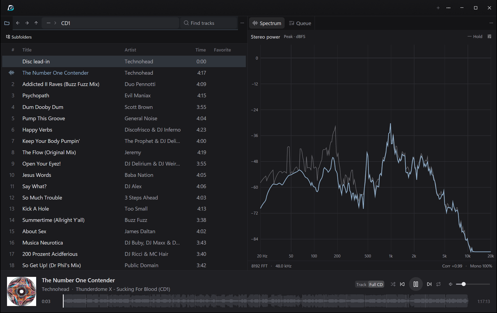
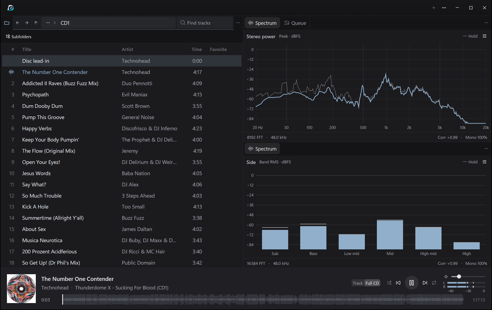

# Windows spectrum qualification

Mission 14 adds stereo capture and FFT analysis to the Mission 13 main-track observer. The audio tests exercise Kira's real Windows backend, while the desktop measurements exercise the release player, its dock, browser, waveform and native rendering. The signal-path diagram, definitions of dBFS and Pawse source comparison are in the [architecture report](realtime-spectrum.md).

## Desktop conditions

Both builds used optimized Rust 1.99.1 x64 on Windows 11 Pro build 26300, a Ryzen 7 8845HS, the same 48 kHz shared-mode WASAPI endpoint and the same stereo FLAC/CUE disc. The screen was set to 2560 × 1600 at 240 Hz and 150% scaling. Each trial started with a fresh profile, the Music Browser and Full CD waveform, a 1240 × 780 logical window, 22% player volume and a one-second diagnostic trace. The baseline is the production Mission 13 player with its levels meter off. All CPU percentages express time on one logical core. Win32 process/thread time and private bytes include normal application activity. Windows session gain lies downstream of the tap.

The standard trace used 8192 samples at 30 Hz. The second instance used the side channel, band RMS, 16384 samples and 15 Hz. A separate Win32 desktop kept the measurements independent of input to the user's window. Both GPUI and the real audio device remained active. Timings are observations from single trials on this machine. [Per-phase measurements and repeat trials](evidence/spectrum/comparison.csv) · [Mission 13 reference](playback-qualification.md)

| Steady playback, 25 s | Process CPU | Window thread CPU | FFT pairs / publications | Plot paints | Peak stereo FFT | Max publish to first paint |
| --- | ---: | ---: | ---: | ---: | ---: | ---: |
| Mission 13 | 10.30% | 2.68% | 0 / 0 | 0 | — | — |
| Candidate, no visualizers | 4.43% | 1.25% | 0 / 0 | 0 | — | — |
| One Spectrum | 31.90% | 26.41% | 750 / 750 | 750 | 0.951 ms | 12.708 ms |
| Two independent Spectrums | 30.23% | 26.04% | 1125 / 1125 | 1510 | 1.280 ms | 12.726 ms |
| One Spectrum and levels | 30.47% | 27.10% | 750 / 750 | 751 | 0.916 ms | 12.590 ms |
| Two Spectrums and levels | 36.66% | 32.91% | 1125 / 1125 | 1530 | 0.752 ms | 16.344 ms |

Visible configurations captured about 1.20 million stereo frames in 25 seconds, regardless of panel count. With two windows of different FFT lengths there were 45 stereo FFT pairs per second. Matching analysis windows share a transform, which the deterministic worker test verifies. GPUI can repaint both plots during a single workspace frame, hence the extra canvas paints. The publish-to-paint timer starts at worker publication and ends at the first paint of that reading. It excludes the analysis window, physical display scan-out and endpoint latency. The configured analysis rates top out at 60 Hz. These runs do not establish an end-to-end 120 Hz interaction guarantee.

| Stress phase | Mission 13 process / UI | Candidate off | Two Spectrums and levels |
| --- | ---: | ---: | ---: |
| Continuous resizing, 15 s | 26.28% / 22.02% | 33.44% / 28.97% | 46.67% / 41.89% |
| Minimized, 20 s | 3.12% / 0.86% | 4.45% / 1.72% | 4.21% / 1.01% |

We repeated the off and baseline runs in the opposite order to examine the initial resize difference. Resize process CPU was 27.61% candidate and 32.77% baseline on the repeat, reversing the first result. Steady candidate CPU repeated at 4.50% and baseline at 3.37%. These samples establish a range for the two players on this desktop. They do not establish a consistent resize regression or a steady-state speedup.

The two-panel run issued 238 resizes across four widths. Its largest stereo FFT time during resize was 4.988 ms, and the largest publish-to-paint delay was 31.706 ms. Private memory peaked at 348 MiB during resizing and finished the minimized interval at 111 MiB. Mission 13 reached 382 MiB during resizing. With the window minimized, Spectrum recorded zero captured frames, FFTs, publications and paints while audio callbacks continued. Every desktop comparison above recorded zero dropped capture frames, decoder errors, reported device errors and losses from the handled-device-error queue.

The original implementation experiment cached the whole player. On a full disc that increased the waveform's per-segment paint count from about 20/s to about 400/s in steady playback. Removing that cache brought it back to 20/s with Spectrum visible. Only Spectrum's own plot uses a cached entity boundary. A waveform count represents a segment paint and can increase substantially during a resize.

## Audio callback cost and output continuity

Two optimized passes exercised 500,000 Kira effect calls per configuration. Each block held 128 stereo frames and represented 2.667 ms at 48 kHz. The producer ring was drained between timed batches. The following are means in nanoseconds per block. Callback diagnostics were disabled for this microbenchmark.

| Observers | Mission 13 | Mission 14 |
| --- | ---: | ---: |
| None | 2.2–3.5 ns | 6.4–6.6 ns |
| RMS and peaks only | 198.7–201.9 ns | 215.8–220.1 ns |
| PCM only | — | 30.4–34.1 ns |
| RMS, peaks and PCM | — | 241.1–247.4 ns |

In the two-panel-plus-meter steady trial the maximum Kira renderer time was 1.0% of its callback budget. That ratio measures callback work. It cannot count endpoint underruns.

A separate trial captured the individual Windows player process for 25 s while issuing 250 resizes. The source had a 375 Hz sine on the left and 750 Hz on the right. The candidate ran a 60 Hz trace, a 15 Hz side-band display and the levels meter. We trimmed one second from each end and fit one amplitude and phase to each channel over the remaining 1.10 million frames. The first comparison had different output amplitudes. Reading the original Core Audio sessions showed baseline gain 1.00 and candidate gain 0.12. The paired repeat ran the builds sequentially from the same executable path, confirmed gain 1.00 and mute off for both, and used 8% player volume.

| Process-loopback observation | Mission 13 | Mission 14 |
| --- | ---: | ---: |
| Capture packets / discontinuity flags / silent packets | 2498 / 0 / 0 | 2497 / 0 / 0 |
| Fitted left / right amplitude, signed 16-bit counts | 419.435 / 209.722 | 419.435 / 209.722 |
| Max absolute residual, left / right | 1.975 / 1.959 | 1.975 / 1.959 |
| RMS residual, left / right | 0.500 / 0.498 | 0.500 / 0.498 |

The matched output establishes stereo tone continuity at the process-loopback boundary throughout these resizes. It does not measure downstream driver underruns, DAC behavior or physical speaker output. [Loopback measurements](evidence/spectrum/loopback.json)

## Docking, silence and transport

The CPAL transport fixture separately verified that the PCM epoch remains stable across an adjacent CUE chapter and advances on seek. It exercised mute, pause, resume, stop, a burst of seeks and replacement with a 96 kHz source. Synthetic effect and worker fixtures verified reset and recalibration when the output sample rate itself changes. [Transport fixture](../src/audioTests.rs) · [Capture and rate fixtures](../src/spectrumWorker.rs)

Native Windows UI Automation opened Spectrum from the panel picker, switched to Right and the bass range, opened a second instance, chose Bands, and split the tab group down. Selecting the Queue tab released the hidden plot's demand. Two successive two-second intervals showed no capture or FFT while callbacks continued. Reselecting the tab resumed the signal. A restart restored the two distinct IDs, split and settings. Closing both panels left the same decoder producing audio and capture stopped. The browser was filtered during playback, Track and Full CD were switched, and eight waveform seeks produced eight replacement voices with zero device, decoder or capture errors. Three unchanged position samples occurred across those seeks. The interactive trace recorded a single maximum renderer budget fraction of 55.2% with UI Automation attached. The steady trials above used the final release build without an attached automation client. [Interaction](evidence/spectrum/interaction.csv) · [Restart and close trace](evidence/spectrum/restored-trace.csv)

A generated anti-phase tone followed by ten seconds of digital silence tested settling. Across the four-second settled interval, 192,000 frames were observed with zero transforms, publications or plot paints. The two-second tone intervals before and after silence each produced 60 updates. This lets a visible panel resume automatically on new audio. A hidden panel also releases its PCM demand. [Silence and resumption](evidence/spectrum/silence.json) · [Interactive trace](evidence/spectrum/interaction-trace.csv)





The compact screenshot records the restored workspace from the interactive build, before the whole-player caching experiment was removed. The two larger screenshots above use the final rendering path. [Compact restored layout](evidence/spectrum/spectrum-compact.webp)

## Sustained playback

The real-device engine fixture completed 600.007 s, reaching chapter 4 of the long CUE with one open decoder, one voice and a stable signal epoch. Its 599 complete trace intervals recorded 28,761,600 captured stereo frames, 17,958 FFT pairs, no capture drops, zero unchanged position ticks and zero device or decoder errors. The test read 14,474 non-silent spectra and 14,854 non-silent stereo levels. Maximum Kira renderer budget use was 2.9%. The test process used 15.75 CPU-seconds over 599.33 sampled wall-seconds and peaked at 5.75 MiB private memory. The test fader silences the physical output downstream of the tap. The desktop and loopback trials use normal player gain. [Engine trace](evidence/spectrum/engine-soak.csv) · [Process samples](evidence/spectrum/engine-process.csv)

The first native sustained trial played through a natural CUE transition using one decoder and one voice. Callback and capture activity continued through 443 seconds. At 444 seconds the trace recorded a transport command, followed by two intervals without callbacks and a process exit. It recorded no decoder error, device error or dropped PCM frames. The trace does not identify the initiator of the command. We retained the incomplete trial and repeated the test on an isolated Windows desktop. [First native trace](evidence/spectrum/first-desktop-soak.csv)

The second native run was stopped at the listener's request after 184 seconds. It captured 8,823,936 stereo frames and published 5,499 readings with one decoder, one voice, zero capture drops and zero decoder or device errors. Its trace contains callbacks in every interval. The ten-minute pass applies to the real-device engine test. An uninterrupted ten-minute run with the visible native window remains unverified. [Second native trace](evidence/spectrum/desktop-soak-stopped.csv)

## Integration review

Both open UI branches change panel removal and own presentation state in their workspace. A merge preview against each branch found one textual conflict in `Pane::on_removed`. In isolated preview trees we kept the branch's `sync_display` call, used its existing presentation hook for active tabs and hidden sidebars, and omitted the obsolete `PanelType::toolbar` field in Spectrum's registration. The two previews passed `cargo check --locked --release --all-targets` and built optimized executables. Production Mission 14 targets the current main-branch panel contract. [Workspace PR #11](https://github.com/maikeleckelboom/disqro/pull/11) · [Workspace PR #12](https://github.com/maikeleckelboom/disqro/pull/12)

Both adapted UI previews also played the test disc with two independently configured Spectrum panels. Each recorded 1,125 publications in 25.02 seconds, zero capture drops and zero device or decode errors. Their plots painted 1,518 and 1,528 times respectively. [Compatibility trials](evidence/spectrum/comparison.csv)

## Reproduction

Use the repository-pinned Rust toolchain on Windows. The desktop measurement helper uses Python 3 and Pillow. Supply a FLAC or CUE that references accessible media and use a new output directory for each trial. Its CSVs contain process CPU, window-thread CPU, private memory, callback and decode counters, capture frames and drops, transform and publication counts, and maximum timings. Its screenshot comes from the running native window. [Desktop harness](../tools/qualifySpectrum.py)

```powershell
cargo build --locked --release
cargo fmt --all -- --check
cargo clippy --locked --release --all-targets -- -D warnings
cargo test --locked --release
cargo test --locked --release signal::tests::time_observation -- --ignored --nocapture

$disc = 'D:\Music\disc.cue'
cargo build --locked --release --features qualification
python tools/qualifySpectrum.py two target/release/disqro.exe $disc .local/spectrum-two
python tools/qualifySpectrum.py soak target/release/disqro.exe $disc .local/spectrum-soak
$env:DISQRO_SOAK_SOURCE = $disc
$env:DISQRO_PLAYBACK_TRACE = "$PWD/.local/engine-soak.csv"
cargo test --locked --release audio::tests::sustained_output_observation -- --exact --ignored --nocapture
```

The optimized suite passed 126 tests with five opt-in fixtures. The real-device transport, codec/seek, timed observer and sustained fixtures were exercised separately. Formatting and all-target Clippy passed. Tests cover sine amplitude and step size, FFT frequencies and leakage, DC and Nyquist, rate and window changes, fractional smoothing, display tilt, peak timing, channel separation, anti-phase content, mono retention, capture overflow and source discontinuity.
