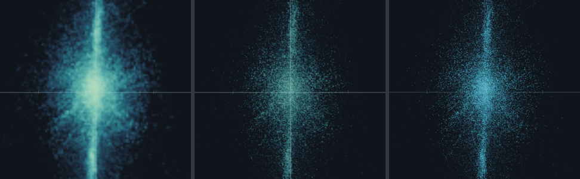
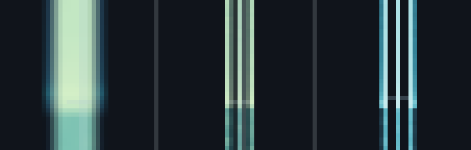
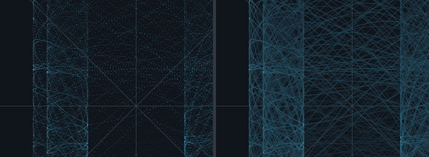

# Stereo Field rendering on Windows

The native Stereo Field now resolves three mid/side ridges 0.008 side units apart in a 773-device-pixel plot. The identical-L/R fixture draws a single bright center column. Both observations use the same paired PCM, display gain and sample-time persistence as their baselines.

The images below run from left to right through the original Mission 15 renderer, the subsequent high-resolution PR head, and this revision. The music crops preserve the native pixels. The ridge crops use 6× nearest-neighbor magnification.





## Where detail was lost

| Stage | Observation |
| --- | --- |
| Grid and deposition | The original square contained 256² floats. At a physical diameter of 773.5 px, a cell spanned 3.02 display pixels. Bilinear deposition spreads each sample over at most two cells per axis. Enlarging those cells merged the three nearby ridges. The later PR head used 2048² for density and 1024² for trace even in a compact dock. It recovered much of the missing geometry. |
| Temporal accumulation | Both baselines accumulate in audio time. Replaying the same 96,000 post-observer frames with the same 240 ms half-life produced different spatial profiles. The decay controls how long occupancy remains visible. The resize and half-life tests account for that mass independently. |
| Reduction and tone | The high-resolution head converted individual cells to eight-bit intensity before selecting the brightest contributor per presentation pixel. Multiple low-density arrivals could therefore produce exactly the same output as one arrival. A regression fixture now deposits weights 3 and 5 in adjacent source cells and checks the compact pixel against the response for 8. |
| Color and compositing | The head applied a second brightening curve to intensity, interpolated a six-stop color ramp, and used the same brightening curve for alpha. The grid was then drawn over the brightest signal. The revised LUT separates dwell compression from color, blends very low occupancy over the guide, and paints the signal last. |
| Atlas and filtering | GPUI 0.3.12 inserts a BGRA sprite into its atlas, snaps both destination edges independently, and uses a linear minification/magnification sampler in the Windows D3D11 backend. The original image magnified analysis cells. The later head already targeted physical output size, but fractional crop origins could still change the rounded sprite width. The new plot snaps its origin and chooses an odd physical diameter so that zero lands at a pixel center. |

Across rows 425–489 of the native ridge captures, the original green-channel profile formed one broad plateau. The intermediate head produced mean peaks of 200, 197 and 202 with valley minima of 47 and 82. This revision produced peaks of approximately 211, 214 and 213 with both valleys at 21. Background green is 20. The separations follow the authored side coordinates. Absolute channel values also reflect the palette change.

## Density, trace and resource bounds

Each group of matching analysis settings accumulates at the largest active subscriber’s physical diameter, capped at 2049. A 293² compact field uses 0.33 MiB for float cells, a 773² field 2.28 MiB, and the cap 16.02 MiB. Active indices, snapshots and atlas storage are additional. A resize that changes the largest requested size reprojects the retained mass after the diameter has been stable for 150 ms. During a drag the last grid can be resampled temporarily. Detail from new samples arrives at the settled resolution.

Density uses a subpixel bilinear splat. The shared worker sums linear occupancy for a smaller subscriber before compressing it. The transfer combines a half-response at 2.2 normalized hits with a slower logarithmic shoulder. Both inputs increase monotonically. Exposure follows diameter relative to a 769 px reference and is limited to 0.5–2.5×. This compensates for the shorter per-pixel dwell of a sweep in a larger viewport. A generated mono sweep stayed one pixel wide at 513, 769 and 1537 px, with average nonzero-region intensities within three display codes. The original gain, stereo coordinates and statistical measurements still use the paired audio samples.

Trace divides each continuous segment into subpixel deposits with conserved dwell. A separate low-intensity response keeps fast sweeps legible. Digital zero, off-scale samples and invalid samples break the connection. A 128-pair block has a budget of 8192 interpolation steps. A long isolated jump can use that budget. If a segment exceeds the remaining budget, only its measured endpoint is drawn. This limits the cost of repeated full-scale alternation.

The worker bounds visible occupancy in 64-row bands and merges bands when doing so adds little empty area. The UI reuses atlas entries for identical bands and replaces changed bands. The graticule retains its tessellated outline and physical-pixel tick geometry until the bounds, DPI or axes change. The implementation uses the existing CPU worker and D3D11 presentation path. Callback capture, FFTs, dock settings and transport code are unchanged.

For the same two independent harmonic mixtures, density resolves discrete paired samples along the curves. Trace connects successive samples into continuous sweeps, including low-dwell crossings through the interior. These two native crops have the same bounds and no rescaling.



## Matched native evidence

Both sides of each pair use a fresh profile, the same private window dimensions, unity gain and the default half-life. For screenshots only, a scratch qualification build holds a precisely defined input window. After digital lead-in it takes the first 96,000 nonzero-onset-aligned post-observer stereo frames, including any zeros within that interval, and feeds them to the production field in 128-pair blocks. The screenshots come from Win32 PrintWindow and use lossless WebP. The live performance build runs the normal continuous observer. [Capture hashes, GPUI scales and plot geometry](evidence/stereo-rendering/capture-manifest.csv)

| Signal and presentation | Before | After |
| --- | --- | --- |

| Three close ridges, mid/side | [Before](evidence/stereo-rendering/before-ridges.webp) | [After](evidence/stereo-rendering/after-ridges.webp) |
| Identical L/R, mid/side | [Before](evidence/stereo-rendering/before-mono.webp) | [After](evidence/stereo-rendering/after-mono.webp) |
| Inverted L/R, mid/side | [Before](evidence/stereo-rendering/before-opposed.webp) | [After](evidence/stereo-rendering/after-opposed.webp) |
| Two harmonic mixtures, XY density | [Before](evidence/stereo-rendering/before-wide.webp) | [After](evidence/stereo-rendering/after-wide.webp) |
| Same mixtures, XY vector trace | [Before](evidence/stereo-rendering/before-trace.webp) | [After](evidence/stereo-rendering/after-trace.webp) |
| Decaying attacks, XY vector trace | [Before](evidence/stereo-rendering/before-transients.webp) | [After](evidence/stereo-rendering/after-transients.webp) |
| Music excerpt, mid/side density | [Before](evidence/stereo-rendering/before-music.webp) | [After](evidence/stereo-rendering/after-music.webp) |
| More correlated music, mid/side density | [Before](evidence/stereo-rendering/before-music-narrow.webp) | [After](evidence/stereo-rendering/after-music-narrow.webp) |
| Wider music, 2560 × 1440 window | [Before](evidence/stereo-rendering/before-music-wide.webp) | [After](evidence/stereo-rendering/after-music-wide.webp) |
| Music in the compact dock | [Before](evidence/stereo-rendering/before-compact.webp) | [After](evidence/stereo-rendering/after-compact.webp) |
| XY density, 100% GPUI scale | [Before](evidence/stereo-rendering/before-scale100.webp) | [After](evidence/stereo-rendering/after-scale100.webp) |
| XY density, 3840 × 2160 window at 200% GPUI scale | [Before](evidence/stereo-rendering/before-scale200-4k.webp) | [After](evidence/stereo-rendering/after-scale200-4k.webp) |

The original 256² renderer is also captured with the same fixtures. [Three ridges](evidence/stereo-rendering/original-ridges.webp) · [Mono](evidence/stereo-rendering/original-mono.webp) · [Wide XY](evidence/stereo-rendering/original-wide.webp) · [Music](evidence/stereo-rendering/original-music.webp)

The physical display was the laptop’s 2560 × 1600 panel at 150%. The 100% and 200% cases exercised GPUI’s native Windows DPI-change and resize handlers inside the private player. The harness read back the actual GPUI scale before accepting either image. The 4K window rendered off-screen at 3840 × 2160 with a 1635 px field. PrintWindow’s visible-frame crop produced a 3822 × 2151 lossless capture, including the signal beyond the laptop screen edge. These runs verify native layout and rasterization. Physical 4K scan-out and transfers between real monitors remain unmeasured.

## Live performance

Each steady phase lasted about 25 seconds on the same Windows laptop, using 48 kHz shared output and a private D3D11 window. The default-density, two-instance and XY-trace trials opened the Mission 15 FLAC/CUE disc. The large window used the local *Kick A Hole* music excerpt. CPU percentages use Win32 thread times and are relative to **one logical core**. GPU is the busiest process engine reported by PDH. Atlas bytes count submitted BGRA content. Driver transfer and synchronization times are outside these counters. [Per-trial measurements and executable fingerprints](evidence/stereo-rendering/windows-measurements.csv)

| Layout | Window CPU % | Worker CPU % | GPU engine % | Atlas MiB | Peak plot paint, µs |
| --- | ---: | ---: | ---: | ---: | ---: |
| Density, 30 Hz | 25.35 → 18.05 | 2.81 → 1.06 | 6.69 → 6.85 | 72.5 → 68.0 | 562 → 220 |
| Two densities, 60 and 15 Hz | 39.22 → 42.15 | 5.93 → 1.50 | 13.81 → 13.94 | 27.3 → 28.8 | 1206 → 238 |
| XY vector trace, 30 Hz | 25.60 → 20.80 | 4.37 → 4.62 | 7.17 → 6.84 | 562.6 → 176.0 | 1126 → 337 |
| 3840 × 2160 window, music density | 23.29 → 23.29 | 6.18 → 9.74 | 34.60 → 35.53 | 2856.8 → 2354.6 | 5425 → 2759 |

The columns read from the previous PR head to this revision. In a second two-instance trial with reversed execution order the window thread measured 40.03% on the previous head and 43.09% on the revised renderer. The DSP worker measured 6.557% and 1.124%, respectively. Across both pairs, the two-panel UI cost increased by about three percentage points. Total process CPU fell from 49.39% to 48.02% and from 51.46% to 48.33%, while peak plot paint fell in both trials. The measurements do not isolate the remaining window-thread time by driver or layout stage. The original 256² Mission 15 runs recorded 23.17% UI CPU for one density panel and 59.51% for the 60/15 Hz pair. Raster work and whole-window redraws have different costs. The final single field produced 750 plot paints and 750 browser prepaints. The two-instance layout produced 1870 publications, 2996 paints and 1498 browser prepaints. GPUI’s window traversal remains a measurable cost when either subscriber requests 60 Hz. Results are individual trials on an actively used laptop. [Original timing matrix](visualization-qualification.md)

The live 4K music trial used the physical monitor’s 150% scale with an oversized native window. Compared with the previous head, peak plot paint fell from 5.43 to 2.76 ms and peak private process memory from 331.12 to 320.33 MiB. Window CPU was 23.29% in both runs. The cost moved to the worker, which rose from 6.18% to 9.74% of a core. Total process CPU rose from 34.41% to 36.28%, and the maximum publication-to-first-paint interval rose from 10.44 to 22.81 ms. The largest plot benefits from sharper geometry and fewer uploaded bytes, with a measured worker and latency cost.

The live captures show the shipping renderer during ordinary continuous playback on the silent qualification graph. [Live 4K music field](evidence/stereo-rendering/live-music-4k.webp) · [Two live fields](evidence/stereo-rendering/live-two-fields.webp)

During 240 window resizes in 15.04 seconds, the final field used 38.66% UI CPU, with a peak plot paint of 2.01 ms and 316.02 MiB peak private process memory. The minimized phase recorded 1999 audio callbacks with zero captured frames, visual publications, paints or atlas bytes. The hidden-tab trial recorded 2500 callbacks with the same zero visual workload. All measured phases had zero capture drops, decoder errors or reported device errors. [One-second resize and minimize trace](evidence/stereo-rendering/resize-minimize-trace.csv)

## Silent qualification and reproduction

Every player used the dedicated qualification feature, an isolated profile and the first argument `--qualify-silent`. The Kira main track installs its signal observer and sets downstream gain to exact silence before device construction. The renderer test verified normal internal peaks and zero output samples, including the CUE join and tail. Windows master volume and other audio sessions were untouched. Each player ran on a private Win32 desktop inside a kill-on-close job. The optimized qualification suite passed 140 tests with five opt-in checks skipped. Formatting and all-target Clippy passed.

Build the live binary in a separate target directory. Use new output directories for the timing trials and snapshot builds. The snapshot tool needs Python, Pillow, NumPy and FFmpeg. The music fixture uses two-second extracts at 12, 24 and 48 seconds of the local 60-second *Kick A Hole* excerpt. Its post-observer hashes are in the capture manifest.

```powershell
cargo build --release --locked --features qualification --target-dir .local/live-target
python tools/qualify_spectrum.py field .local/live-target/release/disqro.exe C:/fixtures/disc.cue .local/live-field --exercise-resize
python tools/build_field_reference.py . .local/reference-src .local/reference-target
python tools/capture_field_reference.py .local/reference-src/reference.exe C:/fixtures/excerpt.flac .local/native-captures
```

To capture an earlier implementation, give the current reference tool a checkout of that revision as its first argument and use a fresh scratch directory. The source instrumentation holds the observed samples for the photograph and records the GPUI geometry. Production and live CPU builds use the normal streaming path.
