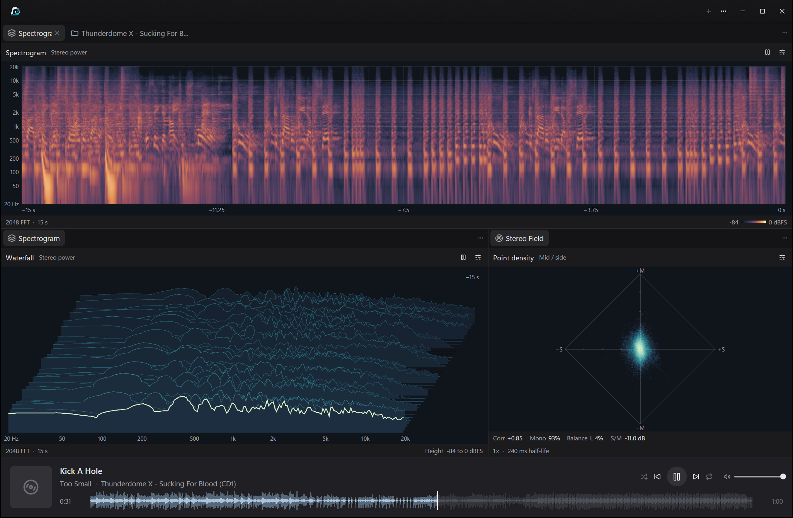

# Windows visualization qualification

The release player completed a 600.15-second native GUI run with Spectrum, Spectrogram and Stereo Field visible. Symphonia played the first ten minutes of a 77-minute FLAC/CUE disc through a single Kira voice. The run crossed the authored chapter boundaries at 4:18 and 8:27. It recorded 28,808,704 captured stereo frames, 56,268 spectral columns, and zero capture drops, decoder errors or reported device errors. The one-second trace has playback callbacks and analysis in every measured interval. [Full sustained trace](evidence/live-visualizations/sustained-trace.csv)



The image shows three simultaneously presented panels reading a decoded excerpt of Too Small’s *Kick A Hole*. Both spectrogram presentations share one STFT history. The field uses the paired time-domain samples. [Music Browser with all three analyzer families](evidence/live-visualizations/workspace.webp) · [XY vector trace](evidence/live-visualizations/xy-trace.webp) · [Compact restored workspace](evidence/live-visualizations/compact-restart.webp)

## Measurement conditions

Windows 11 Pro build 26300, Ryzen 7 8845HS with 16 logical processors, 2560 × 1600 at 240 Hz, 150% scaling, 48 kHz shared output and Rust 1.99.1 release builds. Each matrix run used a fresh profile, a private desktop, a 1240 × 780 logical window, the Music Browser and the Full CD waveform. The benchmark source was a local copy of the same Thunderdome X CD1 used for Mission 14. The voice gain was unity. Mission 14 used 22% voice gain. The same-build Spectrum control provides a comparison at unity.

CPU figures are percentages of **one logical core** from Win32 process and thread times. GPU is the busiest reported per-process GPU engine’s average utilization from Windows PDH. Memory is private committed MiB. Steady and activity trials run for approximately 25 seconds each. These are observations on the owner's working laptop. The diagnostics time application work through GPUI paint and count bytes submitted to its image atlas. Display scan-out, driver transfer timing and endpoint underrun counts were outside that instrumentation. [Per-phase measurements with executable fingerprints](evidence/live-visualizations/windows-measurements.csv)

| Configuration | Process CPU % | Window thread % | DSP worker % | GPU engine % | Peak private MiB |
| --- | ---: | ---: | ---: | ---: | ---: |
| Music Browser only | 4.87 | 1.69 | 0.00 | 0.19 | 125.00 |
| Spectrum | 29.78 | 26.16 | 0.19 | 7.95 | 128.38 |
| Spectrogram | 20.67 | 14.93 | 0.44 | 5.95 | 141.44 |
| Waterfall | 30.54 | 25.29 | 0.56 | 7.26 | 195.15 |
| Stereo Field, density | 27.54 | 23.17 | 0.81 | 6.90 | 174.08 |
| Stereo Field, XY trace | 35.16 | 29.10 | 1.06 | 7.12 | 175.52 |
| Spectrogram + Stereo Field | 33.04 | 29.35 | 0.50 | 7.16 | 176.98 |
| Spectrum + Spectrogram + Stereo Field | 32.54 | 26.92 | 1.37 | 10.17 | 179.79 |
| Two Spectrograms, heatmap and Waterfall | 26.29 | 21.73 | 0.56 | 7.78 | 181.71 |
| Two Stereo Fields, 60 and 15 Hz | 64.63 | 59.51 | 0.94 | 13.41 | 176.73 |
| Both new tabs hidden behind browser | 4.62 | 1.37 | 0.00 | 0.19 | 123.79 |
| All three, scroll and waveform switching | 42.16 | 36.62 | 0.87 | 9.76 | 180.39 |
| All three, ten-minute run | 31.83 | 25.93 | 1.62 | 9.01 | 197.77 |

The combined steady case produced 750 Spectrum publications and 1,500 new-panel publications. Its maximum worker pass was 2.72 ms. Maximum new-plot paint was 0.38 ms and maximum publication-to-first-paint was 20.07 ms. The window prepainted the browser 767 times. These counters distinguish plot work, worker work and repeated shell traversal.

One heatmap produced 2,344 columns in 25.02 s. Two equivalent Spectrograms produced 2,438 columns and 2,438 FFT pairs while serving 1,560 independent presentation updates. The density-only trial produced 0 FFTs. Both hidden tabs produced zero capture and analysis work.

Two density fields at 60 and 15 Hz were the most expensive steady layout. Their 1,867 publications led to 2,990 plot paints and 1,495 browser prepaints in 25.02 s. UI CPU reached 59.51% of one core. The single 30 Hz field triggered 751 browser prepaints. The extra window traversals show the cost of the faster display cadence even when both fields share one accumulator. The default remains 30 Hz.

## Rendering investigation

Mission 14 recorded 31.90% process CPU and 26.41% UI CPU for one visible Spectrum. Its plot callback peaked at 0.313 ms. Moving the FFT to another thread had already separated it from most of the observed UI time. The earlier ten-minute pass was a real-device **engine** test. Its uninterrupted native GUI run remained unverified after an unidentified transport command. The sustained result above qualifies Mission 15’s isolated window. [Mission 14 baseline and caveat](spectrum-qualification.md)

The first Mission 15 Waterfall rebuilt up to 40 filled and stroked paths per frame. It measured 39.47% UI CPU and 11.12% busiest GPU engine. Caching the fixed-time historical layers and translating them between layer crossings gave 21.30% UI and 7.23% GPU in the repeat. The final matrix measured 25.29% UI and 7.26% GPU. Rebuilding the historical image periodically concentrates work into individual frames. The final worst Waterfall plot paint was 7.94 ms.

The first density renderer submitted 187.5 MiB of pixel data in 25 seconds. Limiting each upload to the occupied rectangle reduced this to 9.24 MiB for the same passage. The heatmap retains complete tiles in the atlas and updates the open tile. One additional browser-cache experiment measured 30.73% versus 30.91% UI CPU for Spectrum. That trial gave no measurable saving.

The combined layout completed 240 resizes over 15.0 s, moving between 720, 900, 1240 and 1500 logical pixels. UI CPU was 37.19%, maximum plot paint was 1.53 ms, and private memory peaked at 358.13 MiB. Minimized, it recorded 2,001 audio callbacks and zero captured frames, FFTs, publications or analyzer paints. The separate interaction trial delivered scroll-wheel messages to the library and completed 13 Track / Full CD waveform switches during playback. [Resize and minimize trace](evidence/live-visualizations/resize-and-minimize-trace.csv) · [Interaction workload trace](evidence/live-visualizations/interaction-load-trace.csv)

The sustained trial recorded 176.81 MiB at its start, 176.20 MiB after history warm-up and 184.55 MiB at its end. The largest value after 90 seconds was 197.77 MiB. Its maximum callback workload was 3.2% of the callback budget. The renderer’s callback workload measures processing time. In a separate optimized observer microbenchmark, capture alone averaged 28.8–28.9 ns per 128 paired frames and capture plus levels averaged 229.5–230.1 ns. Mission 14 recorded 30.4–34.1 ns and 241.1–247.4 ns respectively.

## Dock and signal verification

Native UI Automation located controls and directed Win32 pointer input to the isolated player. The checks opened both types from the picker, froze the sole analyzer, switched a frozen snapshot to Waterfall, resumed live history, split right, dragged the tab back onto the Music Browser, and split it out again. Playback continued through freeze with zero captured frames. Two Stereo Field instances retained separate XY/trace and mid-side/density settings across close, reopen and restart. Their saved identities survived. Both settings buttons remained reachable at 720 × 460.

Generated PCM tests cover calibrated harmonic placement on log and linear axes at 32, 48 and 96 kHz, left/right/mid/side interpretation, digital silence, a short impulse between presentations, exact window-center and hop placement, copy-on-write frozen history and the 60-second bound. They also exercise rate-only changes, replacement devices, overflow, mono, inversion, single-channel energy, independent channels and decay to silence. The optimized suite passed 133 tests with five opt-in checks. The real-device transport check separately passed CUE continuity, rapid seeks, pause, resume, stop and replacement at a different source rate. The codec and callback timing checks also ran separately.

## Silent output and reproduction

Qualification requires both the Cargo feature `qualification` and the first argument `--qualify-silent`, with an isolated profile. The output graph installs Disqro’s existing observer first and gives Kira’s main track `Decibels::SILENCE` before constructing the audio manager. Kira maps that value to exact zero after all main-track effects. A renderer test decoded a stereo fixture across a CUE boundary, observed internal peaks above 0.35 on both channels and verified every output sample was zero, including startup and the tail. A normal build rejected the qualification flag with exit code 2 before creating a profile.

The harness starts the player on a separate Win32 desktop and closes it after each trial. A kill-on-close Windows job contains the worker and its player. The private window skips tray and system-media registration. Voice gain, seek and replacement operate upstream of the immutable output mute. The runs used application-local configuration throughout. All qualification players were closed and process absence was verified after the final trial. Windows master volume, device settings and other application sessions were untouched.

```powershell
cargo build --release --locked --features qualification
python tools/qualifySpectrum.py all target/release/disqro.exe 'C:/fixtures/disc.cue' .local/trial-all
python tools/qualifySpectrum.py sustained target/release/disqro.exe 'C:/fixtures/disc.cue' .local/trial-sustained
```

Use a new output directory for each trial and a source longer than the run. Python 3.11+ and Pillow are required. The harness writes the restored workspace, one-second trace, aggregate CSV and a native screenshot. The sustained trial preceded a targeted fix for a new device’s initial sequence position and a Waterfall height-label clarification. The complete short-run matrix, dock checks and native screenshots use the reviewed binary. The replacement-device fixture and a focused worker test cover those discontinuity boundaries.
