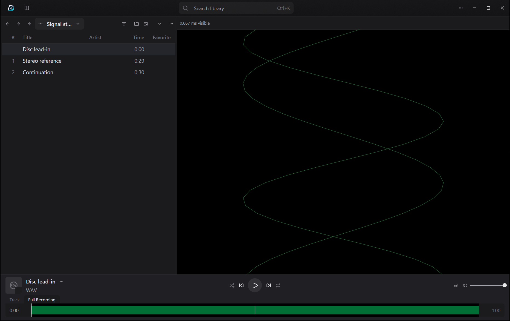

# Waveform panel orientation and stereo energy

Open a Waveform panel's context menu and select **Vertical Time Axis** to put time on the vertical axis. **Reverse Time Axis** changes which end contains the start of the recording. Each docked panel remembers both choices in the workspace. The compact player strip keeps its track and Full CD navigation.

Seeking, scrubbing, pointer-anchored zoom and the editable visible duration all use the panel's time axis. Reversing that axis preserves playback direction and physical source position. At deep zoom, the panel draws continuous left and right traces from decoded samples. [Waveform zoom](waveform-zoom.md)

## Evidence and timing

Overview and detail request the same versioned stereo-power measurement. Opposite-polarity audio retains its spectral color. SQLite keys include the measurement profile, so an existing library can keep both records and populate the new one on demand. Panel orientation stays outside the recording and cache identity.

The waveform samples a bounded renderer clock on the UI thread. A seek starts a new playback identity. The host's brief continuation after the most recent output block has a separate endpoint. The real-time publisher continues to provide the original block data. This integration uses the renderer's estimate of output time.

## Native integration checks

The player deep-zoom journey exercises all four directions. It starts with a saved workspace that previously requested point markers. The engine's historical inspector captures document an earlier host policy.

The earlier panel lifecycle run observed zero frame updates for minimized panels and zero deck dispatches after closing both detailed panels while the compact player continued drawing.

Two separate roughly 25-second runs covered startup, playback, inspection and zoom. These measurements describe the named fixtures on a shared development machine.

| Workload | Process CPU seconds | Peak private memory | Busiest GPU engine | Audio callbacks | Longest callback as fraction of period |
| --- | ---: | ---: | ---: | ---: | ---: |
| One panel, synthetic control WAV | 9.64 | 191.7 MiB | 32.7% | 2,220 | 3.1% |
| Two panels, CUE disc | 24.58 | 186.7 MiB | 35.6% | 2,229 | 4.4% |

Both runs recorded zero decode, device and waveform GPU errors. A separate recovery run intentionally failed one waveform target allocation and recreated the graphics device. Physical audio-to-display offset, energy and long-session delivery require separate instrumentation.

The [deep-zoom procedure](waveform-zoom.md#native-verification) reproduces the current player presentation. The pull request records the exact dependency revision, build checks and hosted CI status.
