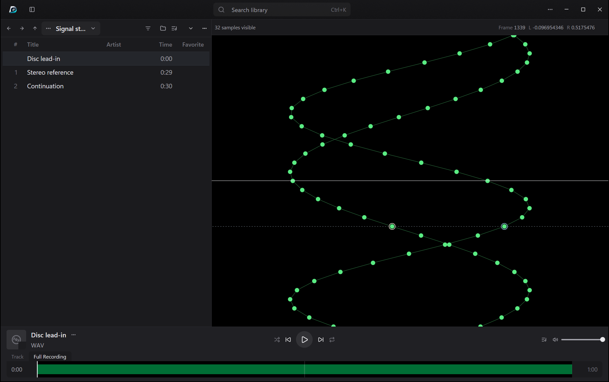

# Waveform panel orientation and stereo energy

Open a Waveform panel's context menu and select **Vertical Time Axis** to put time on the vertical axis. **Reverse Time Axis** changes which end contains the start of the recording. Each docked panel remembers both choices in the workspace. The compact player strip keeps its track and Full CD navigation.

Seeking, scrubbing, pointer-anchored zoom, sample selection and the typed zoom readout all use the panel's time axis. Selecting **Reverse Time Axis** preserves playback direction and physical source frame. At sample zoom, the inspector reads the decoded left and right channels at that frame.

## Evidence and timing

Overview and detail request the same versioned stereo-power measurement. Opposite-polarity audio retains its spectral color. SQLite keys include the measurement profile, so an existing library can keep both records and populate the new one on demand. Panel orientation stays outside the recording and cache identity.

The waveform samples a bounded renderer clock on the UI thread. A seek starts a new playback identity. The host's brief continuation after the most recent output block has a separate endpoint. The real-time publisher continues to provide the original block data. This integration uses the renderer's estimate of output time.

## Native integration checks

On Windows at 144 DPI, all four panel directions completed a silent native inspection journey. The selected left/right amplitudes matched the source WAV at the reported physical frame. Checks included focus and cancellation in the zoom editor, the CUE-relative readout, fractional placement, level-of-detail changes, resizing and marker visibility. The lifecycle journey closed two tabs during playback and recorded zero minimized frames and zero subsequent deck dispatches. The compact player continued to draw.

Two separate roughly 25-second runs covered startup, playback, inspection and zoom. These measurements describe the named fixtures on a shared development machine.

| Workload | Process CPU seconds | Peak private memory | Busiest GPU engine | Audio callbacks | Longest callback as fraction of period |
| --- | ---: | ---: | ---: | ---: | ---: |
| One panel, synthetic control WAV | 9.64 | 191.7 MiB | 32.7% | 2,220 | 3.1% |
| Two panels, CUE disc | 24.58 | 186.7 MiB | 35.6% | 2,229 | 4.4% |

Both runs recorded zero decode, device and waveform GPU errors. A separate recovery run intentionally failed one waveform target allocation and recreated the graphics device. Physical audio-to-display offset, energy and long-session delivery require separate instrumentation.

Run the inspection check with a locked qualification build and a new output directory. The script creates a temporary player profile, generates its stereo WAV and CUE sheet, and drives the muted player on a private desktop.

~~~powershell
cargo build --locked --release --features qualification
python -B tools/qualify_waveform_inspection.py target/release/disqro.exe .local/inspection-up --axis up
~~~

The pull request records the exact dependency revision, native transport and lifecycle results, build checks and hosted CI status.
